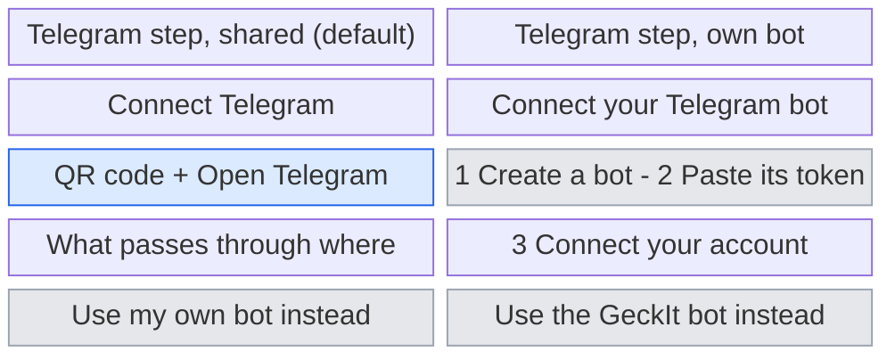
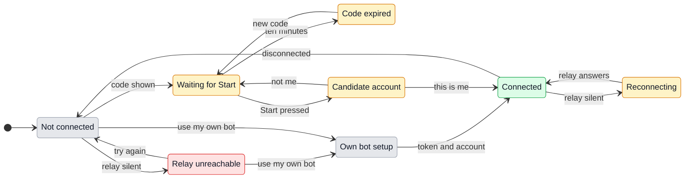
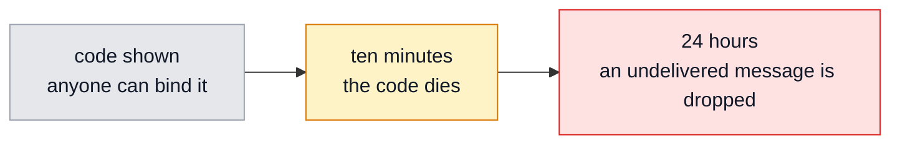

# UX: one shared GeckIt bot

> Not built. Rejected on 2026-10-19, the day it was written, because one bot serves one environment. The reasoning is in section 10, "Shared bot or a bot per environment". The rest of the document is kept as it was: it is the record of what a shared bot would have had to answer, and the sections on pairing, strangers and disclosure stay useful if the question ever comes back.

## 1. Why

Connecting Manager today means making a bot. Open @BotFather, send `/newbot`, invent a display name, hunt for a username ending in `bot` that nobody has taken, copy a token out of a chat and paste it into GeckIt. It is the only place where GeckIt asks someone to learn another product's vocabulary before they can use this one, and it is where people stop: the guided four-step setup exists because that step kept failing. It also means the bot carries whatever name they picked, so the person who sees it over their shoulder learns nothing about GeckIt.

One shared bot replaces all of it with a code to scan. It also gives GeckIt a name that appears in every chat, which is the second reason for doing it.

### The path to the result

- **Entry and result:** Settings, Manager, the Telegram step, which is already locked behind the assistant and delegation steps. It ends with Manager answering on the person's phone.
- **Readiness:** the assistant and delegation steps are answered, as now. New: GeckIt's relay has to answer. When it does not, the step is not blocked, because the personal bot path is still there and is now the stated alternative rather than the only road.
- **Decisions and order:** one decision, and most people never see it: shared bot or their own. Shared is the default and takes no further decisions. Choosing their own bot gives today's three actions unchanged.
- **Shape of the path:** one step, a code and a button, with "Use my own bot instead" quiet underneath. Progressive disclosure rather than two equal choices side by side, because a choice between "ours" and "yours" asks a question most people have no basis to answer at that moment, and the right default is not in doubt.
- **First run and return:** a connected account is changed by disconnecting and scanning again. A second computer joins the same account and the chat gains a way to say which one it is talking to. Moving to a new computer is the same gesture as the first time.

## 2. What is added

| Surface | What appears on it | When it is seen |
| --- | --- | --- |
| Settings, Manager, Telegram step | A pairing code as a QR, "Open Telegram", and one line saying what passes through where | Always, when the relay answers |
| Settings, Manager, Telegram step | "Use my own bot instead", quiet, under the code | Always |
| Settings, Manager, Telegram step | "The GeckIt bot cannot be reached right now." with Try again and the personal path | The relay did not answer |
| Settings, Manager, connected | Which bot is carrying this: `@geckit_bot`, or their own handle | Always, once connected |
| The Telegram chat, first message to a stranger | What GeckIt is and how to connect a computer | Someone opens the bot without a code |
| The Telegram chat | The computer's name as the first line of a message | Only when more than one computer is bound to this account |
| The Telegram chat, `/computer` | A button per bound computer, the current one marked | Only when more than one is bound |

The Telegram step is an existing surface and is being replaced, not extended. The three actions it holds today do not disappear: they move behind "Use my own bot instead" and keep their wording, their masked field and their recovery.

## 3. States

| State | When it happens | What the person sees | What to do |
| --- | --- | --- | --- |
| Not connected | The step is open and nothing is paired | The code, Open Telegram, and the line about what passes through where | Scan it, or press Open Telegram |
| Relay unreachable | The relay did not answer when the code was asked for | "The GeckIt bot cannot be reached right now." and both ways forward | Try again, or use your own bot |
| Waiting | A code is live and nobody has pressed Start | "Waiting for you to press Start in Telegram." and how long the code lasts | Press Start in Telegram |
| Candidate | An account pressed Start with a live code | That account's name and ID, and Connect account | Confirm it is you, or reject it |
| Connected, shared | The account was confirmed | Which bot and which account, and the computer's name | Nothing; send Manager a task |
| Connected, own bot | The same, through their own bot | Their own bot's handle instead | Nothing |
| Code expired | Ten minutes passed with no Start | "This code has expired." and Show a new code | Show a new code |
| Code spent | Start pressed with a code another account already used | "This code has already been used. Open GeckIt and show a new one." | Show a new code |
| Stranger | Someone opens the bot with no code at all | What GeckIt is, and how to connect a computer | Install GeckIt, or ignore it |
| Reconnecting | The relay stopped answering a connected computer | The existing retry state; workers keep going | Nothing; it comes back by itself |
| Several computers | A second computer is bound to this account | Each message says which computer it came from | `/computer` to switch, or nothing |

## 4. Transitions

| From | Event | To | What the person sees |
| --- | --- | --- | --- |
| Not connected | The step opens and the relay hands out a code, by itself | Waiting for Start | The code as a QR, Open Telegram, and the line about what passes through where |
| Not connected | The relay did not answer within five seconds | Relay unreachable | "The GeckIt bot cannot be reached right now." with Try again and Use my own bot instead |
| Relay unreachable | Pressed Try again | Not connected, then Waiting | The code, or the same message again |
| Relay unreachable | Pressed Use my own bot instead | Own bot setup | Today's three actions, unchanged |
| Not connected | Pressed Use my own bot instead | Own bot setup | The same |
| Waiting for Start | The bound account pressed Start, by itself | Candidate account | That account's name and ID, and Connect account; nothing of the person's work has moved yet |
| Waiting for Start | Ten minutes passed, by itself | Code expired | "This code has expired." and Show a new code |
| Code expired | Pressed Show a new code | Waiting for Start | A new code; the old one can no longer bind anything |
| Candidate account | Pressed Connect account | Connected | Which bot, which account, this computer's name, and a first message in the chat |
| Candidate account | Pressed This is not me | Waiting for Start | A fresh code; the rejected account gains nothing and is told nothing |
| Connected | The relay stopped answering, by itself | Reconnecting | The existing retry state; workers keep going and no instant reply is promised |
| Reconnecting | The relay answered again, by itself | Connected | Whatever was waiting arrives, bound to its task as it is today |
| Connected | Pressed Disconnect and confirmed | Not connected | "Telegram disconnected." The binding is gone on the relay too |
| Connected | A second computer is bound to the same account | Connected, several | Every message gains its computer's name as a first line, and `/computer` appears |
| Connected, several | `/computer` and a button | Connected, several | "Now talking to <name>." |
| Any state | Someone with no code opens the bot | Unchanged | The stranger gets the explanation; the person's computer is not told and nothing is disclosed |

## 5. What stays silent

| State | Why it is not shown |
| --- | --- |
| A reconnect that succeeded within the existing backoff | Nothing was lost and nothing is required |
| Which relay instance or region answered | The person cannot act on it and it is not theirs to care about |
| That a message passed through the relay, on each message | It is said once at setup; repeating it is noise that teaches nothing new |
| The computer's name when only one is bound | A name is only information when there is something to tell it apart from |
| A stranger pressing Start, reported to the owner | The owner did not do it and cannot act on it; reporting it would disclose that this bot has owners |
| The relay forwarding normally | Routine delivery needs no account |

## 6. Thresholds and time

| Number | Value | Why this much |
| --- | --- | --- |
| Pairing code lifetime | Ten minutes | The existing pairing expiry, kept: long enough to pick up the phone and walk to it, short enough that a code in an old screenshot binds nothing |
| Uses per code | One | The bot is public, so a code is the only thing standing between a stranger and someone's computer |
| Relay wait for an unreachable computer | 24 hours | The same as Telegram's own retention, which the person has already been told about, so a reachable computer behaves identically and an unreachable one teaches nothing new |
| Relay silence before the setup step gives up | Five seconds | Matches the existing receipt target; past it the person is waiting on a blank step with nothing to read |
| Computers per account | No limit | A limit would be a number invented to avoid designing the picker, and the picker is a list |

## 7. Wording

| State | Text |
| --- | --- |
| Telegram step heading | "Connect Telegram" |
| Telegram step body | "Scan this with your phone, or press Open Telegram on this computer." |
| What passes where, said once | "Your messages pass through Telegram and through GeckIt's relay on the way to this computer. A message waits on the relay only until this computer picks it up." |
| The alternative | "Use my own bot instead. Nothing passes through GeckIt's relay." |
| Waiting | "Waiting for you to press Start in Telegram. This code works for ten minutes." |
| Candidate | Existing: the account's name, its Telegram ID, and "Connect account" |
| Connected, shared | "Connected to @geckit_bot as <name>. This computer is <computer>." |
| Connected, own bot | "Connected to @<their bot> as <name>. This computer is <computer>." |
| Code expired | "This code has expired." / "Show a new code" |
| Code spent | "This code has already been used. Open GeckIt and show a new one." |
| Relay unreachable, setting up | "The GeckIt bot cannot be reached right now." / "Try again" / "Use my own bot instead" |
| Relay unreachable, connected | Existing Reconnecting state: "Reconnecting to Telegram. Workers continue." |
| Stranger | "This is the GeckIt bot. GeckIt runs coding work on your own computer, and this is how you steer it when you are not at it. To connect a computer: open GeckIt, go to Settings, Manager, and scan the code it shows." |
| Several computers, each message | The computer's name as the first line |
| `/computer` | "Which computer should I talk to?" then "Now talking to <name>." |

## 8. Edge cases

- **Empty:** the account pressed Start but the computer slept before the confirmation was answered. It stays a candidate and is confirmed when the computer wakes, as long as the ten minutes have not run out. Past that, the code is dead and the chat says so rather than waiting silently.
- **All at once:** two bound computers both answer in the same second. Each message carries its computer's name and they arrive in the order the relay received them. Nothing is merged, because merging two computers' answers would invent a sentence neither of them said.
- **Break:** the relay dies between the person's message and the answer. This is the existing Uncertain state, unchanged: "Delivery uncertain. Checking before retrying." Nothing is retried blindly.
- **Repeat:** Start pressed twice. The same account pressing twice sees the chat it already has and is told nothing. A different account pressing the same code is told it has been used.
- **Stale copy:** a code photographed days ago. Expired, and the message says so and offers a new one. The relay keeps no record that the old code ever meant anything.
- **Long text:** a computer name long enough to crowd a message is shortened in the chat the way a worker title already is.

## 9. Deliberately not included

| Not doing | Why |
| --- | --- |
| Group chats | One private account per computer is the whole security model; a group has no single owner to confirm |
| Several Telegram accounts for one computer | Today's rule, and nothing here needs it changed |
| Any claim that messages are end to end encrypted | Telegram hands bots plaintext and `sendMessage` takes plaintext, so the claim would be false; the honest line is in section 7 |
| Running the assistant on the relay | The relay forwards; the work is on the person's computer, which is the product |
| Removing the personal bot path | It is the answer for anyone who wants no third party, and it already works |
| A web page for managing bound computers | The computers are in the chat and in Settings; a third place to look would be a third place to be wrong |

## 10. Forks

### Shared or personal as the default

| Option | Verdict |
| --- | --- |
| Shared bot by default, personal behind one line | Yes |
| Two equal choices side by side | No |
| Shared only, personal removed | No |

**Why:** the choice is between "easier" and "nothing of mine touches your server", and at the moment it is asked, most people have no basis to weigh it. A default plus a quiet alternative answers it for them without hiding it. Removing the personal path would take away the only answer for the people who care most.

### How the computer is reached

| Option | Verdict |
| --- | --- |
| The computer holds an outbound connection to `geckit-signal`, which already has Firestore and functions | Yes |
| A new WebSocket service of its own | No |
| The computer polls the relay over HTTP | No |

**Why:** the phone already reaches the Mac this way through `signal/`, so the listener, the pairing key and the deployment all exist. Outbound means NAT, firewalls and routers are not involved. A new service would be a second thing to keep alive for no behaviour the first one lacks.

### Several computers on one account

| Option | Verdict |
| --- | --- |
| One chat, a current computer, `/computer` to switch, the name on each message | Yes |
| Refuse the second computer | No |
| One bot per computer | No |

**Why:** one Telegram account has exactly one chat with one bot, so the ambiguity is forced and has to be answered in the chat. Refusing the second computer takes away something the personal bot gives away free, which would make the shared path worse than the one it replaces. One bot per computer is the thing this whole document is removing.

### Shared bot or a bot per environment

| Option | Verdict |
| --- | --- |
| One shared GeckIt bot, hosted relay, a code to scan | No, 2026-10-19 |
| A bot the person creates, one per environment | Yes |

**Why:** this reverses the decision that started this document, and it reverses it on a fact the document had treated as a detail. A bot has one update stream, so two installations behind the same bot fight over it, which the existing code already recognises as the 409 conflict: "Another receiver or webhook is using this bot." Section 10's several-computers fork answered that with a picker in the chat, which works when a second computer is unusual. It is not unusual here: a dev build and an installed build run side by side on the same machine, so the shared bot would make the common case the ambiguous one, and would make the thing that is free today, a bot each, into a feature that has to be designed. The onboarding cost of BotFather is real and stays unsolved. It is the smaller problem.

### What a stranger sees

| Option | Verdict |
| --- | --- |
| An explanation of what GeckIt is and how to connect | Yes |
| Silence, as unpaired accounts get today | No |

**Why:** this reverses the existing rule in `manager-telegram.md`, section 5, that unpaired accounts are told nothing. That rule exists so no account or task information leaks, and an explanation leaks none: it says what the product is, which is public. On a private bot a stranger is a mistake; on a public one a stranger is a person who found it, and that is the promotion this bot is for.

### Saying what passes through the relay

| Option | Verdict |
| --- | --- |
| Once, at setup, in the step | Yes |
| On every message | No |
| Nowhere | No |

**Why:** it is the one thing about this design a person might object to, so it is said where the decision is made and where the alternative sits next to it. Repeating it on every message would be an apology, and leaving it out would make the alternative look pointless.

## 11. Requirements check

| Requirement | Where it is covered |
| --- | --- |
| FR-014, pairing by temporary link and explicit desktop confirmation | Sections 3 and 4, unchanged in substance; the code carries the link's job |
| FR-021, disclosing what the connection depends on | Section 7, extended to name the relay |
| FR-034, personal bot setup guidance | Section 2, kept behind "Use my own bot instead" |

**What the requirements do not yet know:** FR-013 says the bot is user-owned and its token is kept in operating-system credential storage. That stays true of the personal path and is false of the shared one, where the token exists only on the relay and never reaches a client at all. FR-013 needs splitting, and the shared half needs a requirement of its own saying the token is never distributed, because `research.md` already establishes that handing one token to independent local pollers makes each installation receive other people's updates. Nothing in the requirements covers several computers on one account; `spec.md` puts it out of scope, which was free when every computer had its own bot and is not free now.
