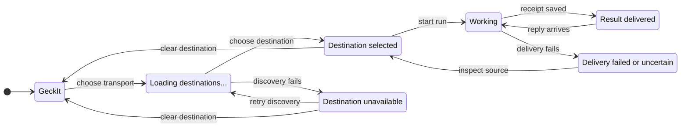

# UX: shortcut result destinations

## 1. Purpose and path to a usable result

Alex saves where each shortcut should send its completed result, then continues that same run by replying there. Today a schedule chooses what starts but has no result destination.

Open Shortcuts or the shortcut in Team, edit its prompt/target and timetable as before, then choose Send result. The default is GeckIt, preserving old jobs. GeckIt keeps the result in the run's task on the existing board; it requires no external channel setup. Selecting a transport reveals Destination. Choose the specific destination and Save. Reopening shows the saved choice; Cancel discards edits. Both manual and timed runs use it. A saved choice records intent; it does not prove live delivery or bypass channel setup, Manager, permissions or approvals.

Keep the existing editor as one form with a result group after execution settings. Transport and place are dependent choices, so place appears only after transport. No separate setup wizard: Settings > Channels already owns connection setup. Returning edits do not require re-entering assistant settings. If a dependency disappears, keep the saved identity visible and explain the problem instead of substituting a place.

Discord text channels support a new native thread per completed run. Slack supports a new root message with a reply thread per run. Telegram currently exposes a paired chat/team topic and shared reply routing; it cannot offer an isolated new result thread per run through the present module. It stays unavailable for this feature until a module implements the required run route. Installed libraries opt in through the same destination contract and state their actual semantics.

## 2. Surfaces

| Surface | Addition | When visible |
|---|---|---|
| Existing desktop/phone shortcut editor | Send result and dependent Destination controls | Every shortcut |
| Existing shortcut lists | Saved destination summary and last delivery problem | If configured |
| Existing worker/Manager CLI and schema | Destination configuration, listing and run delivery evidence | On request |
| Discord selected text channel | New thread with completed result | Once per completed run |
| Slack selected channel | New result root and replies in its thread | Once per completed run |
| Manager | Per-run context linked to source execution and native thread | Configured runs and replies |

No changes to the channel connection screens. Use their existing setup entry point.

## 3. States

| State | Condition | What the user sees | Next action |
|---|---|---|---|
| Local | No destination | "GeckIt" | Save or choose transport |
| Loading | Destination discovery in progress | "Loading destinations..." | Wait or cancel |
| Discovery failed | Destination discovery rejects | "Couldn't load destinations. Try again." | Try again or cancel |
| Older host | Host omits shortcut destination capability | "This host does not support shortcut result destinations. Update GeckIt on the host." | Keep local behavior, clear an existing destination, or update host |
| Choose | Supported transport chosen, no place | "Choose a destination" | Choose a place |
| Selected | Place selected | Saved transport and destination name; semantics help text | Save |
| Empty | No available places | "No destinations available. Check this channel in Settings > Channels." | Configure channel or choose GeckIt |
| Unavailable | Saved transport/place cannot be reached | "Destination unavailable. Check this channel in Settings > Channels." | Restore setup, change destination, or cancel |
| Save failed | Save/readback rejected | "Couldn't save the shortcut. Try again." | Correct choice and retry |
| Working | Run accepted but still working or awaiting approval | Existing task/Manager state | Continue work or answer approval |
| Delivered | Native receipt confirms result and route | Result thread link | Reply there |
| Failed | Definitive refusal before delivery | "Result delivery failed: <reason>" | Fix connection/destination; result remains in GeckIt |
| Uncertain | A write may have succeeded without receipt | "Result delivery is uncertain. Check the destination before retrying." | Inspect destination; no blind automatic repost |

## 4. Transitions

| From | Event | To | What the user sees |
|---|---|---|---|
| Local/Selected | Choose transport | Loading | "Loading destinations..." |
| Loading | Module returns places, automatically without user action | Choose/Selected | Place choices; saved choice retained if still present |
| Loading | Module returns no places or reports an unavailable saved place, automatically without user action | Empty/Unavailable | Exact state text above |
| Loading | Discovery rejects, automatically without user action | Discovery failed | Exact error and Try again |
| Discovery failed | Press Try again | Loading | "Loading destinations..." |
| Choose | Select a place | Selected | Place label and delivery semantics |
| Any editing state | Select GeckIt | Local | Destination control disappears |
| Selected/Local | Press Save | Closed | Updated shortcut list after authoritative save/readback |
| Selected | Save rejects | Save failed | Exact save failure text; draft retained |
| Any editing state | Cancel, Escape or scrim | Closed | Existing saved shortcut remains |
| Closed | Reopen | Local/Selected/Unavailable | Current saved state |
| Selected | Manual start or due timetable, automatically for timetable | Working | Existing running state; destination snapshot retained |
| Working | Source run and tracked work finish, automatically | Delivered/Failed/Uncertain | Native result and link, or exact delivery problem |
| Delivered | Authorized person replies in result thread | Working | Manager works in that run's context, with original worker identity |
| Failed/Uncertain | Open source conversation | Source visible | Completed result remains available without reposting |

## 5. What stays silent

Discovery and ordinary scheduling create no notifications or external posts. Intermediate Manager acknowledgements and approvals do not publish completed results. Duplicate completion events do nothing. Unrelated channel traffic does not enter this run. Legacy shortcuts do not gain external delivery automatically.

## 6. Timing and thresholds

No new schedule timer or missed-run catch-up rule. Completion follows existing session/Manager lifecycle and goal state. Native transport message limits determine chunking; no truncation may be mistaken for the full result. Network uncertainty is preserved rather than converted to a retry timer. Existing authorization is checked again at send and continuation boundaries.

## 7. Wording

Fields: "Send result", "Destination". Default: "GeckIt". Discord help: "Each completed run starts a new Discord thread. Reply there to continue that run with Manager." Slack help: "Each completed run starts a new Slack thread. Reply there to continue that run with Manager." Unavailable transport help: "This channel does not support shortcut result destinations." State wording is defined once in section 3. Connection-specific refusal reason comes from the channel. Save does not say delivery succeeded.

## 8. Edge cases

Empty destination prevents a new incomplete configuration from saving. Existing unavailable destinations remain recognizable and removable; no fallback. Duplicate names show server/workspace plus stable identity. Long labels wrap and controls remain reachable in the editor scroll region. Changing a destination or deleting the shortcut does not retarget an admitted run. Every later run has a fresh identity. Restoring saved state restores context and known receipts. Lost receipts preserve uncertainty. Unauthorized messages remain rejected by the module; a saved route is never a new permission. Secret cleaning uses the existing broker boundary. An unavailable original context reports that limitation and does not claim continuation succeeded.

## 9. What is deliberately absent

No automatic channel selection, real schedule edits, arbitrary channel test posts, provider substitution, native approval bypass or GeckIt restart. No thread promise for Telegram or libraries without the new optional contract. No second UI implementation for testing: browser review mounts actual editor components and substitutes only unavailable native boundaries.

## 10. Decisions

Persist stable transport/place IDs, not names alone: renaming a channel must not redirect a job. Snapshot per run: changing settings affects later admissions. Use existing Manager ownership and routing contracts with explicit host-authorized run context, because copying result text alone loses task identity. Use native per-run threads only where supported. Preserve uncertain delivery instead of blind retries that can duplicate posts.

## 11. Requirements and approval

Sections 1-3 cover FR-001/002/007/009; 4-8 cover FR-003 through FR-006 and FR-008/010; 9 covers FR-011/012. Required evidence: persistence and readback, source completion, native receipt/route, actual Manager continuation, two-run isolation, refusals, uncertainty, restart, legacy, and renderer light/dark desktop/phone interactions. Mock and live results are reported separately. No actual live delivery is claimed by this document.

Alex explicitly approved this document and the behavior in the original Discord thread with "Подтверждаю". The user relayed that approval in this Codex session on 2026-11-15. The define-ux-behavior approval gate is satisfied. Approval covers service -> destination, a separate thread for each run, and replies continuing the same task through Manager. It does not authorize arbitrary live test posts or a GeckIt restart.

## Approved label revision, 2026-11-18

Alex requested GeckIt as a cron job destination because a task and board already exist. Replace the local choice "Only in GeckIt" with "GeckIt" in the shared desktop/phone Send result picker. Selecting it continues to clear external delivery and keeps the result in its existing task. Target, folder, schedule, Save, Cancel and reopen behavior remain as specified above. No additional board or task picker is introduced. The existing approved behavior is unchanged. Alex approved implementation with "Implement it" in GeckIt session codex:01a1eda0-4164-70a3-a4cd-5fb6612ee20a on 2026-11-18.

Apple UX review: selection acts on the shortcut directly, feedback remains inline, cancellation preserves the saved choice, Save remains the next action, the choice persists on reopen, no permissions or notifications are added, and "GeckIt" names the result location plainly. No destructive actions or new timing thresholds are introduced. Rendered review must confirm the existing shared picker in both themes and desktop/phone sizes after implementation.
