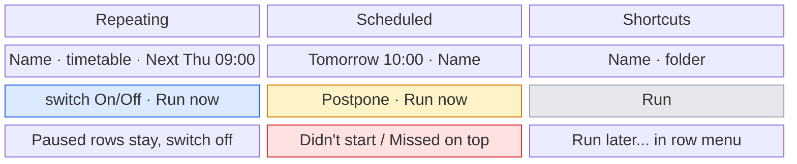
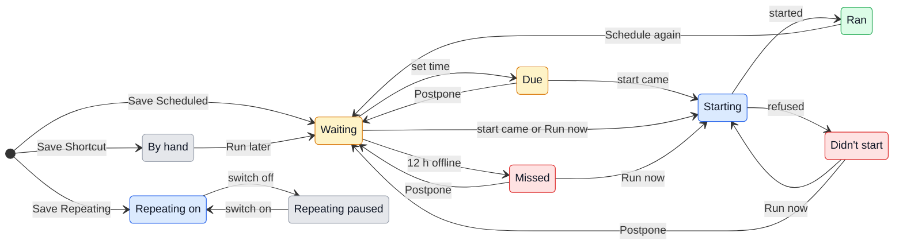

# UX: Repeating, Scheduled and Shortcuts as three places, and the left menu around them

## 1. Why

Today Shortcuts is one list in which three different things look alike: a prompt that runs every weekday at 09:00, a prompt Alex runs himself, and (missing entirely) a piece of work he wants done once, later. A repeating job and a hand-run prompt differ only by a small chip and an icon, so the list does not answer "what will run by itself, and when". There is no way to say "do this tomorrow at 10:00" or to push such work later: the only workaround is a custom recurrence that ends after one occurrence, which then stays in the list after it ran. Alex thinks of this work as three kinds: periodic jobs, scheduled work he can postpone until a time, and shortcuts he runs by hand.

### Path to the result

- **Entry and result:** a new sidebar group "Prompts" (desktop) and the same group in the phone's left menu, holding "Repeating", "Scheduled" and "Shortcuts" in place of today's single Shortcuts under Workspace. The gecko's Manage Shortcuts... opens Shortcuts; Team > an employee's shortcuts opens each kind's page filtered to that employee. The result is one of three: a repeating job that runs by itself, a one-time run waiting for its time, or a prompt ready to Run. Any of them can be started from a copy of an existing one with Duplicate.
- **Readiness:** the same as today. Saved means the service kept it; ready to run additionally needs GeckIt's service running, the assistant available, the folder reachable and the employee not archived. A one-time run whose time came while any of these is missing becomes "Didn't start" and waits for Alex, it is never dropped silently.
- **Decisions and order:** the kind is chosen once, by the page's New button (or Run later..., Schedule again, Duplicate), and the editor never changes it. One editor serves all three kinds and differs only in its timing section: Shortcuts have none, Scheduled asks for a date and time (default tomorrow 09:00), Repeating shows today's Repeat picker without its "Never, only by hand" item and "Timetable on". Both timed kinds have one switch, "Vary start time", on by default. On, the run starts at a random moment up to 30 minutes before or after the set time; off, it starts at the set time. The editor shows only the switch: no minutes, no hint, no drawn start. Everything else (name, folder, prompt, target, employee, assistant, model, checklist, Send result) is the same fields in the same order with today's defaults.
- **Shape:** three peer places in the sidebar, one list each. Each kind has its own primary row action: Repeating rows have an on/off switch, Scheduled rows have Postpone, Shortcuts rows have Run. Apple's guidance puts peer top-level areas in the sidebar and keeps segmented controls for views of the same content; Apple's own Shortcuts app separates Shortcuts from Automation at the top level, and Reminders lists Scheduled as its own sidebar item. A segmented control inside one Shortcuts page was drawn first and rejected: it hid a "Didn't start" run behind a tab, and the manual kind could not be called Shortcuts inside a page of the same name. One long list with sections was rejected earlier: three different actions in one column read as noise and New would have to ask what kind to make. Each page searches its own list.
- **First launch and return:** an empty page says what it is for and offers the button that fills it. The sidebar reopens on the place last shown, as today. To get the same prompt in another kind, Alex uses Run later... (Shortcut to Scheduled) or creates a new one; an item never moves between pages.

## 2. What is added

| Surface | What appears | When visible |
|---|---|---|
| Desktop sidebar (`places.ts`, `Sidebar.tsx`) | Three groups: no header: "Tasks", "Manager", "Quick chats" (renamed from "Questions"); "Prompts": "Repeating", "Scheduled", "Shortcuts"; "Workspace": "Team", "Checklists", "Browsers", "Secrets". Group headers are plain labels: they do not fold and are not clickable. Scheduled carries a red count badge of runs that need Alex (Didn't start plus Missed). Folded sidebar uses refresh, clock and bolt glyphs (clock is new) and a divider between groups | Always; badge only above 0 |
| Desktop pages (`ShortcutList.tsx`) | One page per kind: title, subtitle, its own New button, search and empty state | Its sidebar item chosen |
| Assignee on every row, all three pages, desktop and phone | The row's lead is the assignee's avatar (28 px desktop, 30 px phone): the employee's avatar or initials, the Manager glyph, or, with no employee, the assistant's glyph (Claude, Codex). It replaces today's kind icon tile, whose kind the page already says and whose colour the folder name already carries. The meta line starts with the assignee's name (employee name, "Manager", or the assistant's name), then the folder. Tooltip on the avatar: "{name} · {role} · runs on {assistant}" for an employee. Rows are not grouped by employee as today; search matches the assignee's name | Always |
| Editor Employee field | "Employee" under Target, as today: the employee's badge or "None"; hidden when Target is Manager | New task target |
| Desktop Scheduled rows | Date and time as the row's lead column (red when it needs Alex), More menu (Duplicate, Delete), Postpone menu, Run now; "Didn't start" and "Missed" rows at the top; "Ran today" footer | Scheduled page |
| Desktop Repeating rows | More menu (Duplicate, Delete); Run now; inline on/off switch replacing the "Timetable paused" chip as the control | Repeating page |
| Desktop Shortcuts rows | More menu (Run later..., Duplicate, Delete); Run as today | Shortcuts page |
| Every row, desktop | Right-click opens the same More menu; Cmd+D (Ctrl+D) on a focused row is Duplicate | Always |
| Calendar chip menu, desktop | Click or right-click a chip opens a menu under it: "Edit", "Run now", "Postpone...", "Duplicate" (Cmd+D shown), divider, "Delete". "Postpone..." swaps the menu for the Postpone presets at the same place. Cmd+D on a focused chip is Duplicate; Option-drag (Alt-drag) of a chip to another day duplicates it onto that day | Calendar view |
| Top bar of all three pages, desktop | The same bar as Tasks (`TopBar` in `Board.tsx`): view switch at the leading edge, then Search, then the page's New button at the trailing edge; the page title and subtitle sit below it. Only Scheduled has a view switch: "Week" / "Month" / "List" with the week, calendar and list glyphs, built as Tasks' Board / List switch (`Views` in `Sidebar.tsx`, the week and calendar glyphs are new). Week is the default; the choice is kept in settings beside Tasks' `chatView` | Always; switch on Scheduled only |
| Scheduled page, phone | "Calendar" / "List" segmented control under the large title, Calendar first and default; desktop Week or Month both open the phone on Calendar, List opens it on List | Scheduled page |
| Scheduled Week, desktop | Seven day columns, Monday first, filling the page: heading the month ("November 2026", or "Nov – Dec 2026" when the week spans two), previous week / "Today" / next week; column heads "{Mon} {16}", today's number in the accent circle. Hairline columns, weekends lightly shaded, the selected day a soft background. Each run is a card in time order: folder-colour bar and tint, the time, the full name (wraps, up to 4 lines), the assignee's avatar and name, the model when it is not Default, and "Didn't start" or "Missed" in red with a red bar for a run that needs Alex. The card whose menu is open is filled with the accent. A column scrolls when its cards do not fit. A week with no runs says "Nothing scheduled this week. Double-click a day to plan a run." Click, right-click, Cmd+D, drag and Option-drag work as on the month's runs | Week chosen |
| Scheduled Month, desktop | Laid out like Apple Calendar's month view. The month fills the page below the top bar: the month name as the page heading ("November" bold, "2026" light), previous / "Today" / next at its trailing end; no page title or description in this view (the sidebar names the place). Weekday names and day numbers aligned to the trailing edge; hairline separators only, no outer frame; weekends lightly shaded; days of other months in faint numbers; today's number in an accent circle and nothing else; the selected day a soft hover-colour background. Each run is a line: folder-colour dot, name, time muted at the end, no fill; a run that needs Alex has a red dot and red text. The line whose menu is open is filled with the accent. Up to 3 runs per day, otherwise 2 and "{n} more". When a day is too narrow, the time is dropped and the name kept. Under the grid only the one-line note slot (moved, refused) | Calendar chosen |
| Day popover, desktop | Opened by "{n} more" or Enter on a day; anchored under the day: the day as heading ("Thu 19 Nov"), every run of the day as the same dot / name / time lines, full names, then a divider and "New scheduled on this day" when the day is today or later. A day without runs says "Nothing scheduled." Clicking a run swaps the popover for that run's chip menu at the same place | Calendar chosen |
| Scheduled Calendar, phone | No Week on the phone: the day list under the month already shows full names and the assignee. Compact month grid with a dot per day that has runs (red if one needs Alex); the selected day's runs listed under it, same rows, swipe and long press as the list | Calendar chosen |
| Shortcut editor (desktop and phone, one component) | Top bar says where the person is: the page as a button back ("Shortcuts", "Scheduled", "Repeating"), "/", then the kind's New label or the item's saved name; in a dialog the same words are its title. Name is the first labelled field, above Prompt, with the derived name as its placeholder ("Morning check" when there is no prompt yet) (rule in [sidebar-navigation.md](sidebar-navigation.md), "Where an item's name is edited"); timing section by kind: none; Date, Time and the "Vary start time" switch; or Repeat picker, the same switch and Timetable on. Today's "By hand / On a schedule" switch and the start window minutes field are removed | Editing any item |
| Phone left menu and pages (`PhoneNav.tsx`, `PhoneShortcuts.tsx`) | The same three groups, rename and badge; one page per kind; swipe actions per kind; long press opens an action sheet with Duplicate and Delete (plus Run later... on Shortcuts); Postpone as an action sheet | Always |
| Quick chats (renamed Questions), desktop, phone, CLI and the entry that starts one | Place name "Quick chats"; subtitle "Off the board. Each is deleted a day after its last answer, unless kept."; "Ask a question" becomes "New quick chat"; behavior unchanged | Always |
| Gecko menu bar (`main/tray.ts`) | Shortcuts (the manual kind) at the top level as today; "Repeating" submenu with the repeating jobs; one disabled line "Next: {name}, {time}" for the next Scheduled run | Items of that kind exist |
| Team > employee | The employee's shortcuts listed under the same three kind headings | Employee has shortcuts |
| CLI `geckit employees shortcut add/edit` | `--at <ISO date-time or none>` for a one-time run; `--postpone <ISO date-time>` | Always |

## 3. States

The kind is not stored separately: a shortcut with a one-time `at` is Scheduled, one with a cron or recurrence is Repeating, one with neither is a Shortcut (manual).

| State | When it occurs | What the user sees | What to do |
|---|---|---|---|
| Page empty | No items of that kind | Empty state of that page (wording 7) | Press its New button |
| Repeating on | Timetable saved and on | Timetable chip, "Next {time}", switch on | Nothing; or switch off, Run now |
| Repeating paused | Switch off | "Paused", switch off, no Next | Switch on or Run now |
| Repeating paused while archived | Owner archived | "Paused while archived", switch disabled | Restore the employee in Team |
| Repeating ended | Recurrence ended | "Timetable ended" | Edit the timetable or delete |
| Waiting | Scheduled, set time in the future | Lead "Tomorrow 10:00", "In 18 h" (always the set time) | Nothing; or Postpone, Run now, Edit, Delete |
| Due | Vary start time on, set time passed, the hidden start not yet reached (at most 30 min) | Lead keeps the set time; secondary "Due" instead of "In ..." | Nothing, it starts by itself; or Run now, Postpone |
| Postponed | Postpone chosen | Lead shows the new time; line "Postponed from {old time}" | Nothing; Postpone again |
| Starting | Its hidden start time came, conversation being started | Row "Starting..." | Nothing, passes by itself |
| Ran | Conversation started (queued counts) | Row leaves Scheduled; appears in "Ran today" with Open | Open, or Schedule again |
| Didn't start | Time came, start refused (assistant, folder, employee, Manager) | Row at the top, its time in red, line "Didn't start: {reason}."; badge on Scheduled counts it | Run now, Postpone or Edit |
| Missed | Service was not running for more than 12 h past the time | Row at the top, its time in red, line "Missed. GeckIt wasn't running."; badge on Scheduled counts it | Run now, Postpone or Delete |
| By hand ready | Saved without timing | Name, folder, assistant, Run | Run, or Run later... |
| Calendar, day selected | Calendar chosen; today is selected on open | Grid with the day softly marked | Pick another day, open a run's menu, open the day popover, or create one on that day |
| Dragging a run | Pointer drags a chip | Chip follows the pointer; days it can drop on are highlighted, past days are not | Drop on a day, or Escape to cancel |
| Running | Last run's conversation is working | "Running now" (as today) | Open the last run |
| Saving / Save failed | As today | "Saving...", "Couldn't save the shortcut. Try again." | Wait, retry or Cancel |

## 4. Transitions

| From | Event | To | What the user sees |
|---|---|---|---|
| Shortcut editor | Save | By hand ready | Shortcuts page, row focused |
| Scheduled editor | Save with a time from now on | Waiting | Scheduled page, row in time order |
| Repeating editor | Save | Repeating on | Repeating page, "Next {time}" |
| Any editor | Cancel / Escape | Previous state | Nothing changed |
| By hand ready | Row menu "Run later...", pick a time | Waiting (new item) | Shortcuts row stays; inline "Scheduled for {time}" under the row for 4 s with "Show" |
| By hand ready | Press Run | Running | Goes to the new conversation (as today) |
| Waiting | Postpone > a preset or Choose... | Postponed (Waiting) | Row moves to its new place in time order; "Postponed from {old}" |
| Waiting | Hidden start came, by itself (up to 30 min before the set time when varied, at the set time when not) | Starting | "Starting..." in the row |
| Waiting | Set time came before the hidden start, by itself | Due | Secondary text changes from "In 1 min" to "Due" |
| Due | Hidden start came, by itself | Starting | "Starting..." in the row |
| Due | Press Run now | Starting | "Starting...", then goes to the conversation |
| Due | Postpone | Waiting | Row in time order with its new set time; a new hidden start is drawn |
| Waiting | Press Run now | Starting | "Starting...", then goes to the conversation |
| Starting | Conversation started or queued, by itself | Ran | Row moves into "Ran today"; no notice of its own |
| Starting | Start refused, by itself | Didn't start | Time in red, line with the reason, row on top; one GeckIt notice "{name} didn't start" |
| Waiting / Due | Service started more than 12 h after the latest start (set time, plus 30 min when varied), by itself | Missed | Row on top, time in red, "Missed. GeckIt wasn't running." |
| Waiting / Due | Service started within 12 h after the latest start, by itself | Starting | Runs; "Ran today" says "Ran {time}, {n} min late", late counted from the latest start |
| Didn't start / Missed | Run now | Starting | As above |
| Didn't start / Missed | Postpone | Waiting | Red gone, row in time order, badge drops by 1 and disappears at 0 |
| Any row | More > Delete | Gone | Row removed with "Deleted {name}. Undo" in place for 6 s |
| Any row or calendar chip | More > Duplicate, chip menu > Duplicate, right-click > Duplicate, Cmd+D, or phone long press > Duplicate | Editor, not saved | Editor opens with every field copied, name "{name} copy", the same kind; nothing is in the list yet |
| Editor from Duplicate | Save | Same kind as the original | New row in that kind's page, focused; the original is unchanged |
| Editor from Duplicate | Cancel / Escape | Previous state | Nothing created |
| Scheduled or Repeating editor | Save with Vary start time on, by itself after the save | Same state | A start within 30 min either side of the set time is drawn and kept with the item; nothing on screen changes or shows it |
| Waiting | Postpone, drag to another day, or an edit of date, time or the switch | Waiting | A new hidden start is drawn for the new set time; only the set time is shown |
| Repeating on | An occurrence started, or the timetable or the switch was edited | Repeating on | The next occurrence's hidden start is drawn; "Next {set time}" as before |
| Ran | "Schedule again" | Scheduled editor, tomorrow at the same time | Editor open |
| Ran | 24 h passed, by itself | Gone from "Ran today" | Nothing |
| Scheduled opened for the first time | Nothing chosen yet | Week, today selected | The week of today |
| Any view | Press "Week" | Week, today selected | The week of today; choice kept in settings |
| Any view | Press "Month" | Month, today selected | The month of today; choice kept in settings |
| Week or Month | Press "List" | List | The list, as left; choice kept in settings |
| Week | Previous / next week, Page Up / Page Down | Week | The week before or after; the heading follows its month |
| Calendar | Click a day, or arrow keys | Day selected | Soft background on the day; an open menu closes |
| Calendar | "{n} more", or Enter on the focused day | Day popover open | Popover under the day with all its runs; focus on the first run |
| Day popover open | Click a run | Chip menu open | The run's menu replaces the popover at the same place |
| Day popover open | "New scheduled on this day" | Scheduled editor | As double-click on the day |
| Day popover open | Escape or click outside | Calendar | Popover closes; focus back on the day |
| Month | Previous / next month, Page Up / Page Down, or "Today" | Month | Grid moves one month, or back to today with today selected |
| Calendar | Double-click a day today or later | Scheduled editor | Date set to that day, time 09:00 (or the next whole hour if that day is today and 09:00 has passed) |
| Calendar | Click or right-click a chip | Chip menu open | Its day is selected; the menu opens under the chip |
| Chip menu open | Edit, Run now, Duplicate or Delete | As the same command on a row | Same result as from the row's menu; Duplicate opens the editor not saved |
| Chip menu open | Postpone... | Postpone menu | The presets replace the menu at the same place |
| Chip menu open | Escape or click outside | Calendar | Menu closes; focus back on the chip |
| Calendar | Option-drag a chip to a later day | Editor, not saved | Duplicate editor with the dropped day and the original time; the original stays where it was; nothing is saved until Save |
| Dragging a run | Drop on a later day | Postponed (Waiting) | Chip on the new day at the same time; "Postponed from {old}" on its List row; "Moved {name} to {date}." with "Undo" under the grid for 6 s |
| Dragging a run | Drop on today when its time of day has passed, or on a past day | Unchanged | Chip returns; "{time} on {day} has passed. Drop it on a later day or use Postpone." under the grid |
| Dragging a run | Escape or drop outside the grid | Unchanged | Chip returns, nothing said |
| Moved | "Undo" within 6 s | Previous time | Chip back on its old day; Postponed-from as before the move |
| Repeating on | Switch off | Repeating paused | "Paused" immediately in the row |
| Repeating paused | Switch on | Repeating on | "Next {time}", no catch-up (as today) |
| Repeating on / paused | Run now | Running | Goes to the conversation; timetable unchanged |

## 5. What stays silent

- A Scheduled run that starts on time: no notice. The conversation appears on the board as any other; a notice about one's own planned work is noise.
- Postponing: no confirmation, no notice. The row moves, which is the feedback.
- Repeating runs: unchanged, silent.
- The 12 h rule is not shown anywhere; the "Missed" line says only why it did not run (GeckIt was not running), which is what Alex acts on.
- A Scheduled run waiting for a free slot in the conversation queue counts as Ran: the card says "Waiting for a slot" on the board, the Scheduled page does not repeat it.
- The hidden start time: never shown anywhere, not in rows, the calendar, "Next", notices, the gecko menu or the CLI. Everything Alex sees uses the set time; only "Ran today" shows when a run actually started, because by then it is a fact.
- "Due" says nothing about how long is left: a countdown would show the hidden time.
- The spread (30 minutes), the drawn start and the shorter spread of hourly jobs appear nowhere: not in the editor, the row, the tooltip, the calendar or the CLI listing.
- Calendar: Repeating jobs are not drawn; past days show only Didn't start and Missed runs, not runs that went fine (those are in "Ran today" and on the board).
- Item counts: no sidebar item shows how many items it holds. Only Scheduled shows a badge, and only for runs that need Alex; a count of everything would be a number nobody acts on.

## 6. Thresholds and time

| Number | Reason |
|---|---|
| Default Once time: tomorrow 09:00 | Matches the default timetable's 09:00 (`FIRST_CRON`); "later" usually means the next working morning |
| Postpone presets: "In 1 hour", "This evening, 18:00", "Tomorrow, 09:00", "Monday, 09:00", "Choose..." | One short, one same day, one next morning, one next week, then exact. "This evening" only before 17:00, since less than an hour later is "In 1 hour". "Monday" is shown as "Next Monday" on Mondays |
| Catch-up window: 12 h after the latest start (set time, plus 30 min when varied) | A closed lid overnight or a restart should still run the work; after more than half a day the prompt's context ("today's plan") is likely stale, so Alex decides |
| "Ran today" keeps rows 24 h | Answers "did the morning one run?" through the day without becoming a history page |
| Undo after Delete: 6 s | Long enough to notice the row vanished and press Undo; same as other GeckIt undo spots |
| Runs per day: 3, or 2 and "{n} more" | Three lines fit a day cell when the month fills the Chat window at its smallest height; with more than three, "{n} more" takes the third line, as in Apple Calendar, and opens the whole day |
| Time dropped when the day's width is under 96 px | Below that the name is cut to three letters if the time stays; the name tells runs apart, the time is in the tooltip, the menu and the day popover. Every day in a month shares one width, so all days show or hide the time together |
| New from a day: 09:00, or the next whole hour today | Same default as New scheduled; today at 09:00 would be in the past after the morning |
| Undo after a drag: 6 s | Same as Delete |
| "Scheduled for {time}" under a Shortcuts row: 4 s | Confirms the copy without leaving Shortcuts |
| Earliest Once time: 1 minute from now | A time in the past cannot be saved; one minute leaves room to press Save |
| Vary start time: a switch, on by default, spread fixed at 30 minutes either side | One switch is all Alex wants to decide (Alex, 2026-11-18); 30 is the existing default of the start window. Either side, so on average the run lands on the set time. Not editable, so there is no number to show or validate |
| Hourly and shorter repeats: spread capped at a quarter of the gap between occurrences (hourly: 15 min either side) | 30 min either side of an hourly job could put two runs a minute apart or swap their order; a quarter keeps at least half the gap between runs. Applied silently |
| Never before the moment of saving | A run saved or postponed for "In 1 hour" may start in 30 min, but never in the past; the drawn start is clamped to the save moment |
| When the hidden start is drawn | On every save, Postpone, drag and edit of the time or the switch; for Repeating also after each occurrence | A start drawn at save keeps a restart of GeckIt from moving it; drawing again after a change keeps it inside the new window |

## 7. Wording

- Sidebar and left menu: first group "Tasks", "Manager", "Quick chats"; group "Prompts" with "Repeating", "Scheduled", "Shortcuts"; group "Workspace" with "Team", "Checklists", "Browsers", "Secrets". Badge on Scheduled: the number, with the accessible name "{n} need you".
- Repeating subtitle: "Prompts that run by themselves on a timetable while GeckIt is running."
- Scheduled subtitle: "Prompts that run once at their time. Postpone one until you're ready for it."
- View switch: "Week", "Month", "List", in that order; tooltips "Week: each day's runs with full names, who runs them and the model", "Month: the runs by day, drag one to another day to postpone it" and "List: the runs one under another, soonest first". Week heading: "November 2026" or "Nov – Dec 2026"; arrows "Previous week" / "Next week"; empty week "Nothing scheduled this week. Double-click a day to plan a run." Month heading: "November 2026" (year lighter); buttons, in order, "Previous month" arrow, "Today", "Next month" arrow. More: "{n} more". Run tooltip: "{name}, {10:00}". Day popover: heading "{Thu 19 Nov}", "Nothing scheduled." when empty, "New scheduled on this day". Chip menu heading: the run's name, then "{Tomorrow 10:00} · {assignee} · {folder}", or the Didn't start / Missed line in red. Moved: "Moved {name} to {Fri 20 Nov}." with "Undo". Refused drop: "{09:00} on {Wed 18 Nov} has passed. Drop it on a later day or use Postpone."
- Shortcuts subtitle: "Saved prompts for a new task or Manager. Run them here or from the gecko in the menu bar."
- New button per kind: "New repeating", "New scheduled", "New shortcut".
- Empty Repeating: title "No repeating jobs", line "Run a prompt every day, weekday or week, like a morning plan.", button "New repeating".
- Empty Scheduled: title "Nothing scheduled", line "Plan a prompt to run once, later. You can postpone it until the time comes.", button "New scheduled".
- Empty Shortcuts: title "No shortcuts yet", line "Save a prompt you send often, like a code review.", button "New shortcut".
- Editor top bar: "{Shortcuts|Scheduled|Repeating} / New shortcut|New scheduled|New repeating" when creating; "{page} / {saved name}" when editing, the kind's name ("Shortcut", "Scheduled", "Repeating") when it has none. The page button's tooltip: "Back to {page}". First field: "Name". Scheduled fields: "Date", "Time"; summary as in the Editor summaries line below. Shortcut summary: "Run it from Shortcuts, Team or the gecko in the menu bar." Repeating summary: today's timetable description.
- Once in the past: "Pick a time from now on."
- Scheduled lead: the set time, "Today 15:30", "Tomorrow 10:00", "Fri 21 Nov 10:00"; secondary "In 40 min", "In 18 h", "In 3 days", or "Due" once the set time has passed.
- Switch: "Vary start time", no hint, no value next to it.
- Editor summaries: Scheduled "Runs once on {Thu 19 Nov} around {09:00}." when varied, "... at {09:00}." when not; Repeating "{Every weekday} around {09:00}." / "{Every weekday at 09:00}."
- Postpone button: "Postpone"; menu: "In 1 hour", "This evening, 18:00", "Tomorrow, 09:00", "Monday, 09:00", "Choose...".
- Postponed line: "Postponed from {old time}".
- Starting: "Starting...".
- Didn't start (the row's time column already shows when): "Didn't start: {reason}." Reasons: "Claude isn't available", "the folder isn't reachable", "{employee} is archived", "Manager is off".
- Missed: "Missed. GeckIt wasn't running."
- Late run: "Ran {time}, {n} min late".
- Ran today footer heading: "Ran today"; row actions "Open", "Schedule again".
- Notice: title "{name} didn't start", body "{reason}. Run it or postpone it in Scheduled."
- Delete undo: "Deleted {name}." with "Undo".
- Chip menu: "Edit", "Run now", "Postpone...", "Duplicate" (Cmd+D shown), "Delete".
- Row More menu: "Duplicate" (with the shortcut Cmd+D shown), "Delete"; Shortcuts rows add "Run later..." at the top. Duplicate name: "{name} copy"; the editor's kicker is the kind's New label ("New shortcut", "New scheduled", "New repeating").
- Quick chats subtitle: "Off the board. Each is deleted a day after its last answer, unless kept." Entry: "New quick chat".
- Run later...: confirmation under the row: "Scheduled for {time}." with "Show".
- Repeating switch accessible name: "Run {name} on its timetable". Paused row: "Paused". Archived: "Paused while archived".
- Search with no match: "Nothing matches."
- Gecko menu: submenu "Repeating"; line "Next: {name}, {time}".

## 8. Edge cases

- **Existing data:** shortcuts with cron or recurrence become Repeating, the rest Shortcuts. A recurrence that ends after one occurrence stays Repeating (it is what Alex saved); no migration rewrites it.
- **Time zone:** Once times are kept as an absolute moment and shown in the computer's time; on the phone, in the scheduling computer's time as start windows already are.
- **Postpone while starting:** the menu is disabled during "Starting...".
- **Existing items:** a job saved with "Vary start time" checked keeps the switch on, whatever its minutes were (they become 30 either side); a job saved with exact timing keeps the switch off.
- **Run now** ignores the switch and starts at once, as an action by Alex.
- **Phone and CLI** show only the switch; the CLI takes `--vary on|off` in place of `--start-window-minutes`.
- **Edit a Waiting item while its time comes:** the editor holds the item; the run waits until Save or Cancel, then runs if the saved time has passed (within 12 h).
- **Delete then Undo after its time:** Undo restores it as Waiting if its time is ahead, otherwise as Missed, so it never runs by surprise.
- **Several due at once after a restart:** each starts through the normal conversation queue; the queue's limit decides the order.
- **Archived employee:** a Scheduled run of an archived employee becomes "Didn't start: {employee} is archived" at its time, not silently paused, because a one-time run has no later occurrence.
- **Manager target:** Scheduled works for Manager shortcuts the same way; Ran means the Manager inbox accepted it.
- **Remote host folder unreachable at the time:** "Didn't start: the folder isn't reachable".
- **Phone:** each Scheduled row shows the time with its day under it ("16:00" over "Today"), never a bare time. Postpone presets in an action sheet; Choose... opens the date and time wheel; swipe left on a Scheduled row gives Postpone and Delete; on a Repeating row, Pause/Resume.
- **Calendar and time zone:** days are the scheduling computer's days, as times are. A run at 00:30 belongs to the day it starts on.
- **Calendar keyboard:** arrow keys move the selected day, Page Up / Page Down change month, Enter opens the day popover with focus on its first run; dragging has a keyboard equivalent in Postpone > Choose..., so nothing needs a pointer.
- **Drag on the phone:** not offered; on a small grid a drag is easy to start by mistake. Long press and Postpone cover moving a run.
- **Many runs on one day:** the day shows 2 runs and "{n} more"; pressing it opens the day popover with all of them.
- **Duplicate of a Scheduled run:** keeps its time when that is still ahead; a time already past (a Didn't start or Missed row) moves to the next day at the same time, so Save is never blocked by "Pick a time from now on." Postponed-from, Didn't start and Missed are not copied.
- **Duplicate of a Repeating job:** keeps the timetable and the on/off state; its next run is the first one after Save, never a catch-up. Last run and last conversation are not copied.
- **Duplicate keeps** the folder, prompt, checklist, target, employee, assistant, model, Send result and Vary start time. A duplicate of an archived employee's shortcut keeps the employee and shows the existing "Paused while archived".
- **Rename of Questions:** existing quick chats, their kept flag and the one-day deletion are unchanged; only the words change. The CLI keeps accepting the old command name.
- **Search:** each page searches only its own kind; a name Alex cannot find is on another page, which the three subtitles make plain.
- **Old client / host without Once support:** the editor hides "Once" and Run later... when the host does not report the capability, so a one-time run is never saved as a manual shortcut.

## 9. What is deliberately absent

- **Postpone for a repeating job ("skip next").** Pause covers it today; adding skip doubles the vocabulary of the Repeating row. Revisit if Alex asks.
- **"Send later" in the composer for a new task.** A scheduled run is a shortcut with a time; adding a second entry point in the composer needs its own design of what becomes of the typed text.
- **A history page of every run.** "Ran today" plus the conversation on the board answer the question; the board already is the history.
- **Snoozing an existing conversation on the board.** Different object (a running conversation, not a prompt); out of scope.
- **Catch-up for Repeating.** Unchanged: repeating jobs never catch up.
- **One Shortcuts page with a segmented control.** Drawn first (the earlier prototype); rejected in fork 1.
- **Changing an item's kind.** Not in the editor and not in a menu; Run later... (a copy) and Duplicate plus a new item cover the need without moving rows between pages.
- **Hourly week and day views.** A run has a start but no length; Week shows day columns of cards instead (fork "Week view and its shape"). Revisit if days fill up.
- **Repeating jobs in the calendar.** An hourly job would fill every day with 24 chips; the Repeating page already shows each one's next run.
- **Dragging to change the time of day.** A month grid has no hours; the time stays and Postpone or the editor changes it.
- **"Automation" as the group name.** Shortcuts are run by hand, so it would be wrong for one of its three items; "Prompts" is true of all three.
- **Duplicate that saves at once (Finder style).** A saved copy of a Scheduled run would fire twice at the same time, and a copy of a Repeating job would run twice on its timetable; the copy opens in the editor and exists only after Save.
- **Moving Browsers and Secrets into Settings.** Possible later; they are separate places today and this change does not need to move them.

## 10. Forks

| Question | Verdict | Reason |
|---|---|---|
| Sidebar items, a segmented control in one page, or one list with sections | Three sidebar items (reverses the first draft's segmented control, 2026-11-18, after Alex asked) | Apple HIG: sidebars move between peer areas, segmented controls switch views of the same content; Apple's Shortcuts app splits Shortcuts and Automation at the top level, Reminders lists Scheduled in its sidebar. The sidebar badge shows a Didn't start run from anywhere |
| Names: "Periodic jobs / Scheduled / Shortcuts" or "Repeating / Scheduled / Shortcuts" | "Repeating", "Scheduled", "Shortcuts" | Alex's "Shortcuts" keeps every learned path (gecko menu, CLI, Team); "Repeating" is one word, a plain adjective like "Scheduled", and matches the editor's Repeat. The editor's When option for the manual kind stays "By hand" |
| Order | Repeating, Scheduled, Shortcuts | Alex's own order |
| Sidebar grouping | Three groups: daily places, Prompts, Workspace | Apple HIG: "use succinct, descriptive labels to title each group", "show no more than two levels". Workspace mixed what makes work with rarely changed setup and would have grown to seven items |
| Folding sidebar groups | No: headers are plain labels (Alex, 2026-11-18) | Ten items fit any window height, so folding saves nothing; a folded Prompts would hide the Scheduled badge, the one signal that runs need Alex; and a fold control is one more state to remember and restore |
| Questions name | "Quick chats" (Alex, 2026-11-18) | "Questions" reads as questions agents ask Alex (approval cards, "Waiting for your approval") and says nothing about being off the board and deleted after a day |
| Duplicate: copy saved at once or opened in the editor | Opened in the editor, unsaved | Avoids twin timed runs; the person usually changes the name or time anyway |
| Can the editor switch kind | No (Alex, 2026-11-18). One editor component, kind fixed at creation | A switch let a Repeating job silently become a Shortcut and leave its page; each place now holds what was made there. Same code keeps the three editors consistent; only the timing section, kicker, summary and Save target differ |
| Where Duplicate lives | Row More menu, calendar chip menu, right-click, Cmd+D, Option-drag in the calendar, phone long press | The same command everywhere Apple puts it (File > Duplicate is Cmd+D; iOS context menus on long press; Option-drag copies an event in Apple Calendar) |
| How the assignee shows | Avatar as the row lead plus the name first on the meta line; no grouping by employee (Alex asked where the assignee was, 2026-11-18) | The first prototype dropped the employee that today's rows show, which hid who does the work. Grouping by employee on top of three kind pages would make headers over one or two rows; a leading avatar answers "who" at a glance as Mail and Messages do, and the kind icon it replaces repeated the page name |
| Calendar look and the selected day's runs | Apple Calendar month view: month as heading, hairlines, dot / name / time lines, today circle only; the day's runs in a popover, not a list under the grid (Alex, 2026-11-18) | The boxed grid with filled chips, a second outline on today and a list below the fold failed the deference and hierarchy requirements; Apple keeps the month the whole content and shows a day's detail where it was asked for. Rejected: starting the grid at the current week, since the month title and Today / arrows then stop meaning one month, and Apple's own month view shows the whole month |
| Calendar: replace the list or a second view | Second view; Calendar first and the default (Alex, 2026-11-18), Week before Month once Week was added; the switch sits where Tasks has Board / List, at the leading edge of the top bar, remembered in settings | Scheduled runs are about dates, so the month is the natural first view; the list stays for a quick scan that shows problems first. Placing the switch exactly as on Tasks means one learned place for "how this page is drawn". Apple HIG for macOS: a segmented control "to help people switch views in a toolbar" |
| Week view and its shape | Add Week, default and first; columns of cards, not an hourly grid (Alex asked for full names at a glance, 2026-11-18) | Month cells cut names to a few letters; a run has a start but no length, so an hourly grid like Apple Calendar's would draw slivers with even shorter names. Cards in day columns give the full name, assignee and model while keeping the week's shape and drag to postpone |
| Model on display | Shown only when it is not Default: on List rows' meta line, Week cards, the month tooltip and the chip menu; the editor has a Model field as today | A Default on every row is noise; a chosen model is a decision worth seeing |
| Drag to postpone | Yes on desktop, keeps the time of day, with Undo | Postponing by moving the run is direct manipulation (Apple UX 1); Undo makes a wrong drop harmless |
| Exact start or varied | One switch, "Vary start time", on by default, 30 min either side, start drawn and kept hidden (Alex, 2026-11-18) | Alex wants on or off and nothing more; showing the drawn time or the spread would make it a precise schedule again. Supersedes the minutes field of the start window design and the earlier "always varied, after the set time" draft |
| Run later... moves or copies the By hand shortcut | Copies | A reusable prompt must not vanish because it was wanted once later |
| Scheduled item after it ran | Leaves the list into "Ran today" for 24 h | A done one-time item in the main list looks like pending work |
| Missed one-time run | Run within 12 h on start, else Missed and ask | Overnight sleep should not lose work; stale context should not run unasked |
| Didn't start: notice or only the row | Both: one notice, because Alex is not looking at the page at that time and the work is waiting for him | Apple UX 7: notify about what needs action |
| Gecko menu: list all kinds | Shortcuts top level, Repeating submenu, one "Next:" line for Scheduled | The menu is a launcher; Scheduled items are not run from it |

## 11. Reconciliation with requirements

Closes Alex's requests of 2026-11-18: three kinds (periodic jobs, scheduled with postpone until, shortcuts run by hand); separate left menu items; creating any of them by Duplicate; a calendar view of Scheduled; renaming "Questions" to "Quick chats". The feature spec is [specs/035-prompt-kinds/spec.md](../../specs/035-prompt-kinds/spec.md); this document stays the source for every label, state and number.

Data needed (implementation detail, for the plan): an optional one-time moment on `Shortcut` (`at`), the time it was postponed from, and a per-run record for "Ran today", "Didn't start" and "Missed"; a host capability for Once.

Apple design UX requirements:

1. Direct manipulation: met. Switch and Postpone act on the row; in Calendar a run is postponed by dragging it to another day; no dialog for pause or postpone.
2. Immediate feedback: met. Row moves or changes in place; "Scheduled for {time}" appears under the row that was acted on.
3. Forgiveness: met. Delete has Undo; Postpone is reversible by postponing again or Run now.
4. Visible next step: met. Each empty kind offers its New button; Didn't start and Missed name Run now and Postpone.
5. No surprises: met. Missed runs older than 12 h never run unasked; the sidebar reopens on the last place; an item never changes kind or page by itself or by an edit.
6. Ask late, ask once: not applicable, no permissions involved.
7. Quiet notifications: met. Only "didn't start" notifies; the sidebar badge counts only runs that need Alex, never all items.
8. Plain wording: met. Reasons name the missing piece and the next step.

Missing from requirements: whether Postpone should also exist on the board card that a Scheduled run started (not designed); whether Telegram or Slack should be able to schedule ("remind me tomorrow") through Manager.
