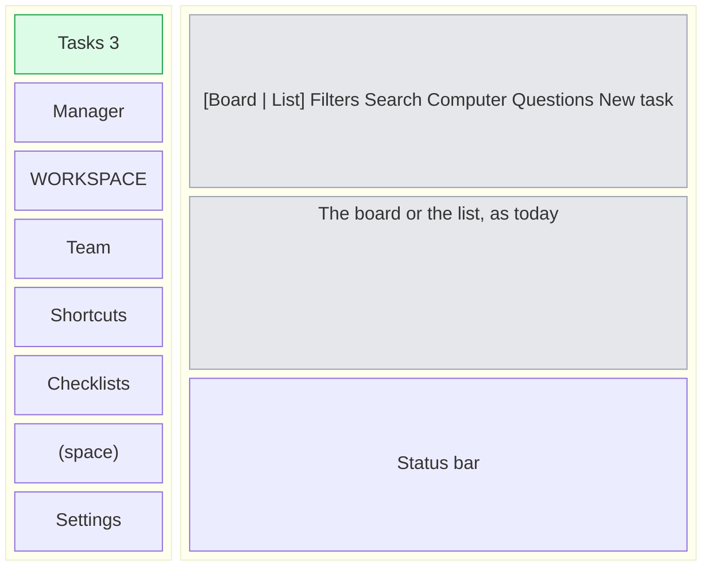
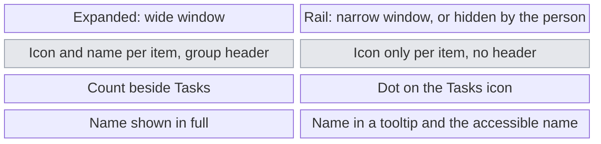
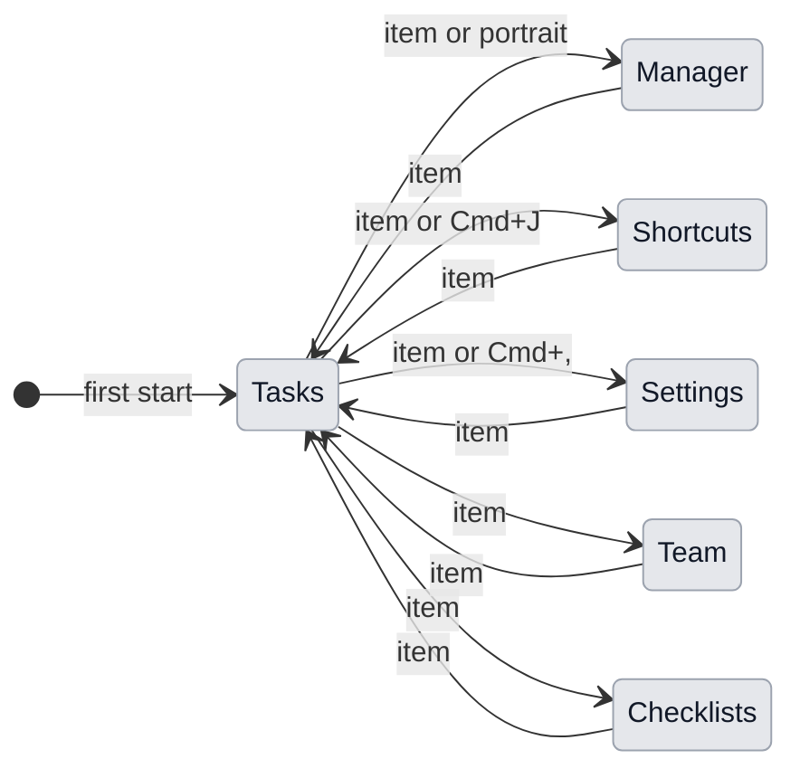
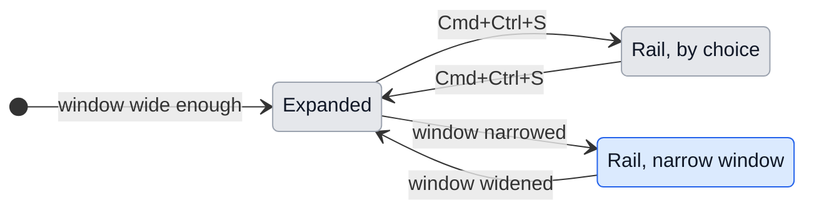
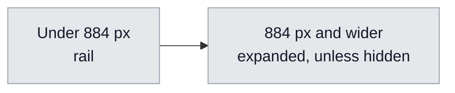

# UX: A sidebar for the Chat window

## 1. Why

The Chat window has one real page, the board, and everything else hangs off its top bar: Shortcuts behind a bolt icon, Team behind a portrait, Manager as a dialog, Settings as a dialog with thirteen sections, Checklists inside those settings. Eight controls share the bar with the board's own Board/List switch, Filters, Search, Questions and New task. Nothing tells a person what GeckIt contains beyond the board, which of those places they are in, or how to get back. Manager, Team and Shortcuts are things people return to every day, and as dialogs they cover the board they are about and close when the person clicks away. The goal is a web-app layout in the manner of Linear: a quiet sidebar on the left lists the places, the place chosen fills the rest of the window, and the board's bar holds only the board's controls.

### Path to the result

- **Entry and result:** the person opens the Chat window and sees the sidebar with Tasks chosen. One click on a sidebar item shows that place in the content area; one click on Tasks brings back the board exactly as it was left.
- **Readiness:** nothing to set up. The sidebar appears for everyone on the first start after the update.
- **Decisions and order:** the only decision is which place to look at. Showing or hiding the full sidebar is optional and remembered.
- **Shape of the path:** one level of navigation with four groups, ordered by how often each place is used: places where work happens, places that shape the work, the computers work runs on, then Settings apart at the bottom. A flat list of nine was rejected because setup used once a month (Secrets, Browsers) would then weigh the same as the board used all day (section 10).
- **First launch and return:** the first start lands on Tasks, so the board a person knows is the first thing they see; the items are labelled with words, so nothing needs explaining. Later starts reopen the last place shown. Settings items that used to be reached from the bar are reached from the sidebar's Settings, and every keyboard shortcut that opened them still does.

## 2. What is added

| Surface | What appears | When seen |
|---|---|---|
| Chat window, new | A sidebar along the left edge, full height, below the window's traffic lights on macOS | Always on desktop |
| Sidebar, new | Group one, no header: Tasks, Manager, Questions | Always |
| Content area, Questions, moved | The general questions kept off the board (today the Questions button and its menu in the board bar): the list on the left, the open question on the right, "Ask a question" with Cmd+Shift+N in the page header | Questions chosen, or Cmd+Shift+N |
| Sidebar, new | Group two, header "Workspace": Team, Shortcuts, Checklists, Browsers, Secrets | Always |
| Sidebar, new | Footer: Settings, and the gecko button while the gecko is hidden | Always |
| Sidebar, new | The button that hides or shows the names: beside the traffic lights when expanded, under them in the rail, since the window's buttons reach past the 52 px rail | Always on desktop |
| Sidebar, Tasks item, new | A count of conversations waiting for the person | While at least one waits |
| Content area, existing board | Tasks shows the board or the list as today | Tasks chosen |
| Content area, Manager, moved | The Manager chat as a page instead of a dialog, with all of Manager's threads listed beside the open one: GeckIt first, then each Telegram chat and Slack or Discord thread by last message, as `manager-threads.md` describes; the composer and the line "Manager's answer is also posted to Slack." as there | Manager chosen |
| Content area, Team, moved | Team as a page instead of an overlay | Team chosen |
| Content area, Shortcuts, moved | The shortcut list and editor as a page instead of a dialog | Shortcuts chosen |
| Content area, Checklists, moved | The Checklists section, taken out of Settings | Checklists chosen |
| Content area, Browsers and Secrets, moved | Each its own page, taken out of Settings: Browsers holds Chrome through GeckIt and the browser profiles (was the "Web Browser" section); Secrets lists the secrets with "Add secret" in the page header | Browsers or Secrets chosen |
| Content area, Settings, moved | The settings section list as a column on the left of the page, the section on the right; Checklists, Web Browser and Secrets no longer in it; Hosts (SSH) stays | Settings chosen |
| Board top bar, existing | Loses Shortcuts, Team, Manager, the gecko button, Settings, the computer selector (now the Computers group) and Questions (now a sidebar item); keeps Board/List, Filters, Search and New task | Tasks chosen |
| Status bar, existing | Loses the Manager portrait: Manager is in the sidebar | Always |
| Sidebar, moved | Group three, header "Computers", above the footer: the GeckIt computers this one is paired with over GeckIt's own link, the list the board bar's computer menu held. "This computer" first, then each saved computer, then "Connect computer" and, once one is saved, "Manage computers". The computer shown is marked; when it is another computer, a dot says connected (green) or not (grey). In the rail each saved computer is a two-letter monogram of its name, since the same icon twice would not tell them apart. Hosts reached over SSH are not here: they stay in Settings, Hosts | Always on desktop |
| Content area, another computer | That computer's own workspace, with its own sidebar, as the computer menu opened it; its Computers group returns to This computer | A saved computer chosen |
| Board, existing | Unchanged: a card says "2 queued" for messages waiting in it, and a conversation waiting for a slot says "Waiting for a slot" (`conversation-queue.md`) | Tasks chosen |
| Phone, left menu | The same places in a left menu opened from a button at the top left (section "Phone" below) | Always on the phone |

The prototype is `docs/design/sidebar-navigation.html`.

The sidebar is chrome: it is quieter than the board, only the item in use carries the selection, and the count on Tasks is the only number in it.

## 3. States

| State | When it happens | What the person sees | What to do |
|---|---|---|---|
| Tasks | Tasks chosen; the first start after the update | Tasks marked as current, the board or the list with its bar | Work, or choose another place |
| Manager | Manager chosen | Manager marked, the Manager chat filling the content area, its composer at the bottom | Write to Manager, or choose another place |
| Team | Team chosen | Team marked, Team's page | Edit an employee, or choose another place |
| Shortcuts | Shortcuts chosen, or Cmd+J | Shortcuts marked, the list of shortcuts and its editor | Run, edit or add one, or choose another place |
| Checklists | Checklists chosen, or "Checklists" picked in New task | Checklists marked, the checklists list | Edit one, or choose another place |
| Settings | Settings chosen, or Cmd+, | Settings marked, the section list with the last section shown | Change a setting, or choose another place |
| Expanded | The window is at least 884 px wide and the person has not hidden the names | Icons with names, the group header, the count beside Tasks | Hide the names with Cmd+Ctrl+S, or the button at the top of the sidebar |
| Rail | The window is narrower than 884 px, or the person hid the names | Icons only, a dot on Tasks while anything waits, each name in a tooltip | Widen the window, or show the names again |
| Waiting | At least one conversation waits for an answer, a permission or a review | The count beside Tasks, or the dot in the rail | Choose Tasks |
| Page with an unsaved edit | An editor (a shortcut, a checklist, an employee, a setting being typed) holds text and another place is chosen | Nothing: the other place shows | Come back; the edit is where it was left |

## 4. Transitions

Every place reaches every other place by its item; the diagram draws only the paths through Tasks to stay legible.

| From | Event | To | What the person sees |
|---|---|---|---|
| Any place | Pressed another item, or reached it with the keyboard and pressed Enter | That place | The item marked, the place in the content area at once, no animation of the page |
| Any place | Pressed the item already marked | The same place | Nothing; the place stays as it is |
| Any place | Cmd+J | Shortcuts | The Shortcuts page |
| Any place | Cmd+, | Settings | The Settings page on the section shown last |
| Any place | Pressed a saved computer under Computers | That computer's workspace | Tasks first, today's connecting screen, then its board with its own sidebar; the computer marked, with its dot |
| Another computer's workspace | Pressed "This computer" | This computer's Tasks | The local board; This computer marked |
| Any place | Pressed "Connect computer" | Connect a computer | Tasks, with today's "Connect a computer" dialog over it |
| Any place | Pressed "Manage computers" | Saved computers | Tasks, with today's list of saved computers over it |
| Tasks | Picked "Checklists" in the New task form | Checklists | The New task form stays as typed; the Checklists page shows. Tasks brings the form back as it was |
| Any place | Cmd+Shift+N | Questions | The Questions page, ready to ask |
| Any place | Cmd+N | Tasks | Tasks, with the New task form open |
| Any place | Cmd+P, Cmd+K | The same place | The search or the folder switcher over the current place; choosing a conversation goes to Tasks and opens it |
| Any place | A notification about a conversation pressed | Tasks | The conversation open, as today |
| Tasks with an open conversation | Chose another place, then Tasks | Tasks | The board, the view, the filters and the open conversation as they were left |
| Page with an unsaved edit | Chose another place, then the page again | Page with an unsaved edit | The edit as it was left, by itself, with no question |
| Expanded | Cmd+Ctrl+S on macOS, Ctrl+Alt+S elsewhere, or the sidebar button | Rail, by choice | The names fold away; the content area widens. The sidebar button stays where it was, as in Slack: right after the traffic lights on macOS, at the window's top left corner on Windows and Linux, in every state, so the same spot folds and opens the names |
| Rail, by choice | The same shortcut or button | Expanded | The names return |
| Expanded | The window narrowed below 884 px, by itself, without a choice | Rail, narrow window | The names fold away |
| Rail, narrow window | The window widened to 884 px or more, by itself | Expanded | The names return, unless the person hid them |
| Rail, narrow window | The sidebar button or its shortcut | Rail, narrow window | The names open over the content area, from the sidebar's edge, without moving it; choosing a place, Escape or a click outside folds them again |
| Waiting | The last waiting conversation answered, by itself | Not waiting | The count, or the dot on the rail, goes |
| Not waiting | A conversation asks, by itself | Waiting | The count appears beside Tasks |
| Any | Window closed and opened again | The place shown last | The same place, and the sidebar expanded or hidden as left |
| Any | Escape | The same place | What Escape does in that place today (closes a menu, stops an answer); Escape never changes the place |

## 5. What stays silent

| State | Why not shown |
|---|---|
| Unread Manager messages | Manager's replies already reach the person as notices and in channels; a second count would report the same news twice |
| Shortcuts that ran on a timetable | Their conversations appear on the board; the board is where work is reported |
| Secrets expiring, browser not connected | Each is shown where it blocks work (the conversation, the Chrome card); the sidebar does not repeat it |
| Queued messages and conversations waiting for a slot | They need nothing from the person; each card says so on the board, and the Tasks count stays for what waits for the person |
| Conversations working | Working needs nothing from the person; only waiting is counted |
| Team members' status | Each employee's work is on the board with their portrait |

## 6. Thresholds and time

| Number | Value | Why so many |
|---|---|---|
| Expanded sidebar width | 200 px | Fits the longest name, "Show the gecko", with its icon, and "Tasks" with a two-digit count, without wrapping |
| Rail width | 52 px | One 44 px target with 4 px either side |
| Window width where the names fold | 884 px | The expanded sidebar (200), the list sidebar at its default (264) and a conversation at its minimum (420): below that the List view could not show all three |
| Count on Tasks | Up to 99, then "99+" | Two digits fit the 200 px width; past 99 the exact number no longer changes what to do |
| Page change | Under 100 ms, no transition | Feedback where the click happened; a place is shown, not travelled to |

## 7. Wording

| State | Text |
|---|---|
| Item | "Tasks" |
| Item | "Manager" |
| Item | "Questions"; tooltip in the rail "Questions (Cmd+Shift+N)" |
| Group header | "Workspace" |
| Item | "Team" |
| Item | "Shortcuts" |
| Item | "Checklists" |
| Item | "Browsers" |
| Item | "Secrets" |
| Item | "Settings" |
| Waiting, tooltip of the count | "3 conversations waiting for you" (singular "1 conversation waiting for you") |
| Sidebar button, expanded | Tooltip "Hide names (Cmd+Ctrl+S)", Windows and Linux "Hide names (Ctrl+Alt+S)" |
| Sidebar button, rail | Tooltip "Show names (Cmd+Ctrl+S)", Windows and Linux "Show names (Ctrl+Alt+S)" |
| Rail item | Tooltip and accessible name: the item's name, and "Tasks, 3 waiting" while any wait |
| Settings section, renamed | "Browsers" (was "Web Browser") |
| Group header | "Computers" |
| Computer items | "This computer", then each computer's saved name |
| Shown computer, tooltip and accessible name | "This computer, shown"; another computer "Studio Mac, connected" / "Studio Mac, not connected" |
| Add one | "Connect computer" |
| Saved list | "Manage computers" |
| Keyboard shortcuts list, new line | "Show or hide the sidebar's names" |

## 8. Edge cases

- **Empty:** nothing waits: Tasks shows no count and no dot. A place with nothing in it (no shortcuts, no checklists, one Manager only on Team) shows that place's own empty state, which already exists.
- **Everything at once:** a question arrives while the person is in Settings: the count on Tasks grows and the usual notice appears; the place does not change by itself.
- **Connection lost:** the service restarts or is unreachable: the sidebar stays and every place shows the state it shows today; the sidebar adds nothing.
- **Repeat:** the current item pressed again does nothing; Cmd+J pressed on Shortcuts does nothing.
- **Stale copy:** the place remembered was removed from the sidebar by a later version: the window opens on Tasks.
- **List view on a narrow window:** below 884 px both the rail and the list sidebar are shown; the list keeps its own width and drag handle.
- **Full screen and conversation below the board:** the sidebar stays; the strip of board and the conversation below it share the content area as today.
- **Phone:** the same places in a left menu; see the section "Phone" below.
- **No saved computers:** the Computers group shows "This computer" and "Connect computer", so the way to add one stays visible.
- **Many computers:** the middle of the sidebar scrolls; the Computers group and the footer stay in reach by scrolling, the footer never moves.

## 9. What is deliberately absent

| Not done | Why |
|---|---|
| A Manager button in the status bar | Manager is in the sidebar; a second entry would say the same thing twice |
| Projects or folders listed in the sidebar | Folder filtering moved into Filters on 2026-11-06 (`toolbar-filters.md`) to keep the bar quiet; a second control for the same filter in the sidebar would reverse that the week after |
| Section header above Tasks and Manager | They are the first group and need no label; a header there would be read before the items themselves |
| A sidebar on the Panel or the voice capsule | Those windows do one thing each |
| Keyboard numbers for places | Cmd+1 to Cmd+9 already open conversations by their place in the list |
| An animated slide between places | A place is shown, not travelled to; motion would have no origin to explain |
| Collapsing the sidebar fully away | The rail keeps every place one click away; the content gains only 52 px more by hiding it |
| Renaming Shortcuts | The name is shared by Cmd+J, the phone, the CLI, the docs and Manager shortcuts; a rename is its own change |

## 10. Forks

### Which items the sidebar holds

| Option | Verdict |
|---|---|
| All nine proposed: Board, Manager, Shortcuts, Web Browser, Secrets, Remote, Checklists, Team, Settings | No |
| Places used daily or weekly in the sidebar; setup in Settings | No, reversed |
| Setup as a third "Connections" group in the sidebar | No |
| Browsers and Secrets in Workspace, computers in their own group | Yes |

### Where remote computers go

| Option | Verdict |
|---|---|
| GeckIt computers (paired over GeckIt's own link) as a "Computers" group at the bottom of the sidebar | Yes |
| SSH hosts in that group | No, corrected |
| SSH hosts in Settings, Hosts | Yes |

**Why:** corrected by Alex on 2026-11-16. The Computers group is the board bar's computer menu moved to the sidebar: choosing one shows that computer's whole workspace, a place, as Finder lists Locations at the bottom of its sidebar. An SSH host is not a place to go: its conversations are on this computer's board, labelled by project, and it is set up once, so it stays in Settings with Hosts. The first build put the SSH hosts in the group; that was the mistake.

**Why (setup items):** first decided for Settings, then reversed on 2026-11-16: in the prototype Alex looked for Browsers and Secrets in the sidebar twice and did not find them in Settings, which is the test that matters ("Visible next step"). They join Workspace because, like Team and Shortcuts, they are what conversations use while they work; they are not computers, so they are not in that group. The earlier reasoning, kept for the record: Apple's sidebars (Mail, Notes, Finder, Music) and Linear's both list content and places, ordered by how often they are used, and leave one-time setup to Settings. Browser profiles, secrets and hosts are set up once; daily signs of their state already appear where they block work. Confirmed by Alex on 2026-11-16.

### Board or Tasks as the first item

| Option | Verdict |
|---|---|
| "Board" | No |
| "Tasks" | Yes |

**Why:** the place holds two views, Board and List, switched in its bar; an item named "Board" would be wrong whenever List is shown. The phone's tab for the same place is already "Tasks".

### Name of the second group

| Option | Verdict |
|---|---|
| No header | No |
| "Automation" | No |
| "Workspace" | Yes |

**Why:** Team is people, not automation; the group is what shapes how work is done in this workspace. A header separates it from the two places where work itself happens.

### Hide the names

| Option | Verdict |
|---|---|
| Never | No |
| Rail by the person's choice and on a narrow window | Yes |

**Why:** the window's minimum width is 760 px; on it the expanded sidebar with the List view would leave no room for a conversation. Cmd+Ctrl+S is the shortcut macOS apps use for showing and hiding a sidebar.

### Manager page or dialog

| Option | Verdict |
|---|---|
| Keep the dialog over the board | No |
| A page in the content area | Yes |

**Why:** a dialog closes when the person clicks the board behind it, and covers the cards Manager is talking about. A page keeps the conversation while the person looks at the board through the sidebar, and returns exactly as left.

## Phone

The phone has the same places as the Mac sidebar, in a left menu as Linear has on mobile. Alex chose it on 2026-11-16 over a five-tab bar (fork below).

| Surface | What it holds | What changed from today (`phone-tabs.md`) |
|---|---|---|
| Menu button | At the left of the bar of every place's top page: three lines, accessible name "Menu". On a pushed page Back takes its spot | New. The tab bar (Tasks, Questions, Search, Settings) goes |
| Left menu | A panel 300 pt wide from the left edge over a dimmed screen: Tasks with the count of conversations waiting for the person, Manager, Questions with a dot while an answer is unread; header "Workspace": Team, Shortcuts, Checklists, Browsers, Secrets; Settings apart at the bottom. The place shown is marked | New |
| Tasks | The board as today, with "N queued" and "Waiting for a slot" on rows. In the bar: Menu, the working count, Search, Say it, The host's screen, New task; holding New task still lists the shortcuts | The Manager row at the top of the list goes. The Shortcuts icon in the bar becomes Search, since Search is no longer a tab |
| Manager | Large title "Manager", a gear for Manager's settings, and every Manager thread as a row: GeckIt first, then Slack, Telegram and Discord threads by last message, each with its state dot, last line and where it came from. A row opens the thread full screen with "< Manager", the composer, and "Manager's answer is also posted to Slack." where it applies | New place. Was a row on Tasks that opened one chat |
| Questions | Unchanged, reached from the menu | Was a tab |
| Team, Shortcuts, Checklists, Browsers, Secrets | Each a place of its own with + in the bar where something can be added | Team, Shortcuts and Web Browser leave Settings; Checklists and Secrets are new on the phone |
| Settings | This phone, Privacy, Host, Connection, Channels, Assistants, Board (Profiles, Folders, Hidden conversations), New tasks, Messages, Dictation, About | Loses Team, Shortcuts and Web Browser. Gains Channels, as the Mac's Settings has it: Telegram, Slack and Discord (and installed channel libraries), each with On or Off, what it is connected to ("@geckit_alex_bot · 2 chats", "Not set up"), and a page with its switch, Set up and Allowed people. Note under the group: "Where Manager can be written to besides this app. Each thread shows on Manager." |

Secrets lists each secret with what it is used for and where; a secret's page has Used for, Where, Kept, History and Remove, Remove in red at the bottom. Adding one is + in the bar, which opens the same link page a conversation sends. Checklists lists each with its item count; a checklist's page lists its items and Add item.

Search, opened from Tasks, puts a field with Cancel in the bar and shows recent conversations under "Recent", or matches under "Found" as the person types; Cancel or Escape brings the board back as it was.

**States and transitions.**

| From | Event | To | What the person sees |
|---|---|---|---|
| Any place's top page | Taps Menu | Menu open | The panel slides in from the left in 280 ms, the screen behind dims |
| Any place's top page | Swipes right from the screen's left edge, 24 pt is enough | Menu open | As with Menu. On a pushed page and in a conversation the same swipe is Back, since there the edge belongs to Back |
| Menu open | Taps a place | That place | The panel closes; the place as it was left, scroll and pushed page included |
| Menu open | Taps the place already shown | Its top page | The panel closes; the place back at its top page |
| Menu open | Taps the dimmed screen, swipes left on the panel or the dimmed screen (24 pt is enough; a mostly vertical move scrolls the list instead), or Escape on a keyboard | The same place | The panel closes |
| A list | Taps a conversation, thread or question | Full screen | It opens with Back; the menu button is not shown there |
| Any | The app opened again | The place shown last | A kept place that no longer exists (Search, from before) opens Tasks |

Typed text in a thread, a question or Search is kept across places.

**Menu button dot.** While the menu is closed, a dot on the menu button stands for what the menu would show: amber while a conversation waits for the person and Tasks is not the place shown, the accent colour while a question has an unread answer and Questions is not shown, amber first when both hold. Its accessible name is then "Menu, a conversation is waiting for you" or "Menu, a question has an answer". Without it, a request for permission would be invisible from every place but Tasks.

**What stays silent.** The number of waiting conversations is shown only in the menu, beside Tasks; the button carries a dot, not a count. Manager and the Workspace places get no count, for the reasons in section 5.

**Numbers.** Menu width 300 pt: the longest name with its icon and the Tasks count fit, and 75 pt of the screen behind stays visible on a 375 pt phone to tap and close it. Rows 44 pt, Apple's smallest target.

**Wording.** Menu items "Tasks", "Manager", "Questions", group header "Workspace", "Team", "Shortcuts", "Checklists", "Browsers", "Secrets", "Settings". Back buttons name the page they return to. Secrets note: "Conversations use these by name and never see them. Kept in the host's Keychain." Search headings "Recent" and "Found"; nothing matching: "Nothing found."

**Forks.**

| Question | Verdict | Why |
|---|---|---|
| Tab bar or left menu | Left menu, chosen by Alex on 2026-11-16 | It keeps the Mac sidebar's list and groups as they are. Recommended against at the time: places and their dots are hidden while it is closed, a switch takes two taps, and the button sits in the hardest corner to reach. A tab bar with Tasks, Manager, Questions, Workspace, Settings was built and compared in the same prototype |
| Computers on the phone | No, as `remote-hosts-phone.md` decided | The phone reaches hosts only through the computer it is paired with; adding, connecting and disconnecting stay on the computer. Hosts show as the labels of their projects, and the paired computer stays in Settings, Host |
| Channels in the left menu | No: in Settings, as on the Mac | A channel is set up once and then only works; its threads, the part used daily, are on Manager |
| Manager as a row on Tasks, as today | No | Manager has several threads now; one row could open only one of them |

The prototype is `docs/design/sidebar-navigation-phone.html`.

## Implementation notes

Where the build departs from the text above, as found while writing it (2026-11-16):

- **Questions page:** laid out as the Tasks List view (changed 2026-11-16 at Alex's request; it was a centred card of rows, a question opening over the page). The list stands in a sunken column as wide as the List view's, under "Kept" and day headings that fold, each row drawn as a List view row: status dot, title, age, what it stands at and its time left or a pin when kept, with More (and right click) for Keep or Stop keeping and Delete. The open question fills the pane beside the list with no dimming, the row marked as the List view marks the open one; with none open the pane says "Choose a question to read it here." Close or Escape empties the pane. It is the same conversation view as on the board, not a second copy, so a conversation's draft and scroll stay in one place. Choosing another place closes the question pane, including while its history is loading; Tasks opens without the question popup. Returning to Questions shows its empty pane until a row is chosen again. Closing the pane preserves the question and its unsent draft; it does not stop its work. A conversation opened from Tasks still stays open when visiting another place and returning without opening a question.
- **Opening a loaded question:** clicking its row or pressing Enter selects it and opens its pane immediately, without waiting for the task list to refresh. While its history is read, the pane shows the existing loading skeleton, accessible as "Reading the conversation". Another question's messages are cleared on selection; a later reply for a previously selected question cannot replace the current one. Unknown conversation links retain the existing lookup. This restores responsiveness within the approved Questions flow; it adds no controls, wording or layout.
- **New task and Ask a question:** two separate forms, one open at a time (changed 2026-11-16 at Alex's request). Neither form carries a New task / Ask a question switch any more; each has its own heading. New task opens from the board bar or Cmd+N, Ask a question from the Questions page or Cmd+Shift+N. A draft left in both forms reopens only New task after a restart; the question draft stays kept for the next time Ask a question opens.
- **Computers:** the group is the board bar's computer menu, moved; Connect computer and Manage computers open today's dialogs over Tasks. While another computer is shown, the window shows only that computer's own sidebar.
- **Prototype:** `docs/design/sidebar-navigation.html` still draws SSH hosts in the Computers group; this document and the build follow Alex's correction of 2026-11-16.
- **Phone, Secrets:** the list, history and Remove work; adding a secret still says "Manage secrets on the computer.", since its value is sealed on the computer's page.
- **Phone, Channels:** each channel's switch is in Settings; setting one up and its allowed people stay on the computer, where its tokens are typed. A channel not set up says "Set up on the computer".
- **Phone, Search:** opens as a page over Tasks with Back to Tasks.
- **Section pages:** Checklists, Browsers and Secrets keep their section's own heading only for screen readers, since the page head already names them.
- **Cmd+P from another place:** shows Tasks and puts the cursor in the board's search.
- **Phone, Manager:** shows Manager's chat with its own thread picker; the list of every thread as rows is not built yet.

## 11. Reconciliation with requirements

| Requirement | Where covered |
|---|---|
| Left sidebar like a web application, in the manner of Linear | Sections 1, 2 |
| Items Board, Manager, Shortcuts, Checklists, Team, Settings | Sections 2, 7; Board named Tasks (section 10) |
| Items Web Browser, Secrets | In the Workspace group as Browsers and Secrets (sections 2, 10); Alex could not find them in Settings in the prototype |
| Remote connections in the sidebar, at the bottom | Computers group of GeckIt computers (section 2), asked by Alex on 2026-11-16 and corrected the same day: SSH hosts stay in Settings |
| Manager shows all chats | Manager page with its threads (section 2) |
| Queued messages | Board unchanged (section 2), silent in the sidebar (section 5) |
| No Manager in the bottom bar | Section 2, section 9 |
| Settings holds whatever is not in the sidebar | Section 2 |
| Judge the items against Apple design | Section 10 and the check below |
| The same navigation on the phone | Section "Phone", asked by Alex on 2026-11-16 |

**Apple design UX requirements:**

| Requirement | Check |
|---|---|
| 1. Direct manipulation | Met: places are chosen directly; Checklists and Shortcuts become pages edited in place instead of dialogs |
| 2. Immediate feedback | Met: the item is marked and the place shown under 100 ms |
| 3. Forgiveness | Met: changing place loses nothing; unsaved edits wait where they were left |
| 4. Visible next step | Met: every place is named on screen; empty states are the places' own |
| 5. No surprises | Met: the place never changes by itself; the names fold only on a narrow window, which the person caused, and return when it widens |
| 6. Ask late, ask once | Not applicable: no permission or setup is asked |
| 7. Quiet notifications | Met: one count, only for what needs the person (section 5) |
| 8. Plain wording | Met: item names are the person's words for the places (section 7) |

**What the requirements lack:** what the Manager page shows when Manager is turned off, and whether Team and Manager should merge, are not decided by the request; this document keeps both as they are today.
