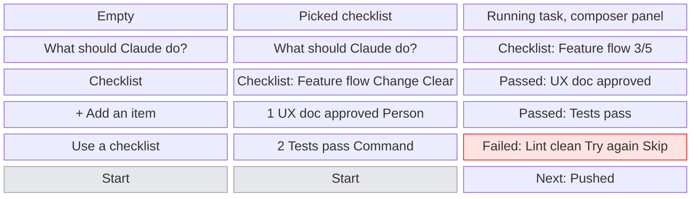
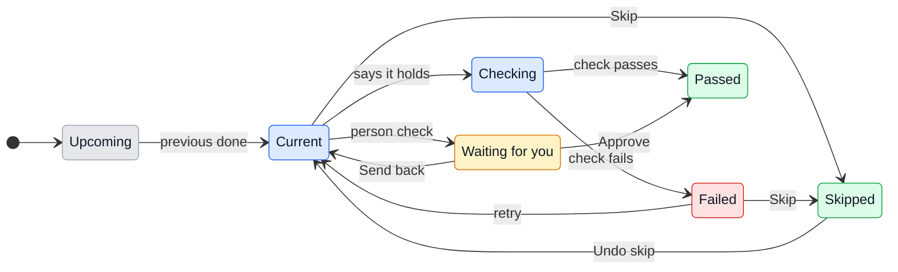
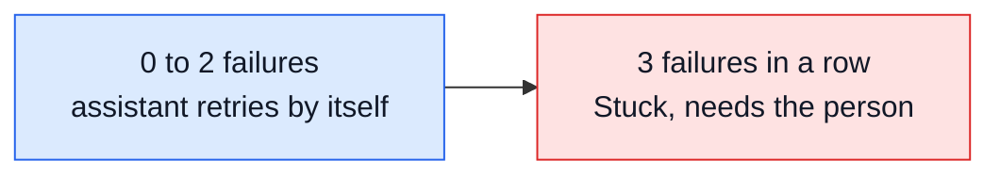

# UX: Checklists for tasks

## 1. Why

A goal is one condition, and the assistant decides when it holds: Codex grades itself, and Claude's goal evaluator reads only what Claude printed. Work that has a fixed path in a folder (UX doc, then code, then tests, then review) is retyped as a prompt for every task, its order is not held, and a card reaches In review on the assistant's word. A checklist is a reusable, ordered list of end states that GeckIt checks itself before the task moves on. It replaces Goal: a one-item checklist is what a goal is today.

### Path to the result

- **Entry and result:** the person opens New task, leaves the checklist empty, types items, or picks a saved one; the result is a card that shows "3/7" and reaches In review only when every item has passed.
- **Readiness:** none for an empty or typed checklist. A saved checklist needs to exist in Settings > Checklists or be picked from a folder's default. A command check needs the folder reachable (local, or a connected host).
- **Decisions and order:** folder first (it decides which checklists are offered and the default), then the work, then the checklist. Everything else has defaults: an item's check is None until set.
- **Shape:** one form, progressive disclosure. The checklist field looks like today's goal field until a second item or an item's details are opened. Steps would be wrong: no item depends on another decision in the form.
- **First launch and return:** with no saved checklists the field offers "Add an item" only; "Use a checklist" appears once one exists for the folder or as shared. A running task's checklist is changed from the composer's Checklist control. A saved checklist is changed in Settings and never changes running tasks by itself.

## 2. What is added

**Built so far (2026-11-16, first pass):** New task field and picker on desktop and phone, item details, Settings > Checklists, and the one-line goal the assistant gets. The task panel, card progress, gate checks, transcript notes and the shortcut editor are the second pass; until then the card keeps today's goal line and "Goal reached".

| Surface | What appears | When |
|---|---|---|
| New task form, desktop (existing) | "Checklist" field replaces "Add a goal": items, "Add an item", "Use a checklist" | Every task, not a question |
| New task form, phone (existing) | "Checklist" cell under Folder replaces the Goal cell, its value "None", the one item, "<n> items" or "<name>, <n>"; it opens the field in a sheet with "Done" | Every task, not a question |
| Checklist picker (new menu) | Folder's checklists, then shared ones, then "Manage checklists..." | "Use a checklist" pressed |
| Item details (inline, new) | Description, Check (None, Command, Review, Person), command field, "Recheck after the last item" | An item opened |
| Settings > Checklists (new section) | List grouped Shared, then by folder; "New checklist"; editor with Name, Belongs to, "Default for new tasks in this folder", items | Always |
| Board and list card (existing) | Progress replaces the goal line: "3/7 · <current item>", or the state | Task has a checklist |
| Composer, desktop and phone (existing) | "Checklist 3/7" replaces the Goal button; opens the task's checklist | Conversation in a folder |
| Task checklist panel (new popover, sheet on phone) | Items with their state, check output, "Approve", "Skip", "Try again", "Edit" | Checklist control pressed |
| Transcript (existing) | One note per failed check and per item waiting for the person | Those events only |
| Shortcut editor (existing) | Same Checklist field replaces Goal | Always |
| CLI and Manager (new commands) | `checklists list/show/add/edit/remove`; `--checklist <name>` or `--items <JSON>` beside `--goal` on `start`, `sessions start` and `employees shortcut add/edit` | Agents and the person's terminal |

**One item at a time (2026-11-16, decided with Alex):** a checklist is no longer one combined goal. GeckIt sets the current item as the goal; when the assistant meets it, GeckIt ticks the item and, 3-10 s after the conversation rests, sets the next. A Person item waits with "Approve" and no goal until the person ticks it. Items marked "Recheck after the last item" get one more goal after the last item: the assistant confirms they still hold. The option is hidden on Person items (an approval is not the assistant's to confirm) and greyed out with "Needs a later item." while the checklist has one item. The first message carries the whole list so the assistant knows what comes later. A saved checklist is a template: New task copies it, and the task's copy is edited in chat without touching the template or other tasks. In chat the composer control and the board card read "2/5 · <current item>", "2/5 · Approve: <item>" or "5/5 · Done" (the count of ticked items always comes first; the phone row shows the count alone, green when done); on desktop it opens a panel at the right of the conversation, on the phone a sheet. The panel is the conversation's inspector, Mac style: a sidebar toggle at the trailing end of the conversation header shows and hides it (pressed while shown, open or shut remembered per window) and the panel has no close button of its own. Its left edge is dragged to resize it, as the sidebar is (280 px at least, the conversation keeps 360 px; double-click returns to 380 px; the width is remembered per window). To make room, the header keeps only Status, Find, More (...) and the toggle; Copy terminal command, Refresh, Move to top or bottom of In progress, and Open conversations over or below the board moved into More. When a second pane joins the inspector, it gets an icon row at the top of the panel, not a rail. The panel runs the full height of the conversation area; everything that belongs to the conversation stays in the column beside it: Status history, the transcript, the Approve bar, the queue, the phrases and the message box. Only the window's status bar at the bottom (branch, model, context) spans under both. Rows have a box to tick by hand. There is no Save: every change saves itself 0.6 s after the last edit (a pause in typing, not each key), and closing the panel or sheet saves what is still waiting; the phone sheet and the dialog end with Done. Ticks that land meanwhile are kept, and an edit made elsewhere (Manager, the phone) shows when nothing here is waiting to save. The goal follows an edit only after edits have rested for 3 s and the conversation rests, so typing never sends half-written goals. A task started with a plain goal shows it as a one-item checklist. Board cards show the same progress. This replaces the Skip and Try again controls of section 4.

**Approval wherever the person is (2026-11-16, decided with Alex):** when the current item is a Person item waiting for Approve, the board card moves to Needs you and says "Waiting for your approval"; the phone row's count becomes "Approve" in the warning colour. Unless the person is looking at that conversation, GeckIt sends one notice, "Waiting for your approval - <folder>", with the task title and the item, as a macOS notification and a phone push like a question; approving clears it. For a task Manager runs or a channel thread tracks, the item is also a Manager decision with one Approve button, shown in GeckIt and in Telegram, Slack and Discord to the people allowed to answer there, and the channel status line reads "waiting for your approval: <item>" (the item is left out when it holds a secret). Manager itself never approves.

**Approve above the composer, and a message means "not yet" (2026-11-16, decided with Alex):** while the current item waits for Approve and the checklist panel is hidden (always on the phone, whose sheet is closed while writing), a bar sits above the composer: "Waiting for your approval: <item title>" with one button, "Approve", and the composer's placeholder reads "Or write what to change". With the panel shown the bar is absent: the panel's own Approve is in view, and two Approve buttons for one item read as two requests. Approve does what ticking the item does. Sending a message instead (anything but a `/` command or a `!` command, from GeckIt, the phone, Manager or a channel) means the item is not approved and needs correction: the item leaves Waiting for approval, the bar and the "Waiting for your approval" card state, notice and Manager decision go away, the message goes as written, and the item is set as the goal again right after it, so the assistant works the correction and asks for approval again when the item holds. Nothing extra is said in the transcript; the message itself is the record. A `/` or `!` command leaves the approval waiting. The assistant does not ask for approval itself: a Person item's goal reads "<item> - check: ready for the person to approve; do not ask them, GeckIt does", and the first message says the same once, so the only question is GeckIt's Approve.

**A person's item is a turn, not a goal (2026-11-16, decided with Alex):** a goal on a Person item could never be met, because the goal check waits for an approval only the person gives, so the assistant looped "Still waiting for your approval". GeckIt now sends a Person item as an ordinary message: "Next on the checklist: <item>. Work on it until it is ready for the person to review, then stop and say what is ready. Do not ask them to approve it: GeckIt asks them, and any change they want comes as their next message." The panel marks it Goal while it is worked. When that turn ends by itself, the item waits for Approve (bar, card, notice, Manager decision). A message sent while the item is worked or waiting is more work on it, and when that turn ends it waits for Approve again. A goal left on a Person item by an earlier version is cleared when its turn ends for any reason, Stop included, and the item then waits for Approve.

**Command line (2026-11-16):** a start with none of `--goal`, `--checklist` or `--items` gets the folder's default checklist, as New task does; Manager's `sessions start` fails when there is none, since every worker needs a completion condition. A name is looked up in the folder's checklists first, then shared ones. A shortcut keeps its own copy of the checklist (2026-11-16): the shortcut editor on desktop and phone has the same Checklist field as New task in place of Goal, a run starts its task with the copy, and the task works through it one item at a time; a shortcut saved with only a goal opens and runs as a one-item checklist and is saved as one. A Manager shortcut has no checklist. A new shortcut does not take the folder's default checklist: a shortcut is often a report or a check that needs no completion condition, so it is chosen by hand. Checklists are saved in `checklists` of the configuration JSON, exported and imported with the rest. Agents learn this from the `define-checklists` skill (saving) and the Manager and conversation skills (picking or writing items on the fly).

## 3. States

### Item

| State | When | What the person sees | What to do |
|---|---|---|---|
| Upcoming | Before its turn | Title, muted | Nothing |
| Current | Its turn, assistant working | Title, "Now" | Nothing, or Skip |
| Checking | Assistant says it holds; GeckIt runs the check | "Checking..." | Nothing, passes by itself |
| Passed | Check succeeded | Title with a check mark | Nothing |
| Self-reported | Check None and the assistant says it holds | Title with a check mark and "Not checked" | Nothing |
| Failed | Command exited non-zero, review said no | "Check failed" and the last lines of output | Nothing (assistant retries), Try again, or Skip |
| Waiting for you | Check Person and the assistant says it holds | "Waiting for you" | Approve or Send back |
| Skipped | Person pressed Skip | Title struck through, reason if given | Nothing, or Undo skip |

### Task checklist

| State | When | What the person sees | What to do |
|---|---|---|---|
| None | Field left empty | Card has no progress line; composer "Checklist" | Add items any time |
| Working | An item is Current or Checking | Card "2/5 · Tests pass" | Nothing |
| Waiting for you | Current item is Waiting for you | Card "Waiting for you: UX doc approved"; existing waiting attention | Approve or Send back |
| Stuck | Same item failed 3 times in a row | Card "Check failed: Lint clean" with error attention | Read output, Try again, Skip or Edit |
| All passed | Every item Passed, Self-reported or Skipped, final-gate items rechecked | Card moves to In review; "5/5" | Review the work |
| Template changed | Saved checklist edited after the task copied it | In the panel: "Feature flow changed since this task started." with "Update" | Update or ignore |

## 4. Transitions

| From | Event | To | What the person sees |
|---|---|---|---|
| Upcoming | Previous item passed or was skipped, by itself | Current | Card names this item |
| Current | Assistant prints the item's status line, by itself | Checking | "Checking..." on the item |
| Checking | Command exits 0 or review says it holds, by itself | Passed | Check mark; card count goes up |
| Checking | Check None, by itself | Self-reported | Check mark and "Not checked" |
| Checking | Command exits non-zero, times out, or review says no, by itself | Failed | "Check failed" and output; transcript note |
| Failed | GeckIt sends the output back to the assistant, by itself | Current | Nothing new; the transcript shows the assistant continuing |
| Failed | Third failure in a row, by itself | Failed, task Stuck | Card error attention; assistant is not sent more |
| Failed | Press "Try again" | Checking | "Checking..." |
| Current | Item has Person check and assistant prints its status line | Waiting for you | Card "Waiting for you: <item>"; transcript note |
| Waiting for you | Press "Approve" | Passed | Check mark; next item starts |
| Waiting for you | Press "Send back" and type what is missing | Current | The words go to the assistant as a message |
| Current or Failed | Press "Skip", reason optional | Skipped | Struck through; next item starts |
| Skipped | Press "Undo skip" before the task reaches In review | Current | Item is current again; later items return to Upcoming |
| Last item done | Final-gate items rechecked and all pass, by itself | All passed | Card moves to In review |
| Last item done | A final-gate item fails its recheck, by itself | That item Failed | Card names it; assistant gets the output |
| Any | Press "Edit" in the panel and save | Same | Upcoming items change; passed items cannot be edited, only skipped ones undone |
| Template changed | Press "Update" | Same | Upcoming items replaced by the saved ones; passed items stay |

## 5. What stays silent

| State | Why it is not shown |
|---|---|
| Each passed item in the transcript | The card and panel already show it; one note per step floods the conversation |
| The native goal sent to the assistant | It is how GeckIt keeps the assistant working, not a choice the person makes |
| A check retried by the assistant before the third failure | It resolves by itself; the card shows the count |
| Upcoming items changing because the template changed | Never happens by itself; only "Update" changes them |
| Status lines the assistant prints | Read by GeckIt for the card; they stay in the transcript as the assistant wrote them, not restyled |

## 6. Thresholds and time

| Number | Value | Why |
|---|---|---|
| Failures before Stuck | 3 in a row | One retry fixes a typo, two fix a real bug; a third failure on the same check means the assistant is looping and spending the plan |
| Command check time limit | 10 minutes | Covers a full test suite and build on this project; beyond that a check is hung, and the person should see it |
| Output kept per failure | Last 40 lines | Enough for a test failure and its stack; the whole log is in the assistant's own transcript |
| Checklist text warning | 3,500 characters | Claude's goal condition takes up to 4,000; the warning leaves room for GeckIt's own wording around the items |
| Items | No limit; hint after 10 | Longer lists usually mix steps with end states; a hint, not a block |

## 7. Wording

| State | Text |
|---|---|
| Field label | "Checklist" |
| Add item button | "Add an item" |
| Item title placeholder | "What is true when this step is done" |
| Description placeholder | "How to prove it, and what must not change" |
| Pick button | "Use a checklist" |
| Picker footer | "Manage checklists..." |
| Picked header | "Checklist: <name>" with "Change" and "Clear", and "Undo" right after a pick replaced typed items |
| Check labels | "None", "Command", "Review", "Person" |
| Check None hint | "The assistant says when it holds" |
| Command hint | "Passes when this exits with 0" |
| Review hint | "Another model reads the conversation and decides" |
| Person hint | "Waits for you to approve" |
| Final gate | "Recheck after the last item" |
| Start hint, no checklist | "No checklist: it stops when <assistant> is done" |
| Start hint, checklist | "<assistant> works through these in order; the card moves to In review when all pass" (until the gate exists: "<assistant> works through these in order, then the card shows Goal reached"; one item keeps today's "<assistant> keeps working until this holds, then the card shows Goal reached") |
| Text warning | "Long checklists may not fit in one goal. Shorten descriptions." |
| Items hint | "Long lists often mix steps with results. Each item should be one result." |
| Card working | "<n>/<total> · <item title>" |
| Card waiting | "Waiting for you: <item title>" |
| Card stuck | "Check failed: <item title>" |
| Item checking | "Checking..." |
| Item self-reported | "Not checked" |
| Item failed | "Check failed" |
| Transcript failed | "Check failed: <item title>. The output went back to <assistant>." |
| Transcript stuck | "Check failed 3 times: <item title>. Waiting for you." |
| Transcript waiting | "<item title> is waiting for your approval." |
| Panel actions | "Approve", "Send back", "Try again", "Skip", "Undo skip", "Edit" |
| Skip reason placeholder | "Why skip (optional)" |
| Template changed | "<name> changed since this task started." with "Update" |
| Settings section | "Checklists" |
| Settings intro | "Results a task must reach, in order. Pick one in New task, or make one the default for a folder." |
| Settings empty | "No checklists yet. A checklist is a list of results a task must reach, in order." (the header's "New checklist" is the one action) |
| Belongs to hint | "Offered in New task for every folder." or "Offered in New task for <folder> only." |
| Belongs to | "Belongs to" with "Shared" and the folder names |
| Folder default | "Default for new tasks in this folder" |
| Repository note | "Saved in <folder>/.geckit/checklists, so it goes with the repository." (not shown while checklists are kept in settings) |
| Delete confirmation | "Delete <name>? Running tasks keep their copy." with "Delete" (destructive) and "Cancel" |
| Host offline, command check | "Waiting for <host> to check this." |

## 8. Edge cases

- **Empty:** no checklist is valid; the task behaves like today without a goal. No saved checklists: "Use a checklist" is hidden, "Add an item" stays.
- **Everything at once:** a final-gate item and a person item fail at the end together: the card names the first in list order; the panel shows both.
- **Connection lost:** a host folder disconnects during a command check: the item stays Checking with "Waiting for <host> to check this." and runs when the host returns. The assistant is not told it failed.
- **Repeat:** pressing Approve twice passes once. Try again while Checking is disabled.
- **Stale copy:** a template edited or deleted after the task started does not change the task; edited shows "Update", deleted shows nothing.
- **Folder default removed or folder changed in the form:** the picked checklist is cleared only if it belongs to the old folder; typed items stay.
- **`/goal` typed in the conversation:** it becomes a one-item checklist, replacing the current one only if the task has none; otherwise GeckIt says "This task has a checklist. Edit it from Checklist." and does not send it.
- **Existing goals:** tasks and shortcuts with a goal show it as a one-item checklist with check None.
- **Question form:** no checklist, as there is no goal today.
- **Long titles:** card truncates to one line; panel wraps.

## 9. What is deliberately absent

| Not doing | Why |
|---|---|
| Separate Goal next to Checklist | Two controls for "what done means"; a one-item checklist is a goal |
| One native goal per item | Both Codex and Claude pitch goals for multi-step work; swapping goals mid-task is fragile |
| The assistant marking items passed | That is the self-grading this feature exists to remove |
| Several checklists on one task | Order across two lists is undefined; merge them into one |
| Branching or conditional items | A workflow engine; ordered end states cover the requests so far |
| Templates changing running tasks automatically | The agent's instructions would change under it mid-task |
| A per-folder settings screen | There is none today; Settings > Checklists with "Belongs to" covers it without a new place |
| Notification for each passed item | Only the person's action items notify (Apple UX 7) |

## 10. Forks

### Checklist instead of Goal

| Option | Verdict |
|---|---|
| Replace Goal with Checklist | Yes |
| Keep both | No |

**Why:** one concept for "what done means"; the one-line case stays one line.

### Where folder checklists are stored

| Option | Verdict |
|---|---|
| In the repository, `.geckit/checklists/*.md` | Yes, pending Alex |
| In GeckIt settings, keyed by folder | For the first pass only |

**Why:** the first pass keeps every checklist in GeckIt's settings (`checklists`, with `root` for a folder's), since moving them into the repository later is easy and Alex has not chosen. The repository remains the recommendation: versioned, shared with teammates through git, works on SSH hosts unchanged. Cost: the folder shows in the repository's diffs. Settings to repository later is an easy move; the reverse means migrating files people edited.

### Order

| Option | Verdict |
|---|---|
| Strict top to bottom, with "Recheck after the last item" for invariants | Yes |
| Any order | No |

**Why:** the request is a workflow. Invariants such as "lint clean" would break if checked once in the middle, so they are rechecked before In review.

### Phone layout

| Option | Verdict |
|---|---|
| A Checklist cell that opens the field in a sheet | Yes |
| The field inline in the form | No |

**Why:** the rendered form showed a five-item checklist pushing "What to do", the form's main field, below the fold. A cell keeps the form as it was with the Goal cell.

### Skip

| Option | Verdict |
|---|---|
| Person only, reason optional | Yes |
| Assistant can skip | No |

**Why:** a skipped step is a decision the person owns; a required reason adds friction to the common "not needed here" case.

## 11. Reconciliation with requirements

| Requirement | Where covered |
|---|---|
| Checklists enforced automatically | 3, 4 (checks run by GeckIt; In review only when all pass) |
| Tied to a folder or shared | 2 (Settings > Checklists, Belongs to), 10 |
| Item has title and description | 2, 7 |
| Top to bottom, like a workflow | 4, 10 |
| Empty or a picked checklist on a new task | 1, 2 |

### Apple design UX requirements

| Requirement | How |
|---|---|
| 1 Direct manipulation | Items are edited, removed (a faint × on every row, always shown on phone), reordered (drag the number, Alt+Up/Down, or Move up and Move down in the item's details, which is how the phone reorders) and approved in place |
| 2 Immediate feedback | Item state changes where it was pressed; card count updates |
| 3 Forgiveness | Skip has Undo skip; deleting a checklist is confirmed and spares running tasks |
| 4 Visible next step | Card and panel always name the current item or the person's action |
| 5 No surprises | Templates never change running tasks; folder change keeps typed items |
| 6 Ask late, ask once | Not applicable: no permissions asked |
| 7 Quiet notifications | Only Waiting for you and Stuck use attention |
| 8 Plain wording | Section 7; errors say what failed and what happens next |

**What the requirements lack:** how a Review check is run (which model, what it reads) and the agent-facing status line format; both are implementation decisions for the plan, not UX.
