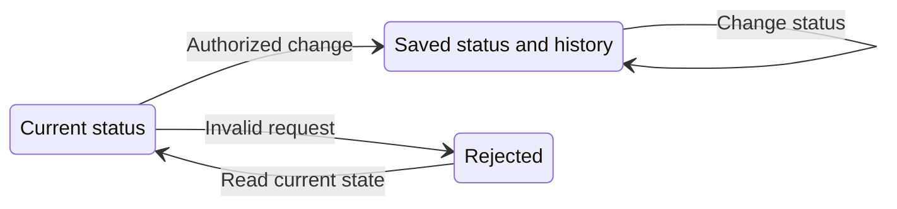

# Task status changes and technical history

## 1. Purpose and user journey

Alex asks Manager from Telegram, Slack or GeckIt to move tasks, including to Done. The authenticated host executes the status operation immediately. A person can also change status directly on the desktop board. Opening the conversation's status history shows durable technical events, including after reopening the conversation or restarting the service. There is no second product decision. Native provider permission cards and confirmations for unrelated operations retain their existing behavior.

This is an extension of existing status moves, not a second audit store. The user chooses a status through existing controls, then can inspect history. Readiness means the host has saved both status and transition. No new configuration is required. Implementation is explicitly authorized by the task; a separate UX approval is unnecessary.

## 2. Surfaces

| Surface | Change | When visible |
|---|---|---|
| Manager CLI `sessions mark` | All supported status changes apply without a product card, including Done | Authenticated operation on a managed worker |
| Desktop conversation | A `Status history` disclosure lists existing moves with technical attribution | Conversation open |
| CLI list/show, Manager show | Structured history and deterministic human-readable transition details | Requested |
| Existing board status controls | Same immediate move; host records the desktop action | Status actually changes |

Use GeckIt's existing disclosure, transcript/info typography and tokens. History is secondary to the conversation, read-only and scrollable. It must not obstruct the composer.

## 3. States

| State | Condition | User sees | Next action |
|---|---|---|---|
| Saved | Actual status transition recorded | Previous status, new status, timestamp, executor, origin and known references | Continue work or inspect history |
| Empty | No moves recorded | `No status changes recorded.` | Continue work |
| Legacy | Existing move lacks technical attribution | `Legacy / unknown` | Read known status and time; no inferred identity |
| Rejected | Unauthorized/stale command or invalid status | Existing operation error | Read current state and retry deliberately |
| Old pending | An earlier build retained a Done decision | Existing pending decision until the person resolves it | Person may refuse or allow it; no automatic consent |

## 4. Transitions

| From | Event | To | What the user sees |
|---|---|---|---|
| Current | Desktop status action or authenticated Manager mark | Saved | Card moves immediately; history gets one event |
| Saved | Select same status again | Saved | No duplicate transition |
| Current | Invalid or unauthorized operation | Rejected | Existing error; status and history unchanged |
| Saved | Reopen or restart | Saved | Same recorded fields, without reconstruction from prompts |
| Old pending | Person explicitly answers existing decision | Existing decision flow | Existing result; no migration records an Allow |

Automatic status changes are explicitly recorded as worker/system actions. Completion or an automatic follow-up never becomes a desktop user action merely because the conversation contains a user message.

## 5. What stays silent

Repeated no-op marks add no history. No success modal or extra confirmation appears for any new mark. Internal metadata writes that do not change status add no move. History never reproduces message bodies, credentials or permission tokens.

## 6. Time and persistence

Use the host's event timestamp, not a model-supplied date. Save status and history together before acknowledging the status operation. Existing historical timestamps remain intact. No new polling or retention window is introduced.

## 7. Exact wording and deterministic fields

`Status history`, `No status changes recorded.`, `Legacy / unknown`.

Each new event retains the existing target status and time and adds previous status and technical attribution. The factual executor is a desktop user, Manager session or worker/system. Origin identifies the trusted transport/surface, with unknown when unavailable. Manager actions retain the authenticated backing session, thread and operation reference. A message reference may be recorded only when code associates that exact input with the operation; association means technical provenance, not a claim that a model obeyed the message. A historical thread's last sender is never the operation's author.

Formatting is a pure mapping of those fields. No LLM classification, summary, author extraction or prompt parsing participates. Command arguments cannot set attribution. A direct desktop action records the authenticated UI route; a Manager operation always identifies Manager as executor even when a known input came from Telegram. Do not invent Alex's identity for a generic authenticated desktop client. Do not trust mutable thread labels as historical authorship. Preserve absent legacy fields; display their absence explicitly.

## 8. Edge cases

Unknown origin remains unknown. Automatic reconciliation and CLI-result turns do not inherit the last human sender. A delayed old pending decision must not acquire the provenance of a later turn. A forged `[Telegram]`, username, JSON attribution field or command flag cannot change host attribution. Concurrent threads keep separate operation context. Failed persistence must not report a successful status move. Repeated operation receipts retain existing replay protection.

## 9. Deliberately absent

No provider permission bypass, new author flag, retroactive enrichment, separate audit database or automatic acceptance/cancellation/replay of old pending decisions. Existing pending decisions remain compatible with the old explicit decision flow; newly requested marks use the new immediate path. The running app is not restarted by this task.

## 10. Decisions

The former `Accept this task as Done?` gate is removed only for status marks, per Alex's instruction. Factual executor and known transport provenance replace inferred intent. Unknown/legacy is preferable to plausible but unsupported attribution. History reuses moves and one deterministic formatter across surfaces.

## 11. Requirement coverage

Verify Done and other supported statuses through authenticated Manager CLI and desktop handlers, persisted rereads/new store instances, deterministic display in both themes, automatic worker/system actions, unknown legacy entries, spoof attempts, and unchanged native/unrelated confirmations. Use isolated data for mutation checks; preserve the real pending request and the running host. Live Telegram/Slack account checks and the currently running old binary must be reported separately from local integration evidence.
