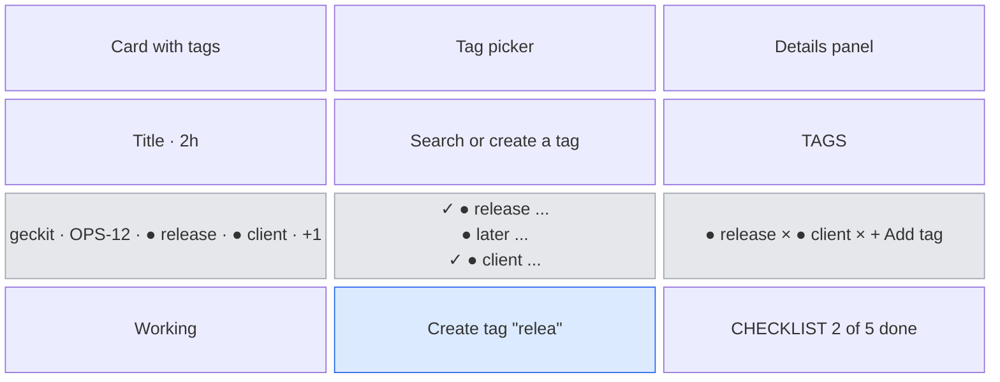
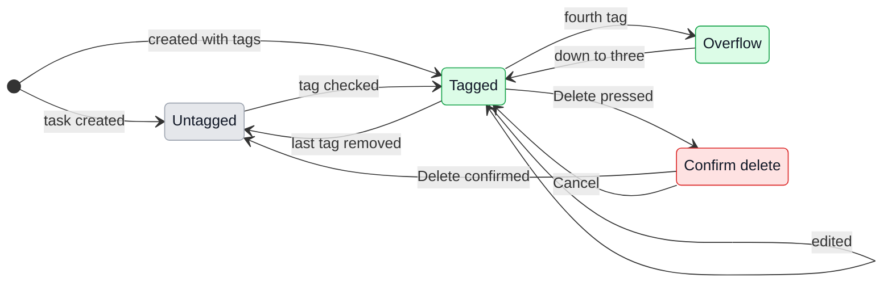

# UX: Tags on tasks

## 1. Why

The board groups tasks only by column, folder and employee. A person cannot mark tasks with their own words, such as "release", "blocked on client" or "later", and cannot see or filter by such a mark across folders. Today the workarounds are a word in the title, which a rename by the assistant can lose, or a favourite star, which is one mark with one meaning. Tags let the person mark a task the way they think about it and narrow the board to one mark.

### Path to the result

- **Entry and result:** the person right-clicks a card, opens the conversation's details panel, or starts a new task, picks or types a tag, and sees it on the card at once. The usable result is a board narrowed to that tag through Filters.
- **Readiness:** nothing to set up. The first tag is created by typing its name in the tag picker; there is no catalog to fill first.
- **Decisions and order:** the person decides only the name. The colour is given automatically and can be changed from the tag's "..." in the picker. Which tasks carry a tag and which tag the board is filtered by are independent choices.
- **Shape of the path:** one picker, the same everywhere: a search field over a list of tags with check marks, and "Create tag "<typed>"" when nothing matches. Each tag row has its own "..." with Rename, Colour and Delete, so adding, editing and deleting a tag all happen where tags are used. A separate "create a tag" dialog or a Settings page was rejected: both send the person away from the task they are marking.
- **First use and return:** the first time, the picker shows only the field and the hint. Changing a working setup (rename, colour, delete) is one step deeper than checking a tag, behind the row's "...", so a click meant to tag a task never renames or deletes one. Tags are kept with the task and survive restart, column moves, archive and model changes.

## 2. What is added

| Surface | What appears | When visible |
|---|---|---|
| Board card, desktop (existing, `Board.tsx`) | Tag chips after the project and work links, a colour dot and the name; at most 3, then "+N" | When the task has tags |
| Board list view and phone task row (existing, `PhoneBoard.tsx`) | The same chips, same limit | When the task has tags |
| Card context menu (existing) | "Tags" submenu: the tag picker; with several cards picked it applies to all of them | Always |
| Tag picker (new, opened from every place below) | Field, tag rows with check marks, "Create tag "<typed>"", and a "..." on each row: Rename, Colour, Delete | Wherever tags are changed |
| Conversation details panel, desktop (existing inspector, `TaskChecklist.tsx`) | A "Tags" section at the top, above the checklist: the chips, each with a remove button, and "Add tag", which opens the picker | In a task conversation, while the panel is shown |
| Inspector toggle in the conversation header (existing) | Tooltip becomes "Show details" / "Hide details"; the panel opens even when the task has no checklist | In a task conversation |
| Conversation header, desktop (existing, `Chat.tsx`) | Tag chips after the project; pressing them opens the picker | When the task has tags |
| Phone conversation info (existing, `PhoneInfo.tsx`) | A "Tags" row showing the tags; opens the picker as a sheet, each row with "..." for Rename, Colour, Delete | In a task conversation |
| New task form, desktop and phone (existing) | A "Tags" control beside Employee, same picker | Always |
| Filters menu (existing, `TaskFilters.tsx`) and phone filters | "Tags" page: "All tags", "No tags", then every tag with a check mark | When at least one tag exists |
| Search (existing, `Switcher.tsx`) | A tag name matches tasks carrying it, after title matches | Always |
| CLI `geckit sessions` (existing) | `sessions tag <id> --add <name> --remove <name>`, `sessions list --tag <name>`, tags in `sessions list` output | Always |

Tags sit on the card's existing metadata line, after the project and work links, so the title and state lines do not move. A tag is quieter than the project: neutral chip, colour only in its dot, so the project tint remains the strongest colour on the card. In the details panel tags come first because they are one line; the checklist below them keeps the rest of the height.

## 3. States

### A task's tags

| State | When it occurs | What the user sees | What to do |
|---|---|---|---|
| Untagged | The task has no tags | Nothing on the card or header; the panel's Tags section shows only "Add tag" | Add one from the card menu, panel or info |
| Tagged | The task has 1 to 3 tags | The chips on the card, header and panel | Change from the same places |
| Tagged, overflow | The task has more than 3 tags | 3 chips and "+N" on the card and header; the panel shows every tag | Open the panel or picker to see all |

### The picker

| State | When it occurs | What the user sees | What to do |
|---|---|---|---|
| First use | No tag exists yet | The field and "Type a name to create a tag" | Type a name, Enter |
| Listing | Tags exist, the field is empty | All tags, checked ones first, then by last used; each row's "..." shows on hover or focus | Check, uncheck, or type |
| Filtering | The field has text matching a tag | Matching tags; no create row when one matches exactly, ignoring case | Check a match |
| Creating | The field has text matching no tag exactly | Matches, then "Create tag "<text>"" | Enter or press the row |
| Too long | The text is over 32 characters | The create row is disabled with "Tag names are up to 32 characters" | Shorten it |
| Mixed | Several cards picked and they differ on a tag | That tag shows a dash instead of a check | Press it to add it to all; again to remove from all |
| Tag options | "..." pressed on a row | A menu beside it: "Rename", "Colour", "Delete" | Pick one or Escape |
| Renaming | "Rename" picked | The row becomes a field with the name, in place in the picker | Enter saves, Escape cancels |
| Name taken | The new name equals another tag, ignoring case | The field stays open with "A tag with this name exists" | Change it or Escape |
| Choosing colour | "Colour" picked | The palette swatches, the current one ringed | Pick one |
| Confirm delete | "Delete" picked on a tag carried by tasks | Dialog: "Delete tag "<name>"?" "It is removed from N tasks. The tasks stay." Cancel, Delete (destructive) | Confirm or cancel |

### The board filter

| State | When it occurs | What the user sees | What to do |
|---|---|---|---|
| No tag filter | "All tags" | The board as today | Nothing |
| Tag filter on | One or more tags chosen | Tasks carrying any of them; the Filters button dot; "Tags" row says the names | Change or "Clear filters" |
| No tags filter | "No tags" chosen | Untagged tasks only | Same |
| Nothing matches | The filter leaves no tasks | The existing "No tasks match these filters" with "Clear filters" | Clear |
| Filtered tag deleted | A chosen tag is deleted | It leaves the filter; if none remain the filter is off | Nothing |

## 4. Transitions

| From | Event | To | What the user sees |
|---|---|---|---|
| Untagged | Checked a tag in the picker | Tagged | The chip appears on the card, header and panel at once; the picker stays open for more |
| Untagged | Typed a new name and pressed Enter | Tagged | The tag is created with the next palette colour and checked; the chip appears; the field clears |
| Tagged | Unchecked its last tag, or pressed its remove button in the panel | Untagged | The chip disappears everywhere; the panel keeps "Add tag" with focus on it |
| Tagged | Checked a fourth tag | Overflow | Three chips and "+1" on the card and header |
| Overflow | Unchecked down to three | Tagged | "+N" disappears |
| Picker listing | Pressed a row's "..." | Tag options | The Rename, Colour, Delete menu opens beside the row |
| Tag options | "Rename" | Renaming | The row becomes a field with the name selected |
| Renaming | Enter with a free name | Picker listing | Every card, header, panel, filter and phone row shows the new name |
| Renaming | Enter with a taken name | Name taken | "A tag with this name exists" under the field |
| Renaming or Name taken | Escape | Picker listing | The old name stays |
| Tag options | "Colour", then a swatch | Picker listing | The dot changes everywhere |
| Tag options | "Delete" on a tag carried by no task | Picker listing | The row disappears; nothing else to confirm |
| Tag options | "Delete" on a tag carried by tasks | Confirm delete | The dialog over the picker, Cancel focused |
| Confirm delete | Delete | Picker listing | The row and every chip of that tag disappear |
| Confirm delete | Cancel or Escape | Picker listing | Nothing changes |
| Any | Picker closed by Escape, click outside or Back | Same | Changes already made stay; there is nothing to save |
| Any | Card moved to another column, archived, unarchived, resumed with another model | Same | The tags stay |
| Any | Task deleted | Gone | Nothing more; the tag stays in the picker |
| Any | Manager or a worker runs `sessions tag` | Tagged or Untagged | The chips change on the card and panel, by itself, without the user |
| Panel hidden | Inspector toggle pressed | Panel shown | Tags section at the top, checklist below |
| No tag filter | Picked a tag in Filters > Tags | Tag filter on | Board narrows; Filters button gets its dot |
| Tag filter on | "Clear filters" or "All tags" | No tag filter | Board shows everything again |

## 5. What stays silent

| State | Why not shown |
|---|---|
| A tag was added or removed | The chip appearing is the feedback; a toast repeats it |
| Manager or a worker tagged a task | The chip on the card is the result; it needs no action, so no notice, push or channel message |
| A tag carried by no task | It is still a choice the person made; it stays in the picker until deleted |
| How many tasks carry a tag | Only the delete dialog needs it, and says it there; Filters answers "which tasks" better |
| A filtered task got its tag removed by an agent | It leaves the filtered board like any card that stops matching; no explanation needed |
| Tag colour given automatically | The person sees the colour; how it was chosen does not matter |

## 6. Thresholds and time

| Number | Value | Why |
|---|---|---|
| Chips shown on a card and in the header | 3, then "+N" | The metadata line already holds the project and up to two work links; a fourth chip wraps the line on a narrow column and pushes the state line down |
| Chips shown in the details panel | All | The panel is where the whole set is read and edited; its section wraps |
| Tag name length | 32 characters | Long enough for "waiting for client review"; a chip on a card truncates with a tooltip past its width anyway, and a longer name stops being a mark and becomes a note |
| Tags per task | No limit | A limit would be an arbitrary refusal; overflow already keeps the card compact |
| Tags in total | No limit | The picker's search scales; the person owns the list |
| Colours | The existing project palette, 8 colours, rotated | One palette in the product; rotation keeps neighbouring new tags distinct without a choice |

## 7. Wording

| State | Text |
|---|---|
| Card menu item | "Tags" |
| Panel section title | "Tags" |
| Panel add button | "Add tag" |
| Panel chip remove button, for assistive tech and tooltip | "Remove <name>" |
| Inspector toggle tooltip | "Show details" / "Hide details" |
| Picker field placeholder | "Search or create a tag" |
| First use hint | "Type a name to create a tag" |
| Create row | "Create tag "<text>"" |
| Too long | "Tag names are up to 32 characters" |
| Row options button, for assistive tech and tooltip | "<name> options" |
| Row options | "Rename", "Colour", "Delete" |
| Name taken | "A tag with this name exists" |
| Delete dialog title | "Delete tag "<name>"?" |
| Delete dialog body | "It is removed from 1 task. The tasks stay." / "It is removed from <N> tasks. The tasks stay." |
| Delete dialog buttons | "Cancel", "Delete" |
| Overflow chip | "+<N>"; tooltip: the remaining names, one per line |
| Filters row | "Tags", subtitle "All tags", "No tags" or the chosen names joined by ", " |
| Filter options | "All tags", "No tags" |
| CLI unknown tag on `--remove` or `list --tag` | "No tag named "<name>"." |

## 8. Edge cases

- **Empty:** no tags at all: Filters has no Tags row, the picker shows the first-use hint, the panel's Tags section shows only "Add tag".
- **Everything at once:** a card with a work link, a host tag and five tags: project, host, links, then three tags and "+2"; the panel shows all five, wrapping; long names truncate with the full name in the tooltip.
- **Case:** "Release" and "release" are the same tag; typing either checks the existing one and keeps its original spelling. Leading and trailing spaces are trimmed; an empty name cannot be created or saved by Rename.
- **Several cards picked:** the picker applies each check to all picked cards; mixed tags show a dash. Rename, Colour and Delete act on the tag itself, the same as with one card.
- **Rename to an existing name:** refused in place with "A tag with this name exists"; merging tags is not offered.
- **Delete while filtering by it:** the tag leaves the filter; the board shows what the remaining filter allows.
- **Hosts:** a conversation on a host is tagged on this computer like any other; a disconnected host's cards keep their tags.
- **Phone and remote computers:** the phone and a paired computer read and change the tags of the computer they look at, including rename, colour and delete; tags are kept per computer, not synced between computers.
- **Connection lost (phone or remote client):** the change is held with the client's existing held calls for 60 s; the chip shows at once and is withdrawn if the call fails, with the client's existing error.
- **Repeat:** checking a tag twice quickly toggles it twice; the final state is what the picker shows.
- **Stale copy:** a phone with a kept copy shows the old tags until the link is made, then the current ones.
- **Manager:** Manager conversations have no tags; the picker, the panel section and the info row are not offered there.

## 9. What is deliberately absent

| Not doing | Why |
|---|---|
| Settings > Tags | Rename, colour and delete live on each tag in the picker, where tags are used; a second place to manage the same list would drift |
| A tag count in the picker | Only delete needs it, and its dialog says it |
| Clicking a tag chip on a card filters the board | The card is pressed to open it; a chip that changes the whole board on a near miss is a surprise. Filtering stays in Filters and Search |
| Tags as a separate pane of the details panel | Tags are one line; a pane switch would hide them behind a click. A section above the checklist shows both |
| Columns or swimlanes by tag | The board's columns are workflow states; tags narrow, they do not restructure |
| Tags per folder | The board spans folders; "release" means the same in every project |
| "All of these tags" filter | Any-of covers narrowing to a set of marks; all-of is rare and doubles the filter's wording |
| Assistant tagging tasks on its own initiative | Tags are the person's words; agents tag only when asked, through the CLI |
| Tags on shortcuts, applied to every run | Useful later; added when asked, through the same picker |
| Merging tags | Rename refusal plus delete covers it; merge is rare |
| Syncing tags between computers | Tasks themselves are per computer |

## 10. Forks

### Where tags are created

| Option | Verdict |
|---|---|
| Typed in the picker, created on Enter | Yes |
| Created only in Settings, then picked | No |

**Why:** marking a task is the intent; forcing a trip to Settings first breaks it in two.

### Where tags are renamed, recoloured and deleted

| Option | Verdict |
|---|---|
| A "..." on each tag row in the picker | Yes |
| Settings > Tags | No (reversed 2026-11-25) |
| Both | No |

**Why:** Alex asked to do it from the card (2026-11-25). The picker is the one place every tag already appears, on the card menu, the panel, the header and the phone, so one row recipe covers all of them. Settings > Tags from the first draft is dropped rather than kept as a second place: two lists of the same thing drift, and the only thing Settings added, the per-tag count, is said in the delete dialog where it matters.

### Tags in the details panel

| Option | Verdict |
|---|---|
| A section at the top of the panel, above the checklist | Yes |
| A second pane with an icon row | No |
| Only in the header | No |

**Why:** Alex asked for tags in the right panel with the checklist (2026-11-25). The panel is where a task's own settings are edited; the header has room for 3 chips and no remove buttons. A pane would hide one line of tags behind a switch. The panel therefore opens for every task conversation, not only one with a checklist, and its toggle reads "Show details".

### How a tag looks on the card

| Option | Verdict |
|---|---|
| Neutral chip with a colour dot | Yes |
| Fully coloured chip | No |
| No colour | No |

**Why:** the project tint is already the card's colour; a coloured chip competes with it. No colour makes tags hard to scan across a column.

### Filter logic with several tags

| Option | Verdict |
|---|---|
| Any of the chosen tags | Yes |
| All of the chosen tags | No |

**Why:** people pick several tags to see "release or hotfix"; requiring all of them usually empties the board.

### Agents and the CLI

| Option | Verdict |
|---|---|
| CLI reads and writes tags; Manager can tag on request | Yes |
| UI only | No |

**Why:** Manager is asked "what is on release" and "mark these for review"; without the CLI it cannot answer either.

## 11. Reconciliation with requirements

There is no feature spec; the requests are "support adding tags to tasks, it would like to mark them that way" and "make it possible to add, edit and delete tags in the card, and on the right panel where the checklist is" (2026-11-25).

| Requirement | Where covered |
|---|---|
| Add tags to tasks | Sections 2, 3, 4 |
| Mark tasks with tags visibly | Section 2, card, header and panel chips |
| Add, edit and delete tags from the card | Picker row options, sections 2, 3, 4 |
| Tags in the right panel with the checklist | Details panel section, section 2 and fork |

**What the requirements lack:** filtering, phone, CLI and agent behaviour were decided here. Data: a tag has an id, name and palette colour, kept in settings; a task keeps tag ids in its note, so a rename never touches tasks.

### Apple design UX requirements

| Requirement | How it is met |
|---|---|
| Direct manipulation | Tags are added, renamed, recoloured and deleted where they are used: the card, the panel, the phone sheet; rename is in place |
| Immediate feedback | The chip appears or changes everywhere as the action is taken |
| Forgiveness | Unchecking or the panel's remove undoes a tag; deleting a tag in use is confirmed, naming how many tasks lose it, with Delete marked destructive and not default; rename is cancelled by Escape |
| Visible next step | First use hint in the picker; the panel always offers "Add tag"; "No tasks match these filters" offers Clear |
| No surprises | Chips on cards do not filter on click; rename and delete sit behind a row's "...", so checking a tag never changes it; agent changes appear only on the tasks they touch |
| Ask late, ask once | Not applicable: no permissions or setup |
| Quiet notifications | No notifications at all (section 5) |
| Plain wording | Section 7: names the tag and the outcome |
