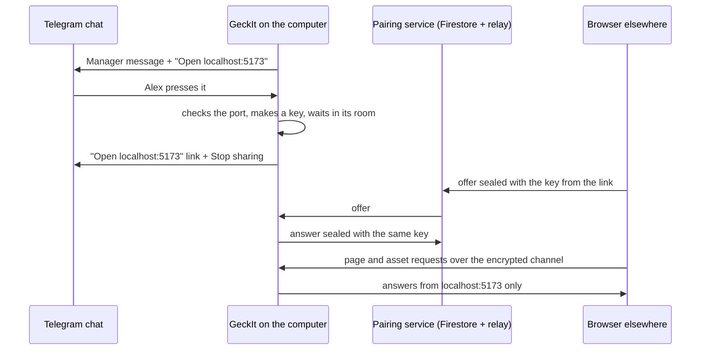
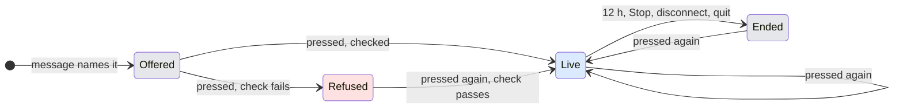
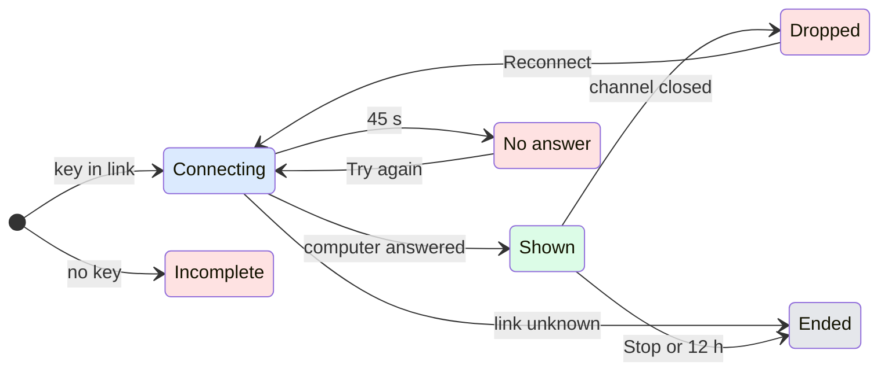

# UX: Opening a local page or file from Telegram

## 1. Why

Manager in Telegram often ends a job with "it runs at http://localhost:5173" or "the report is /Users/alex/Projects/app/report.html". Alex reads that on his phone, or on another computer, and neither the address nor the path opens there: localhost there is the phone itself, and the path is on the Mac. Today the only way to see the result is to go to the Mac, or to open the GeckIt phone app if it is paired and installed. What he asked for: "if I open, it opens website which shows local files or localhost website".

## 2. User path

1. **Entry.** A Manager message in the paired Telegram chat names a localhost address or a file or folder on the computer. Under that message are buttons, one per thing it names: "Open localhost:5173", "Open report.html", "Open docs/".
2. **Explicit choice.** Nothing is shared until Alex presses one of those buttons. Pressing is the selection: one origin (`localhost:5173`), one file, or one folder. Only the paired Telegram account can press it, which is the rule the approval buttons already follow.
3. **Ready.** GeckIt checks the target on the computer (something answers on that port, the file is still there and is not private) and replies with "Open localhost:5173" as a link button and "Stop sharing". The link has a key after the `#`. The key reaches the browser and never the web server, and it opens this one target and nothing else.
4. **Use.** The link opens a GeckIt page in any browser: Safari, Chrome, Telegram's own browser, a laptop. The page reaches the computer the same way the GeckIt phone app does, through the encrypted pairing service and its relay, and shows the website or the file. A website keeps working as it is browsed: its pages, scripts, pictures, forms and API calls go to the same localhost port on the computer. A file shows a preview or a Download button. A folder lists its files.
5. **End.** The link ends after 12 hours, on "Stop sharing", on `/links` > Stop, when Telegram is disconnected or Manager is turned off, or when GeckIt quits. An ended link opens a page that says it has ended.

"Saved" and "ready" are one moment here: the reply with the link only comes once the target was checked. Being offered a button is not sharing, and sharing is not proof that the browser can reach the computer. The page proves that by connecting.

Who does what:

The shape is a button under the message, not a command or a setting. The thing to share is already named in the message Alex is reading, so the decision sits next to it. A `/share <path>` command was weighed and rejected (section 9).

## 3. What is added

| Surface | What appears | When |
| --- | --- | --- |
| Telegram, under a Manager message | Up to three buttons "Open <target>" | The message names a localhost address, or an existing file or folder that may be shared |
| Telegram, reply to the press | Title, how long the link lasts, "Open <target>" link button, "Stop sharing" | Target checked and shared |
| Telegram, `/links` | The live links with the time left, and a "Stop <target>" button for each | Any time; "/links" is in the bot's command menu |
| Settings > Manager, under the four steps | "Shared links" list: target, time left, Stop | While at least one link is live; not inside the Telegram step, which is folded once set up and would hide a live link |
| Link page (`https://geckit-signal.web.app/#<key>`), phone and desktop browsers | Connecting, then a thin bar (target, time left, Reload) over the site, file preview or folder list | The link is opened |

## 4. States

### On the computer (per link)

| State | When | What Alex sees | What to do |
| --- | --- | --- | --- |
| Offered | A message named the target | Button "Open <target>" under the message | Press it to share, or ignore it |
| Live | The press was checked | Reply with the link; a row in Settings and `/links` | Open the link anywhere; Stop when done |
| Refused | The press found nothing there, a private file, or too many links | One reply saying which, below | What the reply says |
| Ended | 12 h passed, Stop, Telegram disconnected, Manager off, GeckIt quit | The reply's buttons disappear (while GeckIt runs); the row leaves Settings | Press the original button again for a new link |

### On the link page

| State | When | What the viewer sees | What to do |
| --- | --- | --- | --- |
| Incomplete | No key after `#` | "This link is incomplete. Open it again from Telegram." | Reopen from Telegram |
| Connecting | Dialing | "Reaching your computer..." and the step | Wait |
| No answer | 45 s with no answer | "Your computer did not answer. The link may have ended, or GeckIt is closed or offline there." + Try again | Check the computer, Try again |
| Ended | The computer says the link is unknown or past its time | "This link has ended. Press the button in Telegram again for a new one." | Go back to Telegram |
| Site | Live site link, browser has service workers | The website under the bar | Use it |
| Site, browser cannot | No service workers (some in-app browsers) | "This browser cannot show shared websites. Open the link in Safari, Chrome or Firefox." | Open in a full browser |
| Nothing on the port | The local server stopped | The site area says "Nothing answers at localhost:5173 on the computer. The server may have stopped." | Restart it there, Reload |
| File preview | Picture, PDF, text, Markdown, HTML | The preview, and Download | Read, or Download |
| File, no preview | Any other kind | Name, size, Download | Download |
| Too big | Over 32 MB | "<name> is larger than 32 MB, too big to send over this link." | Get it on the computer |
| Folder | Folder link, or a folder inside it | List of its files and folders, Up when below the shared folder | Open a file or folder |
| Empty folder | No visible entries | "This folder is empty." | Up |
| Dropped | The channel closed while open | "The connection to your computer was lost." + Reconnect | Reconnect |

## 5. Transitions

| From | Event | To | What Alex sees |
| --- | --- | --- | --- |
| (none) | Manager message names a localhost address or a shareable path, automatically | Offered | Buttons under the message |
| Offered | Paired account presses the button; target checks out | Live | Reply with "Open <target>" and "Stop sharing" |
| Offered | Pressed; nothing answers / file gone / private / 20 live | Refused | One reply naming the reason |
| Refused | Pressed again after fixing it | Live | Reply with the link |
| Live | Pressed again | Live, same link | "<target> is already shared. The link ends in <time>." with the same buttons |
| Live | "Stop sharing", `/links` Stop, or Stop in Settings | Ended | "Stopped sharing <target>. The link no longer opens."; its buttons are removed |
| Live | 12 hours pass, automatically | Ended | The reply's buttons are removed; nothing is sent |
| Live | Telegram disconnected or Manager turned off | Ended | Nothing in Telegram (it is disconnected); the Settings list empties |
| Live | GeckIt quits | Ended | Nothing; after restart the old link page says it has ended or got no answer |
| Ended | The original "Open <target>" is pressed again | Live | A new link; the old one stays dead |
| Any | Someone other than the paired account presses a button | Unchanged | Nothing |

| From | Event | To | What the viewer sees |
| --- | --- | --- | --- |
| (none) | Page opened without a key | Incomplete | "This link is incomplete..." |
| (none) | Page opened with a key | Connecting | "Reaching your computer..." |
| Connecting | Computer answered and the link is live | Shown | Bar and content |
| Connecting | Computer answered, link unknown or expired (only in the moment a link ends; afterwards nothing waits in its room, so an ended link reads as No answer) | Ended | "This link has ended..." |
| Connecting | 45 s pass with no answer | No answer | Message + Try again |
| No answer | Try again | Connecting | Steps again |
| Shown | Viewer presses Reload | Shown | The site starts again at its first page; a file or folder is read again |
| Shown | Channel closes (network, computer asleep, GeckIt quit) | Dropped | Message + Reconnect |
| Shown | Link stopped or expired: the computer says so on the open channel, then closes it | Ended | "This link has ended..." |
| Dropped | Reconnect | Connecting | Steps again |
| Folder | Opens a folder or file | Folder / File | The list, or the preview |
| File / Folder | Up or the browser's Back | Folder above | The list it came from |

Every state has a way out: an action, the 45 s limit, or going back to Telegram.

## 6. What stays silent

- **Who opened a link.** No "someone opened your link" message. The link is Alex's own, opened mostly by Alex. A notice for every visit would be noise, and Stop is always at hand.
- **Expiry in Telegram.** Only the buttons go. Expiry is expected, so a message about it would be noise.
- **Buttons for a path that is not there or is private.** No button is offered at all, so there is no button that can only fail. A localhost address always gets a button, because the server may start later. Whether the port answers is checked when the button is pressed.
- **The key.** It is never written as text in the chat or on the page. It sits only in the button's address, and Telegram's link preview is off for these replies.
- **Live reload.** WebSockets do not cross the link, the same as in the phone app, so a dev server's hot reload stays quiet. The page still works and Reload fetches the new version.

## 7. Thresholds and time

| Number | Why |
| --- | --- |
| 12 hours per link | A working day of checking a running app from elsewhere without asking again. It matches the 12 h after which GeckIt already stops a host run nobody looked at, so a forgotten link dies on the same scale as forgotten work. |
| 20 live links | Each live link keeps a room open in the pairing service and a check-in every 30 s. Twenty is more than a day needs, and a cap keeps a looping Manager from opening hundreds. |
| 3 buttons per message | A row of buttons has to stay readable on a phone. A message naming more lists them in the text, and the first three get buttons. |
| 60 offers kept | Buttons are remembered across restarts with the other Telegram callbacks, which Telegram already caps at 256 waiting. The oldest offers fall away first, and a tap on one says it is no longer available. |
| 45 s to connect | The phone app's dial limit, long enough for a cold pairing service on both sides. |
| 32 MB per answer | The phone app's localhost limit. A dev server's largest bundle is well under it. |

## 8. Exact wording

Telegram:

- Offer button: "Open localhost:5173", "Open report.html", "Open docs/"
- Shared: "**localhost:5173 is shared for 12 hours.**\nOpen it from any phone or computer while GeckIt stays open here. Anyone with this link can see it until it ends." Buttons "Open localhost:5173" (link) and "Stop sharing".
- Pressed again: "**localhost:5173 is already shared.** The link ends in 7 h." with the same buttons.
- Stopped: "Stopped sharing localhost:5173. The link no longer opens."
- Nothing on the port: "Nothing answers at localhost:5173 on your computer. Start it there, then press the button again."
- File gone: "report.html is no longer on your computer."
- Private: "GeckIt does not share hidden files, keys or your whole home folder. Ask Manager for the project folder or the single file instead."
- Too many: "20 links are already shared. Stop one with /links, then press the button again."
- Manager off: "Manager is disabled. Enable it in GeckIt Settings → Manager before sharing." (the existing sentence form)
- `/links` with links: "**Shared links** (2)\n• localhost:5173 - ends in 11 h\n• report.html - ends in 2 h", buttons "Stop localhost:5173", "Stop report.html".
- `/links` with none: "Nothing is shared. A button appears under a Manager message that names a localhost address or a file."
- Command menu: "links - What is shared and how to stop it"

Settings > Manager:

- Heading "Shared links"; row "<target>" and "Ends in 11 h"; button "Stop" (read as "Stop sharing <target>").
- After the last one is stopped there: "Nothing is shared now." It takes the focus the Stop had and goes when Settings is next opened. Stopping one that is not last moves the focus to the next Stop.

Link page:

- Connecting steps: "Reaching your computer..." with "Asking the pairing service...", "Waiting for your computer...", "Connecting..."
- Bar: "<target>" and "Ends in 11 h"; button "Reload". A single file's Download is in the bar too; inside a folder each file has its own line with its name, size and Download.
- The other states use the texts in the link page states table above.
- Download button: "Download"
- Folder up: "Up"

## 9. Edge cases

- **Two Manager messages name the same target.** Both buttons lead to the one live link. A second press does not make a second key.
- **A URL on another loopback name** (`127.0.0.1`, `0.0.0.0`, `[::1]`) is the same port on the computer, and its button says what was written.
- **A path relative to a project** ("`src/report.html`") is not offered. Manager's messages are not tied to one project root, and guessing a folder could share the wrong file. Only absolute and `~/` paths are offered.
- **A redirect** from the site to another port or host is not followed; it reaches the viewer as the redirect itself. Redirects within the same port are followed, as in the phone app.
- **A folder holding hidden files** (`.env`, `.git`): they are left out of the list and refused if asked for by name. A symlink that leads out of the shared folder is refused.
- **A file renamed or deleted after sharing:** the page says it is no longer on the computer.
- **Several links open in one browser.** Each tab keeps its own connection. A page from one site that navigates by a root address (`/about`) goes to the site most recently opened in that browser. Both are links the viewer already holds, so nothing new is exposed.
- **A link inside the site opened in a new tab** lands on a GeckIt page that says to go back to the tab the link opened. The new tab has no connection of its own.
- **Another link pasted into the same tab** changes only what is after the #: the page loads again for the new link.
- **GeckIt restarts.** Every link ended. The old "Open <target>" buttons still work and make new links.
- **The phone app is paired too.** Unrelated: the phone keeps its own room and key, and a link key opens none of the phone's calls.
- **A conversation on an SSH host** names its own localhost. Manager's messages run on this computer, so a link always means this computer's localhost. Opening a host's port from here stays the existing forward in the phone app.

## 10. Deliberately not included

- **A `/share <path>` command.** It would let a message typed in Telegram, or a stolen Telegram session, pick any path on the computer. A button under GeckIt's own message keeps the choice to what Manager already showed.
- **A public tunnel (ngrok, Cloudflare Tunnel).** It needs a new account and a public address per port, and anyone who finds it reaches the server directly. The pairing service already reaches this computer from anywhere, encrypted end to end.
- **The page served from the computer over the local network.** It works only on the same Wi-Fi, which is not where Alex reads Telegram.
- **The GeckIt phone app as the only way.** Telegram does not open custom app links from bot buttons on every platform, and a laptop has no phone app. Links on the GeckIt app remain as they are.
- **Hot reload / WebSockets.** A service worker cannot carry them. It is the same limit as in the phone app.
- **Links that survive a restart.** Keeping keys on disk adds a secret store for convenience. A new press is one tap.
- **A notice for every visit**, see section 6.

## 11. Decisions

| Question | Verdict | Why |
| --- | --- | --- |
| Transport | The existing pairing service: Firestore rooms, sealed offers, Cloudflare relay | Already reaches this computer from anywhere, encrypted, and its rules take any room without a change |
| Where the page lives | A static page on Firebase Hosting in `geckit-signal` (`geckit-signal.web.app`) | Same project as the rooms and relay; hosting is free there. **Not deployed yet**: a public deployment needs Alex's go. |
| Key per link, not the phone key | Per link | The phone key opens every phone call; a link must open one target only |
| Who may create | The paired Telegram account, by a button GeckIt itself offered | Matches the approvals rule; nothing typed picks a path |
| Lifetime | 12 h, Stop, disconnect, quit | See section 7 |
| Preview in Telegram | Off for share replies | A preview fetch never runs the page, but it would show a blank card |

## 12. Requirements check

Covers: open a localhost site or an explicitly chosen file or folder in a browser on another device, from the paired Telegram chat. Access is scoped to the pressed target. The link has a lifetime and can be revoked. The unavailable states are named. Assets, navigation and API calls are proxied, WebSockets are not. Files are previewed or downloaded safely, with path traversal refused.

Not covered: the public page is not deployed (Firebase Hosting needs `firebase deploy --only hosting` from `signal/`). Real use from another network needs the relay keys already used by the phone app.
