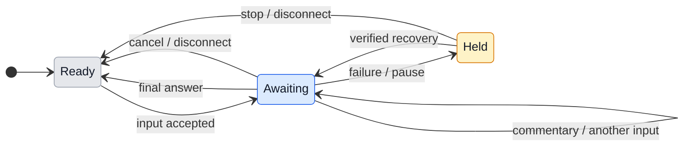

# UX: Telegram typing while Manager answers

## 1. Purpose and journey

Alex sends text, a reply, a photo or a document with an optional caption to the already paired private bot. Instead of a permanent "Sent to Manager." bubble, Telegram shows its native typing status until Manager finishes answering that input. Pairing and Manager must already be enabled and connected; a stored token alone does not mean ready. Existing setup, permission cards and recovery remain the route when those prerequisites fail. No new setting or setup step is needed. Alex explicitly requested this behavior on October 24.

## 2. Surfaces

| Surface | Change | When visible |
|---|---|---|
| Existing Telegram private chat header | Native `typing` action | At least one accepted input is awaiting an answer and delivery is not known blocked |
| Existing Telegram transcript | Omit successful ordinary "Sent to Manager." acknowledgement | Text, reply, caption and attachment forwarding succeeds |
| Existing error, approval and recovery messages | Retain their useful text and controls | Their existing conditions |

No GeckIt renderer layout changes. Telegram owns localization, animation, light/dark styling, focus, keyboard, scrolling and viewport behavior. A separate HTML prototype would not verify native Telegram rendering.

## 3. States

| State | Condition | What Alex sees | Next action |
|---|---|---|---|
| Ready | Paired and enabled; no pending input | Nothing new | Send a request |
| Awaiting | Inbound dispatch or accepted queued/active request | Native typing status, localized by Telegram | Wait or send another clarification |
| Commentary | Intermediate message while the request still awaits completion | Message, then typing resumes | Continue waiting |
| Complete | Final answer for this input | Answer; typing ends unless another input remains | Read or reply |
| Held or failed | Pause, permission, unsupported/failed delivery, disconnected host | Existing useful failure/recovery/permission message; typing is not extended | Use the existing recovery or approval flow |

## 4. Transitions

| From | Event | To | What Alex sees |
|---|---|---|---|
| Ready | Authorized input begins dispatch, automatically | Awaiting | Native typing; no acknowledgement bubble |
| Awaiting | Four seconds pass with live pending work, automatically | Awaiting | Typing refreshes |
| Awaiting | Bot sends intermediate text or file, automatically | Awaiting | Message; typing reasserted while pending remains |
| Awaiting | Final response completes one correlated input, automatically | Awaiting or Ready | Final answer; other queued inputs retain typing |
| Awaiting | Dispatch fails, Manager is blocked/paused, permission needs a person or provider is unsupported, automatically | Held | Existing useful recovery; no false ongoing typing |
| Held | Existing guarded recovery confirms pending work is eligible again, automatically | Awaiting | Typing can resume; no user message or mutation is replayed by the indicator |
| Any | Stop, shutdown, lost connection or changed pairing/chat, automatically | Ready | Refresh stops; Telegram expires its last action |
| Restart | Host restores durable Manager state, automatically | Ready or Awaiting | Resume only verified eligible pending work; interrupted delivery stays uncertain |

## 5. What stays silent

Typing failures, refreshes and backoff do not add chat messages or affect instruction delivery. Unrelated worker updates cannot create pending input. Duplicate update IDs cannot create duplicate pending work. No percentage, provider-consumption claim or automatic approval is implied.

## 6. Timing and API constraints

[Official Bot API](https://core.telegram.org/bots/api#sendchataction) gives actions a lifetime of five seconds or less and clears them when a bot message arrives. Refresh every four seconds while eligible; reassert after intermediate output. There is no stop-typing method: on completion stop refreshing and allow the last action to expire within Telegram's limit. One in-flight action per connection; failures back off from four seconds to a sixty-second cap and respect Telegram `parameters.retry_after` without replaying user input. Connection abort cancels pending action requests and scheduled refreshes.

## 7. Wording

Success has no new text. Remove "Sent to Manager." for ordinary forwarding. The native client supplies the localized typing label. Existing "Manager paused. Existing workers continue.", "Manager resumed.", decision acknowledgements and failure/recovery text retain their meaning.

## 8. Edge cases

Multiple inputs are identified independently, including queued inputs. One final must not settle a different input. Commentary followed by CLI-result continuation is still the same pending response; a terminal response with no continuation ends it. Native permission or known delivery holds suppress typing instead of pretending the model is progressing. Stop/disconnect and pairing replacement invalidate in-flight callbacks. An action API failure may create a visible gap but cannot reject or retry Manager dispatch. A failed outbound message stops the indicator until fresh authorized input or explicit connection recovery; its existing failure notice remains. Persisted queue state is authoritative after restart; only pending input IDs owned by this paired connection can resume the indicator. A new pairing never inherits the previous chat's work. The timer itself is never persisted.

## 9. Intentionally absent

No persistent success bubble, user toggle, global worker-busy timer, fake progress bar, mutation replay, automatic resend, permission bypass or new pairing. No live bot restart or test messages to Alex as part of fixture verification.

## 10. Decision

Use request-correlated Manager lifecycle, not session busy status. Busy status includes worker-event and CLI work unrelated to a particular incoming request; a bare timer could remain forever or end on the wrong answer. Native typing replaces the October 17 successful-forwarding acknowledgement; errors and decisions stay explicit.

## 11. Acceptance evidence

Controlled clock and Bot API fixtures must cover refresh beyond five seconds; commentary then final; command-result continuation; overlapping and queued inputs; dispatch failure; API failure/rate limiting; cancellation, stop, disconnect, pairing change and restart without stale refresh or replay. Exercise the real transport and Manager/Sessions integration at substituted external boundaries. Native Telegram appearance and delivery on the running account require the changed host to be loaded and a user-authorized real request; fixture tests must not be called live verification.
