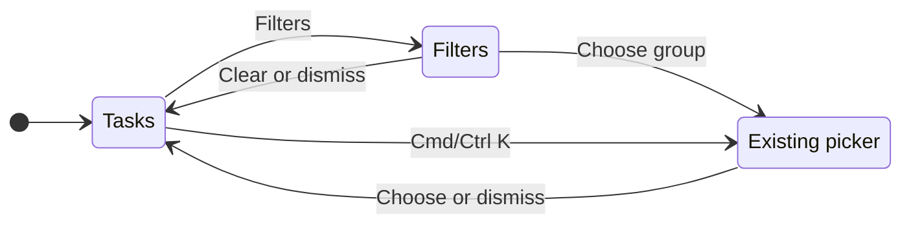

# Compact task toolbar

## Why and user journey

The toolbar repeats default folder, employee and computer names, making routine work look crowded. Open Board or List, search or create a task directly, and open Filters only to narrow the list. Filters groups Folders, Employees and, in Board, Visible columns. Each row shows its current selection and opens the existing picker. Selection applies immediately through the existing settings/scope handlers. Closing and returning preserves it. No connection or new setup is required for filtering.

## Surfaces

| Surface | Change | When |
|---|---|---|
| Desktop Board/List toolbar | One icon named "Filters" replaces folder/employee controls and separate column options | Always |
| Filters menu | "Folders", "Employees", "Visible columns", and "Clear filters" with current values | On demand; columns only in Board; clear only when folder/employee filtering is active |
| Filters button | Active dot and tooltip describing selections | Folder, employee or column restriction active |
| Computer selector | Local display icon, without "This computer" text or chevron; tooltip and accessible name remain | Local workspace, whether remote computers are saved or not |
| Remote computer selector | Existing computer name, connection state and menu | Remote workspace |
| Phone Tasks | Existing folder/employee controls | Unchanged; compact desktop toolbar is not its primary navigation |

## States

| State | What appears | Next action |
|---|---|---|
| Defaults | Filters icon, no filter dot unless columns are restricted | Open Filters or work normally |
| Filtered | Filters dot; tooltip names folders/employees/columns | Open Filters to inspect, change or clear |
| Filters open | Current selections grouped in one menu | Choose a row, Clear filters or dismiss |
| Folder/employee/column picker | Existing picker with search, checks and current value | Choose or dismiss |
| Local | Display icon, tooltip "This computer · Choose computer" | Open computer menu if needed |
| Remote | Name and actual connection state | Switch or manage connections through existing menu |

## Transitions

| From | Event | To | Visible result |
|---|---|---|---|
| Tasks | Click Filters / focus and Enter | Filters | Current folder, employee and column values |
| Filters | Choose Folders, Employees or Visible columns | Picker | Existing selection UI |
| Picker | Choose folder/employee | Tasks | List narrows and filter dot appears; settings persist where already supported |
| Column picker | Toggle column | Same picker | Column changes immediately; picker stays open |
| Any menu | Escape or click outside | Tasks | Selections stay; Escape restores toolbar focus |
| Filters | Clear filters | Tasks | All folders and employees; column layout remains as chosen |
| Tasks | Cmd/Ctrl+K | Folder picker | Existing folder shortcut preserved |
| Local | Choose saved computer | Remote, once connected | Existing switching behavior, remote name stays visible |

## What stays silent

Default folder/employee values stay inside Filters. Local name stays inside the computer menu and tooltip. Successful filtering has no toast. Search, Team, Manager, Settings, questions and New task retain their existing behavior.

## Time and thresholds

No delays or timers. One dot indicates any active restriction; it is not a task count. Menu contents use current state rather than a separate saved form.

## Exact wording

"Filters", "Folders", "Employees", "Visible columns", "Clear filters", "All employees", "Unassigned", "Employee unavailable", "All columns". Folder summaries reuse the existing folder picker. Tooltip: "This computer · Choose computer" locally; remote name/state retain existing wording.

## Edge cases

No employees still permits All employees/Unassigned. An archived employee with assigned tasks remains selectable. An unavailable selected employee is named as unavailable. Long folder/employee names stay inside a scrollable picker; remote names remain truncated in the toolbar with the full name in its tooltip. Folder multiselect, host folders, hidden conversations and adding folders continue through the existing picker. Disconnect and reconnect retain their existing treatment.

## Deliberately absent

No duplicate filtering controls, permanent default-value chips, separate filter view, new connection flow or hidden remote identity. Clear filters does not reset the preferred board layout.

## Decisions

Use the current menu and picker components instead of introducing another form or a new visual style. Grouping takes one additional selection to reach an existing picker and removes the always-visible defaults. Keep a small local computer icon so connecting another computer remains discoverable; expand the identity only for a remote workspace.

## Requirements check

The user's requested single filter entry and smaller local-computer control are covered. This is a refinement of existing filtering and switching, not a separate product feature. Implementation proceeds under the user's requested toolbar change.
