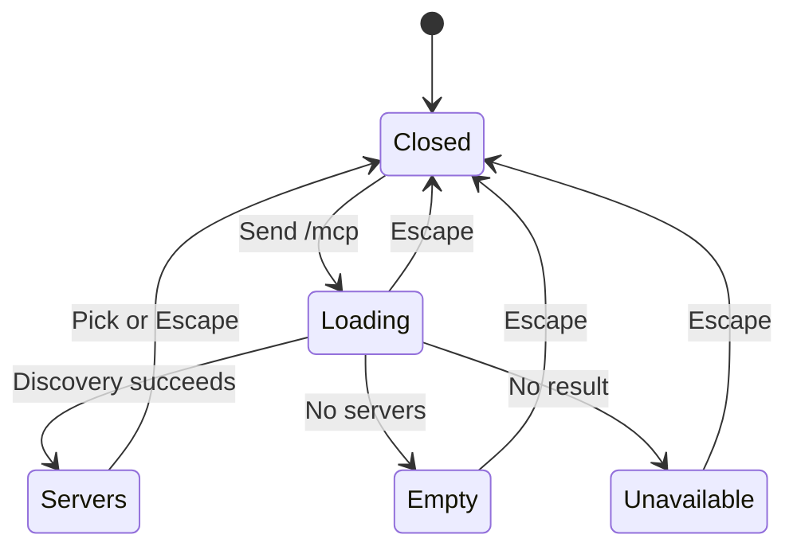

# Typed MCP menu

## 1. Purpose and path

In an existing desktop Claude conversation, typing `/mcp` alone and pressing Send opens the existing MCP menu. It clears the draft and does not send a model turn. The person selects a server to toggle it for the project. Existing MCP discovery and native permission boundaries apply. Closing and returning leaves the menu closed; reopening asks for current servers. This reuses the existing menu because the command is another entry point to the same action.

## 2. Surfaces

| Surface | Change | When |
| --- | --- | --- |
| Composer | Intercepts `/mcp` | Desktop, project selected, Claude-compatible provider |
| MCP picker | Opens from typed command and moves focus into an enabled server | After discovery |
| Shared Picker | Optional opening counter | Only callers supplying it |

## 3. States

| State | Condition | Visible text | Action |
| --- | --- | --- | --- |
| Closed | Before command, after dismissal | "MCP" | Type command or press button |
| Loading | Discovery pending | "Asking Claude Code..." | Wait or dismiss |
| Empty | No servers | "None in this folder" | Dismiss; configure servers separately |
| Unavailable | No discovery result | "Claude Code did not say" | Dismiss and reopen |
| Servers | Discovery succeeds | Server names and current states | Arrow keys and Enter toggle one |

## 4. Transitions

| From | Event | To | Visible result |
| --- | --- | --- | --- |
| Closed | Send exact `/mcp`, with surrounding whitespace allowed | Loading | Draft clears; existing menu opens; no model message |
| Loading | Discovery answers automatically | Servers, Empty or Unavailable | Corresponding text above; enabled server receives focus |
| Servers | Enter or pointer selects a server | Closed | Existing native toggle request; reopening reads updated state |
| Any open state | Escape or outside click | Closed | Menu closes; keyboard opening restores opener focus |
| Closed | Return to conversation | Closed | No automatic reopening |

## 5. Quiet states

Opening counter and native request bookkeeping have no separate UI. A command with arguments, Codex command or phone command follows the existing send path.

## 6. Timing

No new timer or polling. Discovery and its existing response determine readiness; only enabled rows receive focus.

## 7. Wording

Exact state text is in section 3. Existing note: "Switched for every conversation in this folder, as /mcp does."

## 8. Edges

Empty and unavailable menus remain dismissible. Long server lists scroll using the existing Menu. Repeated typed commands reopen after dismissal. A remounted picker records its initial counter without opening. Phone and Codex preserve their existing behavior; `/mcp arguments` is sent normally.

## 9. Exclusions

No new MCP configuration, permission grants or Codex MCP menu. No model turn for the supported desktop command.

## 10. Decision

Reuse the existing picker and its native toggle handler. A separate dialog would duplicate the same operation and states. This documents the existing completed source commit `21e4b1318d182435c42d09d8e080a7890935264b` during authorized integration; it introduces no broader product flow.

## 11. Acceptance

Verify interception, native boundary call, keyboard focus/arrows/Escape, dismissal/reopen, loading/empty/unavailable, long lists, light/dark and narrow desktop; verify phone and Codex continue sending. Renderer fixtures substitute native calls only; real provider discovery and model accounts are outside this Git integration check.
