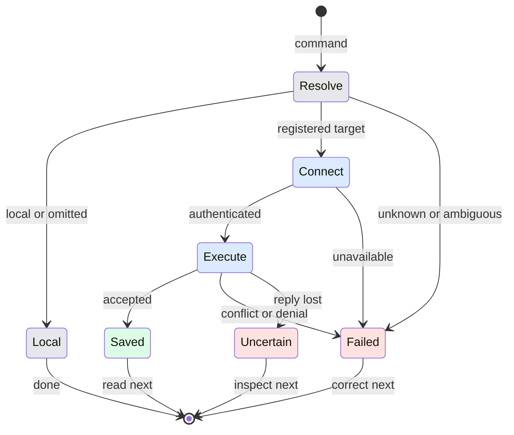

# Unified CLI target selection

## Purpose and path

From a terminal or authenticated Manager, list registered computers, select a stable ID with `--host`, inspect target capabilities and current values, submit a named update with expected values, then read back. A successful write means saved configuration; it does not prove account login or provider readiness. Missing dependencies are corrected before retrying. Existing native authentication and user-bound approval cards remain the only way to answer protected interactions.

## Surfaces

| Surface | Change |
| --- | --- |
| CLI | Ordinary commands accept `--host`; `--computer` remains an alias |
| capabilities/help/schema | Target-specific support and native-only boundaries |
| Manager | Target included in operation identity and confirmation text |
| Native UI | Existing cards and sign-in flows; no new layout |

## States and wording

| State | Output | Next action |
| --- | --- | --- |
| Local | Normal command output | Inspect or edit |
| Remote | Selected computer's command output | Read back on the same target |
| Unknown | "No paired computer is called <name>." | List computers and select an ID |
| Ambiguous | "More than one computer is called <name>. Use its id from geckit computers." | Use stable ID |
| Conflicting target | "Name one host using --host or --computer." | Supply one selector |
| Unsupported | Explicit target capability failure | Update target or use its native flow |
| Unavailable before dispatch | Target connection failure | Reconnect and inspect capabilities |
| Uncertain after dispatch | "Delivery is uncertain"; no automatic replay | Read the same target state before retrying |
| Stale values | Setting/provider changed; read and merge | Fresh read |
| Native approval | Existing bound Allow/Refuse card | Person answers in native UI |

## Transitions

| From | Event | To | User sees |
| --- | --- | --- | --- |
| Resolve | Explicit local or omitted | Local | Normal command result |
| Resolve | Unique registered target | Connect | Nothing while authenticating |
| Resolve/Connect | Resolution or authentication fails | Failed | Target error, nonzero exit |
| Execute | Target accepts write | Saved | Save receipt |
| Execute | Values changed or permission denied | Failed | Conflict or denial; no fallback |
| Saved | User requests fresh state | Resolve | Read-back result |

## Silent state and timing

Connection setup stays silent; the command emits its result or error. Existing transport timeouts remain bounded; no automatic mutation replay is added. Exiting and returning requires a new invocation and fresh read for uncertain writes.

## Edge cases

IDs win over names; duplicate names require IDs. Empty or repeated selectors fail. `--` ends option parsing. SSH execution hosts are distinct from paired GeckIt computers: an SSH registration alone cannot configure a remote GeckIt service. Disabled providers remain disabled until an explicitly authorized product action; active, queued, held and closing runtimes prevent unsafe disable. Defaults, project choices, enabled task shortcuts and enabled Manager dependencies must be moved explicitly. Install/reinstall leaves a library disabled. Idle runtimes have an explicit release request; disable rechecks closure. Concurrent preference writes use expected values.

## Deliberate exclusions and decisions

No automatic SSH shell fallback, credentials printing, assistant-native approval answering or automatic provider enabling. Reuse paired `cli:run` and product handlers, because a second remote command family would diverge. No new layout is introduced. The existing Manager confirmation card is reviewed in the actual ManagerChat renderer using `client/test/browser/cli-product/`; only its native-answer boundary is a fixture. User has explicitly authorized implementation of this behavior; no separate design approval gate is inferred.

## Authority and lifecycle

An operator uses authenticated local RPC. Manager uses its session/operation grant and a bound native Allow/Refuse card; remote writes require an immutable registered ID and authority is rechecked after dialing. Target Manager authority permits configuration and session reads, while session writes go through `manager send` and its ownership checks. Worker sessions cannot borrow the operator configuration surface. Safe local preferences retain existing confirmation behavior. Remote mutations are explicit source confirmations; secrets and permission/team answers remain native. Manager instruction writes synchronize guides through the existing expected-instructions flow. Application restart is never implicit; Manager restart only recovers its conversation. Automatic intake remains retired, with retained disabled source configuration and Manager shortcuts available.

## Requirements

FR-001/002: target path and errors. FR-003/004: inspect, validated update and read back. FR-005: approval boundaries. FR-006/007: coverage matrix and recorded verification.
