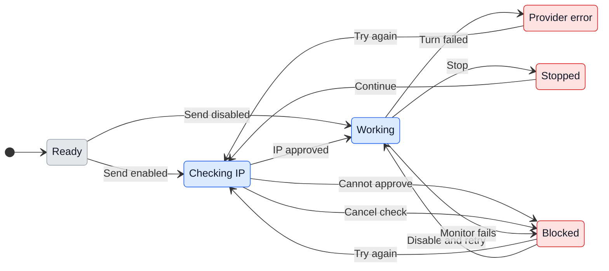

# UX: Check the VPN public IP before sending

## 1. Why

Alex wants GeckIt to hold a new message or continuation when the computer's public IP is outside his VPN addresses. The refusal must happen before conversation information reaches the assistant. He also wants a visible Try again action after errors, like Continue after Stop. On 2026-10-11 he approved checking every 10 seconds during active work, stopping on mismatches or verification failure, holding queues and requiring manual retry.

## 2. What is added

| Surface | What appears | When visible |
| --- | --- | --- |
| Desktop Settings > VPN IP check, existing dialog | VPN IP check group: one VPN IP check switch, approved-address field, Save addresses and scope notes | VPN IP check is open |
| Phone Settings, existing screen | VPN IP check page for the paired computer, with the same effective setting | The page is opened |
| New task or question, existing conversation view | Local unsent conversation with blocking explanation and Try again; retained text and attachments | Starting was blocked before a provider session exists |
| Conversation transcript, existing end action | Blocking or provider error explanation and Try again in the position of Continue | The last operation failed and work is not running |
| Board and phone row, existing state line | Existing blocked/error attention treatment | A saved conversation has a blocked operation |
| Queued message, existing queue UI | Its message stays queued with the blocking explanation; retry resumes that message's dispatch | Dispatch was blocked |

Controls use the product's existing settings and conversation hierarchy. The explanation precedes one main recovery action, Try again; settings remains reachable through its existing entry point. A successful check produces no extra banner.

## 3. States

| State | When | What Alex sees | What he does |
| --- | --- | --- | --- |
| Off | Switch is off | "Check public IP before sending" is off | Enables it when wanted; sends normally |
| Address edit | The local address field differs from the saved list | "Approved public IP addresses" and "Save addresses" | Saves or closes to discard the edit |
| Invalid edit | One or more entries fail validation | "Enter a public IPv4 or IPv6 address on each line. Invalid address: {entry}." | Corrects the named entry; saved configuration remains effective |
| Ready | Enabled with saved valid addresses; no check underway | No ongoing status; the scope note remains in Settings | Sends or continues |
| Checking | A guarded operation is awaiting verification | "Checking public IP..." and a "Sending..." composer control with spinner and cancellation cross | Waits, or cancels; retry/send is disabled for that operation |
| IP mismatch | A verified usable public IP is not approved | "Not sent. This computer's public IP is {ip}, which is not in your approved VPN IPs. Connect your VPN, then try again." | Connects the VPN and presses Try again, or changes Settings |
| Check unavailable | Verification failed or a usable address family could not be verified | "Not sent. GeckIt could not verify this computer's public IP. Check your connection and VPN, then try again." | Repairs the connection and presses Try again |
| Configuration missing | Enabled list is empty or unusable | "Not sent. VPN IP check is on, but no valid public IP addresses are saved. Add your VPN IPs in Settings." | Fixes the list or disables the guard, then retries |
| Cancelled check | Alex cancelled the pending check | "Not sent: public IP check cancelled. Try again when you are ready." | Leaves the operation unsent or deliberately retries |
| Working | Check passed and operation was accepted | Existing assistant working state | Waits, queues another message or stops |
| Periodic monitoring | VPN IP check is on and GeckIt owns active session work | Existing working display; periodic checks stay silent | Continues working normally |
| VPN stop | A periodic check mismatches or cannot verify | "Paused by VPN IP check." followed by the same specific IP/configuration/connection explanation, without the before-send "Not sent." prefix | Fixes connection/settings and presses Try again to continue |
| Provider error | A started turn ended with an error | Existing provider error plus "Try again" | Retries to continue that conversation |
| Stopped | Alex pressed Stop | Existing stopped note plus "Continue" | Continues when wanted |

All dynamic address text stays selectable. Public addresses are diagnostic text, not clickable links.

## 4. Transitions

| From | Event | To | What Alex sees |
| --- | --- | --- | --- |
| Ready, guard off | Presses Send, Continue or Try again | Working | Existing working display; nothing about IP |
| Ready, guard on | Presses Send or Continue, or a queue/schedule/goal follow-up reaches dispatch automatically without Alex | Checking | "Checking public IP..."; draft or queued operation remains held |
| Checking | Verification approves the current address and current saved settings, automatically without Alex | Working | The checking line goes; the operation appears once as sent |
| Checking | Verification mismatches, times out or fails, automatically without Alex | Blocked | One specific explanation and Try again; nothing sent |
| Checking | Settings change before completion | Checking or Blocked | Result for old settings is discarded; current rule decides; no send while unresolved |
| Checking | Presses the cancellation cross in Sending | Blocked | Dispatch is cancelled; no late lookup result sends it. Unsent content remains available for deliberate Try again |
| Checking or Blocked | Cancels the queued message | Ready | The selected queued message is removed; no late lookup result sends it |
| Blocked | Connects VPN without pressing anything | Blocked | The explanation stays; nothing starts automatically |
| Blocked | Presses Try again | Checking | Fresh check of the same saved operation; button disabled until checking, stop acknowledgement and dispatch complete |
| Blocked | Edits approved addresses or disables the guard | Blocked | Settings update; held work waits until a deliberate retry |
| Blocked, guard now off | Presses Try again | Working | Existing working display; no lookup |
| Blocked | Cancels pending queued work | Ready | The cancelled operation cannot send later |
| Blocked | Sends another message | Blocked | The new message queues behind the held operation; neither starts automatically |
| Working | Periodic check passes, automatically without Alex | Working | Nothing extra; no banner or focus change |
| Working | Periodic check mismatches or fails, automatically without Alex | Blocked | GeckIt interrupts active work, holds queues and shows the VPN stop explanation with Try again |
| Working | Enables VPN IP check | Working or Blocked | First shared check starts immediately without a banner; failure applies the same stop behavior |
| Working | Disables VPN IP check while a periodic check is underway | Working | Monitoring ends; any obsolete result cannot stop work |
| Blocked after VPN stop | VPN returns without Alex retrying | Blocked | Work remains held; no automatic restart |
| Blocked after VPN stop | Presses Try again | Checking | Fresh before-send check; resume saved unsent work or continue started work, preserving unrelated draft |
| Working | Turn finishes automatically without Alex | Ready | Existing completed answer; no retry button |
| Working | Turn fails automatically without Alex | Provider error | Existing error with Try again |
| Provider error | Presses Try again | Checking, or Working if disabled | Fresh check, then a continuation of the same session; original prompt is not replayed |
| Provider error | Dismisses the error or submits a different message | Ready or Checking | Previous end action clears; new message follows the same gate |
| Working | Presses Stop | Stopped | Existing stopped note and Continue |
| Stopped | Presses Continue | Checking, or Working if disabled | Fresh check, then existing continuation behavior |
| Stopped | Leaves the conversation stopped or marks it manually | Ready | No model submission |

The compact diagram's retry/continue arrows show the enabled case; the table defines disabled behavior too. Closing a conversation only hides it and retains pending work. Returning reveals the same blocked state.

## 5. What stays quiet

| State | Why it is not shown |
| --- | --- |
| Successful check | The assistant working is sufficient confirmation |
| Guard off | No IP discovery, polling or session badge is needed |
| Connection recovered without a retry | Starting work requires Alex's action after an error |
| Internal check service details during each send | Disclosed once in Settings; the session only needs the result |
| Periodic check in progress or passed | Working already provides sufficient status; no ten-second status flicker |

## 6. Thresholds and time

| Number | Meaning | Reason |
| --- | --- | --- |
| 10 seconds | Entire verification attempt must succeed or report a blocking error | Avoids an indefinite disabled composer on a broken connection |
| 10 seconds | Start-to-start interval for shared periodic checks, with at most one periodic check in flight | Balances prompt detection against constant lookup traffic; a slow check never overlaps |
| 5 seconds | Existing fallback after a provider ignores Stop | Preserves existing provider interruption behavior; stopping is not instantaneous |
| Zero reusable successful checks | Every actual send gets a new check | An earlier match does not establish the current route |
| One pending dispatch per retry action | Repeated clicks are ignored while checking/dispatching | Prevents duplicate instructions and repeated actions |
| Zero automatic retries after a blocking error | Queue and goal follow-ups wait | Avoids repeated network requests and unexpected starts after reconnection |

## 7. Wording

The state table in section 3 owns the exact state messages; the following are control and help labels.

| Surface | Text |
| --- | --- |
| Settings group/page | "VPN IP check" |
| Switch | "Check public IP before sending" |
| Monitoring help | "When enabled, checks every 10 seconds while sessions are active. If verification fails, GeckIt interrupts active sessions and holds queued work until you retry." |
| Address field | "Approved public IP addresses" |
| Address help | "One public IPv4 or IPv6 address per line." |
| Save action | "Save addresses" |
| Save in progress | "Saving..." |
| Save completed | "Addresses saved." |
| Save failed without a supplied main-process explanation | "Could not save VPN IP check. Try again." |
| Scope note | "Checks the computer running GeckIt, including requests from your phone. Does not verify an SSH host's public IP. Periodic checks cannot prevent traffic between checks; use your VPN's kill switch for that." |
| Service disclosure | "Checks public IP with ipify, with Amazon (IPv4) and icanhazip (IPv6) as fallbacks. No conversation content is sent." |
| SSH interruption note | "Interruption was requested on the SSH host. Remote work may continue if the host cannot be reached." |
| Recovery after error | "Try again" |
| Recovery after Stop | "Continue" |
| Pending composer send | "Sending..." |
| Checking cancellation accessible name and tooltip | "Cancel sending" |

Preserve specific guard explanations on the phone; do not turn them into "Not sent: the host could not be reached".

## 8. Edge cases

- **Empty list:** keep the switch enabled if loaded that way, block sends and explain how to repair it. Never silently turn protection off. An ordinary attempt to enable with no saved addresses focuses the field with the configuration message.
- **Invalid edit:** Save waits for main-process acknowledgement; write failure retains the previous effective rule and shows the returned error. Controls are disabled during the write; the draft stays on failure. All-or-nothing Save; an incomplete typed IP does not weaken or replace the saved list. Turning off takes effect immediately and retains addresses.
- **Several addresses:** any approved current address is eligible, but an unapproved usable egress family cannot be ignored because another matched. Verify the relevant public families or block if verification is incomplete. The later plan must state the discovery limitations.
- **Duplicate/equivalent IPv6:** compare canonical address identities; reject hostnames, CIDR ranges and private-only addresses.
- **Disconnect during check:** block. A cancelled check can never dispatch after it resolves.
- **Disconnect after check:** when VPN IP check is enabled, the next periodic mismatch or failure interrupts active work. Checks have a gap and stopping may take time; ongoing routing protection belongs to the VPN's kill switch.
- **Queued work:** preserve the blocked head and later messages in order; pause that conversation's automatic dispatch. Do not let the existing failed-turn draft recovery remove the wrong queued message.
- **Error after dispatch:** Try again continues context; it cannot safely assume the original message was never processed. State-specific unsent retry is reserved for known blocked operations.
- **Unrelated draft:** Try again never clears or submits text Alex typed after the error. Send again on a known unsent message uses that message's saved text and attachments, leaving the current draft untouched. If an earlier turn still works, the queued row shows the saved message; it must never queue an empty composer placeholder. The same saved payload survives another failed IP check. Once a retry is accepted into the queue, hide Send again for that message; the queued row owns its pending work and cancellation. Keep it visibly unsent until actual dispatch. Cancelling its queue entry restores per-message Send again when no held IP recovery owns it. Successful dispatch clears the unsent state and obsolete failure explanation; reopening the transcript must not bring either back. Repeated requests for an already queued retry do not add another copy.
- **New task without a session:** retain text and attachments in a local provisional conversation and show recovery there; creating or resuming a provider session must not precede the gate if it could transmit context. A successful retry opens the provider conversation and preserves any unrelated draft.
- **Phone:** edits apply to the paired computer; checking the phone's mobile IP would answer a different question. Offline host state remains an ordinary host connection error.
- **SSH:** this version verifies GeckIt's computer only. Settings states that remote egress is not verified. A requirement to protect remote egress must expand this design before implementation.
- **Permission or question answer:** retain the unanswered card and answer selection while blocked; Try again resubmits that answer only after verification. Denial/cancellation remains available.
- **Close/reopen or restart:** retain held messages using existing pending-work storage where possible; any resumed dispatch checks again. Do not persist a successful check.
- **Focus/keyboard:** Tab reaches switch, address field, Save, retry and cancellation in visual order; Enter in the multiline field inserts a newline. Enter/Space activates focused buttons. Escape closes Settings and discards an unsaved edit, retaining the saved guard. Error appears as an alert without stealing focus; after completion, focus returns to the originating form when it still exists.
- **Scrolling/themes:** Settings scrolls within its existing fixed frame; a long list does not grow the dialog. Transcript end action follows the latest relevant error, stays reachable after scrolling, and wraps at phone widths. Use existing product error/focus tokens in both themes; require full-window review before delivery.

## 9. What is deliberately not there

| Not done | Reason |
| --- | --- |
| VPN profile management, tunnelling or the older Agent VPN implementation | Alex asked for approved public IPs as a precondition |
| CIDR ranges, hostname resolution or automatically approving the observed IP | Exact addresses keep the rule explicit; auto-approval could approve the unprotected connection |
| Continuous network interception | Periodic IP probes and provider interruption cannot prevent traffic between checks |
| Automatic start as soon as VPN returns | An error requires explicit recovery |
| Resending original prompt after a started turn failed | Could repeat commands already completed |
| Guarding selected-text correction or unrelated provider account checks | This request concerns sessions; broadening all model features needs an explicit scope decision |
| Proving VPN routing to every destination | A public IP lookup cannot establish that guarantee |

## 10. Decisions

| Question | Proposed verdict | Reason |
| --- | --- | --- |
| One global list or per-folder/provider lists | One list per GeckIt computer | Matches Alex's VPN address list and avoids unprotected entry points |
| Check the phone or paired computer | Paired computer | That is where GeckIt dispatches model work |
| Check SSH host egress in this version | No; disclose local-computer boundary | Requested computer check is implementable without assuming a remote route; Alex can expand scope during review |
| Failure to discover an IP | Block | Failure provides no evidence of an approved connection |
| Retry an unsent operation or continue work | Unsent: exact retained operation; started: continuation | Preserves intent without replaying possibly executed work |
| Immediately save each address keystroke | No; explicit Save addresses | Prevents an incomplete edit becoming effective policy |
| Periodic active-work monitoring | Automatic ten-second shared checks whenever VPN IP check is on; no separate stop preference | Alex removed the separate option on 2026-10-11: "it should be enable by default if the main feature flag enabled" |

Alex requested a separate Settings tab on 2026-10-11. Alex approved the proposed behavior on 2026-10-10 by requesting: "Prepare UI and implement it". Periodic stopping was initially approved as optional on 2026-10-11. Alex then requested one main flag, superseding that choice: enabling VPN IP check always enables active-work monitoring and stopping.

### Periodic monitoring edge cases

- VPN IP check defaults off. Its single switch governs both before-send verification and active-work monitoring. An older saved vpnStopOnFailure=false is ignored and cannot disable protection. No monitoring/probing when the main switch is off or no GeckIt-owned work is active.
- Enabling during work starts an immediate shared check. Active means working, awaiting a permission/question answer, or holding active background/Remote Control work. Idle conversation readers and external terminal sessions are outside the monitor.
- One shared periodic result applies across active conversations. Check the current policy at completion; settings changes invalidate obsolete results. A session that starts during the shared check is covered when that result remains current. Completing a session before the result means no unnecessary restart/continuation is invented.
- On a failure, interrupt affected active work and hold existing queued work. Late provider finish/Stop events must not unpark the queue or erase the VPN error. Persist paused recovery, retain exact known unsent work and continue started work without replaying its original prompt. No automatic resume on recovery, disabling monitoring or app restart.
- Local provider interruption uses existing Stop plus termination fallback where supported. Stop background tasks and Remote Control too where the driver supports control. SSH/disconnected or independent providers can fail to acknowledge interruption; this cannot guarantee remote termination or replace the VPN kill switch.
- A retained permission answer may no longer have a live request after interruption; remove expired cards and continue after that process/card expires. Queue cancellation remains available and cannot be resurrected by retry.
- Try again disables immediately while recovery is pending, including waiting for supported stop/goal-pause acknowledgement. Keep the label; show Checking public IP only for the fresh IP probe. Native control requests use the existing bounded provider deadline.
- Periodic checks do not disable typing, steal focus, show Checking public IP, or reuse success for a later send. The explanatory failure stays local and selectable in each affected conversation, with the existing notification/attention route.

## 11. Requirement check

| Requirement | Where answered |
| --- | --- |
| FR-001/002 | Settings surfaces, validation states and edge cases |
| FR-003/004/005 | Checking/blocked transitions and fresh-check rules |
| FR-006/007 | Retained operation, Try again and draft-preservation rules |
| FR-008 | Transcript end action after error versus Stop |
| FR-009 | Manual recovery and queue hold |
| FR-010/011 | Phone, paired computer and SSH scope notes |
| FR-012 | Service disclosure and content exclusion |
| FR-013 | Permission/question answer edge case and ungated cancellation |
| FR-014/015/016 | Single master setting, shared silent checks, stop/hold and manual recovery |

No unresolved behavior is silently delegated to UI. Planning uses ipify IPv4 and IPv6 probes for configured address families; incomplete verification blocks. A public IP probe still cannot prove routing to every model destination.

### Lookup recovery - 2026-10-14

Alex requested the Claude plugin's bounded retries, independent fallback and diagnostic logging in GeckIt too. Each required address family gets up to three attempts: its ipify endpoint, an independent HTTPS endpoint (Amazon for IPv4, icanhazip for IPv6), then ipify again. Each attempt is capped at three seconds inside the existing ten-second overall deadline. Both usable families must still verify against the current saved policy; successful checks are never reused for a later send.

Retries remain silent inside the existing checking state. A fresh valid unapproved address blocks immediately without another endpoint overriding it. Settings changes discard obsolete policy results; disabling the guard during recovery makes pending results obsolete. The shared periodic checker uses the same recovery, retains its ten-second cadence, and still pauses on exhausted verification failures with manual Try again.

Local application logs record failed attempts, recovery, mismatches and deadline exhaustion with family, endpoint, attempt, elapsed milliseconds and the network error code/message. No prompts, tool output or response bodies enter diagnostics. A logging failure cannot affect verification. First-attempt success stays silent. Existing failure wording and recovery controls remain unchanged; update the desktop/phone service disclosure to name all lookup services.

### Pending-send presentation - 2026-10-15

The composer now shows "Sending..." with a spinner and a cancellation cross while the before-send IP check runs. Its accessible name and tooltip are "Cancel sending"; activating it still calls the existing cancellation handler. The transcript retains "Checking public IP..." so the reason for waiting remains explicit. This replaces the prominent "Cancel" label at Alex's request.

Actual Composer and Transcript components were checked in the existing fixture-backed chat preview: dark 390x844 and light 320x844 phone, plus light/dark 1280x800 desktop. The control fits without overflow, keeps a 44px phone target, supports keyboard focus/Enter, cancels without losing the next draft or attachment, and disappears after cancellation or successful fixture retry. No real public-IP lookup or provider send was exercised. Typecheck, full lint, 270 VPN/session tests and the mobile build passed.

Performance review: no performance problems found. The spinner uses the existing compositor wrapper and unmounts when checking ends; the phone was rebuilt. Other ten checklist items are unchanged.

### Phone sending-control styling - 2026-10-17

At Alex's request, the existing phone pending-send control uses the same round footprint as Send: a progress ring surrounds its cancellation cross, with a 44px touch target. The visible label is visually hidden on the phone; the accessible name and tooltip remain "Cancel sending", and the transcript still says "Checking public IP...". The field keeps its normal height and text space. Desktop presentation and all cancellation, draft-retention and retry transitions remain unchanged.

Reviewed the actual Composer in the fixture-backed browser preview: light/dark phone at 390x844 and 320x844, and desktop at 1280x800. Checked empty and long drafts, 44px target, visible keyboard focus, Enter and pointer cancellation, retained draft and fixture retry completion. No browser warnings/errors. The mobile production build and diff whitespace check passed. No performance problems found: the existing HTML spinner wrapper still turns on the compositor and unmounts when checking ends; no new animation or render work. Real IP verification, provider delivery and physical iPhone installation were not exercised for this styling change.

### Desktop sending-control styling - 2026-10-17

Alex requested the same compact progress ring and centered cancellation cross on desktop. The existing desktop action stays in the composer toolbar, with a 32px round footprint. The visible label is visually hidden, retaining "Cancel sending" as its accessible name and tooltip and "Checking public IP..." in the transcript. The phone retains its 44px touch target. All send, cancel and retry transitions stay the same.

Reviewed actual Composer/Transcript fixtures in light/dark at 1280x800 and 900x700 desktop, including multiline drafts and an attachment. Keyboard focus and Enter cancellation, pointer cancellation, retained content and fixture retry completion passed; no browser warnings/errors. Phone light/dark at 390x844 still has the same appearance and 44px target. Desktop/mobile production builds and diff whitespace passed. Performance review found no added animation, timer or render work; the existing compositor spinner unmounts after checking. Native provider delivery was not exercised and active desktop conversations were not restarted.
