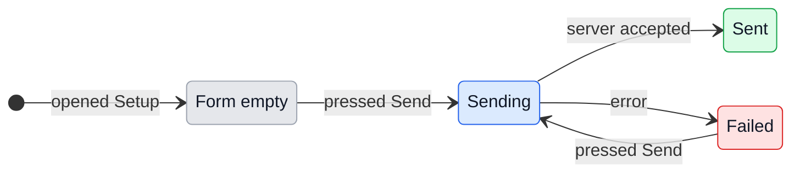

# UX: geckit.app as an AI team you can hire

## 1. Why

geckit.app sells an app for managing AI sessions. Business buyers are not looking for a new app; they understand and pay for an AI employee that does work. The current homepage opens with "An AI employee in your Slack, Discord and Telegram" and then switches to Kanban, terminal tabs and SSH hosts, so a buyer loses the thread halfway down. GeckIt is free with its source public (FSL-1.1-MIT, source-available rather than OSI open source), so revenue comes from setting it up for people: the page has to make "we set it up for you" the main action.

### Journey to the result

- **Entry and result:** a visitor arrives from a post, search or a link, understands in the first screen that they can hire an AI team that works in Slack, sees it work in a Slack thread, and sends a setup request. A developer can instead install it themselves from GitHub.
- **Readiness:** the request is ready when the site's `/api/requests` accepted it; Alex reads it with `weroost requests geckit`. Nothing else is required of the visitor: no account, no install.
- **Decisions and order:** the visitor chooses only between "Set it up for me" and "Install it yourself". The form asks what the team should do and where the team talks; everything else is decided on the call.
- **Shape of the path:** one long page that tells one story (team, Slack demo, what it can do, safety, setup), with the setup form at the hero and again at the end. A separate pricing or signup flow is worse: there is no self-serve product to buy and the price is decided per setup.
- **First visit and return:** the form keeps nothing between visits. A visitor who already sent a request and sends another creates a second request; Alex merges them by email.

## 2. What is added

| Surface | What appears | When visible |
|---|---|---|
| `/` hero (existing, rewritten) | Title, one sentence, hero illustration, "Set it up for me" and "Install it yourself" | Always |
| `/` "You talk to the Manager" (existing `#team`, rewritten) | Illustration: one person, the Manager gecko, three employee geckos with role props; three short cards | Always |
| `/` Slack demo (new `#slack`) | An animated Slack thread: a request, the Manager's handoff, progress, the result; below it "Also in Discord and Telegram" | Always; plays once when scrolled into view |
| `/` "Reach it from anywhere" (existing `#channels`, rewritten) | Illustration: people on laptops and phones linked to one computer or server; Slack, Discord, Telegram, desktop app, phone | Always |
| `/` "It uses websites to do the job" (existing `#browser`, rewritten) | Illustration: a gecko at its own browser filling a CRM and a sheet | Always |
| `/` "Runs on the AI you already pay for" (new `#models`) | Claude Code, Codex, GLM, MiniMax, "Your choice, add with a plugin" | Always |
| `/` "Your passwords never reach the AI" (existing `#secrets`) | Illustration: a person typing into a vault the gecko cannot see into | Always |
| `/` "You approve what matters" (new `#approve`) | Illustration: a phone with Approve and a waiting gecko | Always |
| `/` "We set it up for you" (new `#setup`) | Four steps and the setup form | Always |
| `/` "Install it yourself" (new `#install`) | GitHub link and downloads | Always |
| `/desktop` (new) | The current Kanban, conversations, hosts and "everything else" sections, moved | Always |
| `/mobile` (new) | The current phone section, moved | Always |
| `/developers` (existing `/claude-code-kanban-board`, kept) | Linked from the footer and from `/desktop` | Always |
| Site nav (existing) | Team, Slack, Setup, Desktop, Mobile, GitHub | Always |

The illustrations share one character: the GeckIt gecko is every AI employee, the Manager wears a headset, the employees carry role props (magnifier for research, pen for writing, laptop for development). People are a mixed office team. One flat, warm style for every scene.

## 3. States

| State | When it occurs | What the visitor sees | What to do |
|---|---|---|---|
| Reading | Page open | The story and two actions | Scroll, press "Set it up for me" or "Install it yourself" |
| Demo waiting | Slack demo not yet in view | The thread's first message only | Scroll |
| Demo playing | Demo became visible | Messages appear one by one | Nothing, it finishes by itself |
| Demo done | Last message shown | The full thread and "Watch again" | "Watch again" or keep scrolling |
| Form empty | `#setup` open | Fields and "Send request" | Fill the form |
| Form invalid | Pressed "Send request" with a required field empty or a bad email | The browser's own field message | Correct the field |
| Sending | Request sent | "Send request" disabled, reads "Sending..." | Nothing |
| Sent | `/api/requests` accepted | The form is replaced by the sent message | Nothing; wait for the email |
| Failed | Network or server error | The failed message above the button, fields kept | "Send request" again, or write to the email shown |

## 4. Transitions

| From | Event | To | What the visitor sees |
|---|---|---|---|
| Reading | Pressed "Set it up for me" | Form empty | The page scrolls to `#setup`, focus in the first field |
| Reading | Pressed "Install it yourself" | Reading | The page scrolls to `#install` |
| Demo waiting | 40% of the demo became visible, by itself | Demo playing | Messages appear |
| Demo playing | Last message shown, by itself | Demo done | "Watch again" appears |
| Demo done | Pressed "Watch again" | Demo playing | The thread restarts from the first message |
| Demo waiting | Reduced motion is on | Demo done | The full thread at once, no "Watch again" |
| Form empty | Pressed "Send request", fields invalid | Form invalid | The browser's own field message |
| Form invalid | Corrected and pressed "Send request" | Sending | "Sending..." |
| Form empty | Pressed "Send request" | Sending | "Sending..." |
| Sending | Server accepted | Sent | The sent message |
| Sending | Network or server error | Failed | The failed message, fields kept |
| Failed | Pressed "Send request" | Sending | "Sending..." |
| Sent | Reloaded the page | Form empty | An empty form |

## 5. What stays silent

| State | Why not shown |
|---|---|
| Whether the visitor already sent a request | The site keeps no visitor state; Alex merges duplicates by email |
| The antibot check | It passes silently for people; a failed check shows as Failed |
| Whether the demo is a recording | It is an illustration of a real flow, styled as a thread, not a claim about a customer |

## 6. Thresholds and time

| Number | Value | Why |
|---|---|---|
| Demo start | 40% visible | The thread's first two messages are on screen when it starts, so the start is not missed |
| Delay between demo messages | 1.2 s, 2.5 s before the result | Long enough to read a short message; the longer pause makes the work feel like work |
| Demo plays | Once, then "Watch again" | A looping thread distracts from reading the next section |
| "What should your AI team do?" | Up to 2000 characters | Enough for a paragraph about the job; longer belongs on the call |

## 7. Wording

| Place | Text |
|---|---|
| Hero title | "Hire an AI team that works in your Slack" |
| Hero sentence | "Tell the Manager what you need. It hands the work to AI employees who research, write, fill your CRM and use websites for you, and reports back in the thread." |
| Hero main action | "Set it up for me" |
| Hero second action | "Install it yourself" |
| Hero note under actions | "Free, with the source on GitHub. We install and connect it for you, or you do it yourself." |
| Team title | "You talk to the Manager. It runs the team." |
| Team cards | "One conversation" - "Ask the Manager like you'd ask a colleague." / "A team behind it" - "It gives each part to an employee with its own role and instructions." / "One answer" - "You get the result in the same thread, not ten chats." |
| Slack demo title | "Ask in Slack. Get it done in Slack." |
| Demo message 1 (person, named "You") | "@GeckIt find dental clinics in Austin that have a website and add them to our leads sheet" |
| Demo message 2 (Manager) | "On it. Researcher is collecting the clinics, then Assistant adds them to the sheet." |
| Demo message 3 (Manager) | "Researcher is going through the clinic websites now." |
| Demo message 4 (Manager) | "Done. The clinics are in the leads sheet, each with its website and phone number." |
| Demo action | "Watch again" |
| Under the demo | "Also in Discord and Telegram, and in the GeckIt app on your computer and phone." |
| Channels title | "Reach it from anywhere" |
| Browser title | "It uses websites to do the job" |
| Browser sentence | "Each employee has its own browser. It signs in, searches, fills in forms and updates your tools the way a person would." |
| Models title | "Runs on the AI you already pay for" |
| Models sentence | "Claude Code, Codex, GLM and MiniMax today. Any other model can be added with a plugin." |
| Secrets title | "Your passwords never reach the AI" |
| Secrets sentence | "You type a password on a secure page. The employee uses it to sign in but never sees it." |
| Approve title | "You approve what matters" |
| Approve sentence | "When an employee needs a decision, you answer from your phone. Finished work waits for your review." |
| Setup title | "We set it up for you" |
| Setup steps | "1. Tell us what the team should do" / "2. A short call" / "3. We install GeckIt and connect your Slack" / "4. Your AI team starts working" |
| Setup price | Not shown; postponed by Alex on 2026-11-19 |
| Under the setup steps | "Questions first? Write to hello@geckit.app." |
| Form fields | "Name", "Work email", "Company (optional)", "Where does your team talk?" (Slack, Discord, Telegram, Other), "What should your AI team do?" |
| Form button | "Send request" |
| Sending | "Sending..." |
| Sent | "Thanks. We'll email you within one business day to set up a call." |
| Failed | "Your request didn't go through. Try again, or email us at hello@geckit.app." |
| Install title | "Install it yourself" |
| Install sentence | "GeckIt is free, with the source on GitHub. Download it for Mac, Windows or Linux." |

## 8. Edge cases

- **Empty:** not applicable, the page has fixed content.
- **Everything at once:** a visitor presses "Send request" twice; the button is disabled while Sending, so one request goes.
- **Connection lost:** while Sending, the request fails and shows Failed with the fields kept.
- **Repeat:** a second request after Sent needs a page reload; it arrives as a separate request.
- **Stale copy:** none, the page is static.
- **No JavaScript:** the form posts normally and the server's own response page is shown; the demo shows the full thread.
- **Phone width:** illustrations sit above their text; the demo thread uses the full width.

## 9. What is deliberately absent

| Not doing | Why |
|---|---|
| LinkedIn outreach in the browser scene | LinkedIn forbids automation; showing it advertises account bans and links GeckIt with spam |
| Customer logos, testimonials, counters | There are none yet; inventing them is not allowed |
| Pricing tiers or a buy button | Setup is priced per client on the call |
| A chat widget | The form plus email covers the request; a widget needs someone answering live |
| Discord and Telegram demo tabs | Three demos for one story; one line naming them carries the message |
| Kanban, SSH hosts and terminal content on `/` | It speaks to developers and breaks the buyer's story; it moves to `/desktop` and `/developers` |

## 10. Forks

### Illustrations or real screenshots

| Option | Verdict |
|---|---|
| Illustrations for every scene, one real-looking Slack demo | Yes |
| Real UI screenshots throughout | No |

**Why:** buyers pay for the employee's work, not for the app's UI. The Slack demo carries the proof.

### How the illustrations are made

| Option | Verdict |
|---|---|
| Echopub: one gecko character reference first, then every scene from it | Yes |
| Hand-built SVG | No |
| Brief for an illustrator | No, for now |

**Why:** one reference character keeps every scene consistent, and Alex approves the character before paying for the rest.

### Demo: recording or animated thread

| Option | Verdict |
|---|---|
| Animated thread in the page, built from the wording above | Yes |
| Screen recording of a real Slack workspace | Later, when a demo workspace exists |

**Why:** an in-page thread is sharp at every width, plays only when seen and respects reduced motion.

### Main action

| Option | Verdict |
|---|---|
| "Set it up for me" first, "Install it yourself" second | Yes |
| Download first | No |

**Why:** setup is the business; open source is the reason to trust it.

## 11. Reconciliation with requirements

| Requirement | Where closed |
|---|---|
| AI employee first, as what people understand and buy | 2, 7 |
| Manager and a team, not one employee | 2, 7 |
| Employees use websites to do the job | 2, 7 |
| Claude, Codex and more models | 2, 7, 9 |
| Slack demonstration, Discord and Telegram mentioned | 2, 3, 7, 10 |
| Open source, earn by setting it up | 1, 2, 7, 10 |
| Desktop and mobile pages | 2 |

**What the requirements lack:** whether setup is sold under GeckIt or another name. The price is postponed; the contact email is hello@geckit.app, to be registered by Alex.

## Build notes (2026-11-19)

- "Open source" became "free, with the source on GitHub": the license is FSL-1.1-MIT, which is source-available, not OSI open source.
- The demo person is "You", not an invented name.
- Old Kanban, hosts, terms and developer FAQ moved to `/desktop`; the phone section moved to `/mobile`.
- GLM and MiniMax are listed: Alex confirmed GeckIt supports them, and other models through plugins.
- The nav button became "Get set up" on every page, pointing to `/#setup`.
