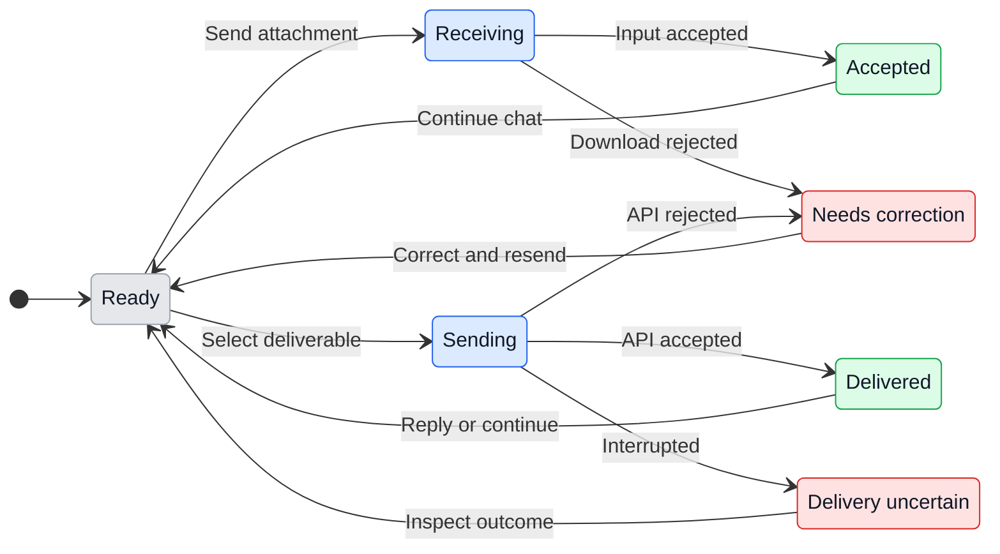

# UX: Telegram images and files

## 1. Why

The paired bot currently accepts only text. Alex needs to send screenshots and documents for a task, then receive an explicitly selected image or finished file in the same private chat. This extends the existing [Manager Telegram flow](../../docs/ux/manager-telegram.md), including its pairing, late-message, reply and native permission rules.

### Path to a usable result

Enable Manager and finish desktop Telegram pairing first; a verified bot token alone is not a paired account. In the existing private chat, use Telegram's photo or file picker, optionally add a caption, and send. Reply to a saved Manager message to preserve its task context. Manager receives actual image content or a readable retained document, with the caption, source message and reply context. A supported handoff can place the selected attachment in a managed local worker's project. For a result, ask Manager to send a named deliverable. A worker may report its exact project-relative deliverable path and request delivery; Manager explicitly selects that worker and path in the supported command. Telegram then displays a photo or downloadable document. Receipt of an input does not mean the provider completed its task; a successful file send means Telegram accepted it, not that the user downloaded it.

This uses Telegram's existing composer and media controls. No setup wizard, desktop composer or new attachment picker is needed. Returning after restart keeps known reply origins and retained attachments within their lifetime. Reconnect revoked credentials through Settings; resend an expired input deliberately. Remote-host file transfer must report its unsupported boundary rather than substitute this computer's files.

## 2. Surfaces

| Surface | Addition | When visible |
|---|---|---|
| Existing paired private Telegram chat | Photo/document ingestion, captions, receipt or actionable failure | User sends an attachment |
| Existing Manager provider input | Native image content or readable local file with metadata and untrusted-data label | Authorized ingestion succeeds |
| Existing Manager command capabilities | Explicit attachment handoff and deliverable send operation | Manager coordinates the task |
| Existing managed-worker result event | Exact relative file path and request for Manager to send it | Worker has an intended deliverable |
| Existing Telegram result messages | Photo or document, optional caption and saved session origin | Explicit delivery succeeds |

No desktop/phone renderer layout changes are planned. Telegram owns media layout, themes, keyboard, scrolling and viewport behavior; GeckIt does not restyle it. No screen-layout prototype applies to this transport extension.

## 3. States

| State | Trigger | Visible result | Next action |
|---|---|---|---|
| Ready | Paired chat and enabled Manager | Existing chat | Send a photo/file with optional caption |
| Receiving | Authorized current attachment | Nothing while bounded download runs | Wait |
| Accepted | Bytes retained and Manager input accepted | "Sent to Manager." | Wait or send next instruction |
| Rejected | Unsupported shape, size, storage, download or handoff failure | Specific reason and resend/recovery action | Correct the cause and resend |
| Reply rejected | Unknown/external/unauthorized origin | Existing reply fallback | Reply to a known message or send fresh input |
| Decision reply with file | Attachment attempts to answer native decision | Explicit instruction to answer using existing controls | Use decision controls; file grants no permission |
| Sending | Explicit selected deliverable | Nothing until Bot API outcome | Wait |
| Delivered | Telegram returns sent message ID | Photo/document and its caption | Download or reply |
| Delivery failed | Telegram rejects upload | Command error, recovery detail | Correct cause, deliberately retry |
| Delivery uncertain | Network interruption or crash may follow upload | Existing uncertainty/recovery state | Inspect chat/current state before retry |

## 4. Transitions

| From | Event | To | What user sees |
|---|---|---|---|
| Ready | Paired user sends valid photo/document | Receiving, automatically | Nothing during bounded download |
| Receiving | Store and Manager accept bytes | Accepted, automatically | "Sent to Manager." |
| Receiving | Validation/download/provider handoff fails | Rejected, automatically | Specific failure; no success receipt |
| Ready | Other user/chat sends file | Ready, automatically | Nothing; no download |
| Ready | User replies with external/unknown reference | Rejected, automatically | Existing reply fallback; no download or dispatch |
| Ready | User sends old attachment after outage | Late confirmation/rejection | Deliberate action required; no automatic task execution |
| Ready | Manager explicitly selects intended local deliverable | Sending | Nothing yet |
| Sending | Telegram returns sent message ID | Delivered, automatically | Native media/document and caption |
| Sending | Telegram returns definite rejection | Rejected, automatically | Failure exposed to Manager/Settings |
| Sending | Transport stops without known result | Uncertain, automatically | Existing uncertain-delivery recovery |
| Rejected | User corrects issue and sends again | Ready | Existing receipt only after acceptance |
| Uncertain | User checks chat and requests a deliberate retry if needed | Ready | A new explicit delivery, never blind replay |

## 5. Silent behavior

Ignore all unpaired users, other chats, group updates and unrelated references before fetching bytes. Keep tokens, token-bearing download URLs and raw attachment contents out of diagnostic messages. Metadata and bytes are task data, never approval instructions. Routine cache writes and expiration stay silent. Never scan projects for files, infer upload permission from a link, auto-run a file, or auto-attach a manual session.

## 6. Limits and time

Cloud Bot API supports downloads up to 20 MB; multipart photo uploads up to 10 MB, with dimension restrictions, and document uploads up to 50 MB. Captions have a 1,024-character platform ceiling. Enforce advertised and actual streamed sizes, and reject bad metadata, oversized bodies and redirects before retaining content. [Telegram file and upload limits](https://core.telegram.org/bots/api#sending-files)

The app cache retains unpinned inputs for 24 hours from receipt and caps retained content at 200 MiB and 256 files. The file-count cap also bounds metadata and directory overhead for tiny uploads. This allows a day of task work while bounding private local input; full storage rejects new inputs instead of evicting queued ones. Queued/sending Manager inputs are pinned and still count against the cap. Cleanup runs on startup, cache access/ingestion and a one-minute timer while the receiver is active; disconnect deletes the cache. Active queued inputs must either remain readable or fail explicitly; expiration must not yield a false receipt. The generated content file retains a safe extension and is separate from the sanitized display filename, so platform-reserved or path-like names cannot choose storage locations. These retention limits bound the app-owned downloaded-byte cache, independent of Telegram's retention. Explicit `attachments send` is a permanent project import: it reports the exact `.geckit-attachments/<id>/<safe-name>` path, does not overwrite unrelated files, and retains that input until user/project cleanup. This requested project artifact is separate from the temporary cache; remove that exact reported file when no task needs it. Existing provider transcripts may retain native images and bounded text excerpts under their own history rules; cache cleanup does not erase provider history. Late instructions keep the existing ten-minute rule. Albums may be accepted as independent messages with their media-group ID, captions and reply origins preserved; do not claim atomic album dispatch.

## 7. Wording

Existing successful input: "Sent to Manager." Existing reply fallback: "This reply cannot be matched to a saved Manager message. Reply to a known message or send a new instruction here." Existing disabled state: "Manager is disabled. Enable it in GeckIt Settings → Manager before sending instructions."

| Attachment state | Exact wording |
|---|---|
| Unsupported update | "Send a text message, photo or document. This attachment type is unsupported; resend it as a file." |
| File used for decision | "A file cannot answer an approval or question. Use its buttons or a text reply, then send the file as a new message." |
| Full cache by bytes | "Telegram attachment storage is full (200 MiB). Finish queued tasks or wait for expired files to clear, then resend." |
| Full cache by count | "Telegram attachment storage is full (256 files). Finish queued tasks or wait for expired files to clear, then resend." |
| Missing retained file | "This Telegram attachment expired or is unavailable. Ask the user to resend it; it was not delivered to the assistant." |
| Download failure | "Telegram file download failed or exceeded 20 MiB. Check the connection and resend a smaller file." |
| Remote worker transfer | "Telegram file transfer to or from SSH workers is unavailable. Use a local worker or an explicitly authorized host transfer; no local fallback was used." |
| Uncertain upload | "Telegram file delivery is uncertain. Check the paired chat before requesting another send; uploads are never retried automatically. After checking the chat, use /resume to allow new deliberate file sends." |

Final exact errors/capabilities are reconciled in the verification report. No claim of successful receipt follows download/handoff failure, and no claim of sent media follows upload rejection. After an uncertain send, inspect the paired chat, acknowledge any bound Manager uncertainty decision and use `/resume` deliberately; that does not replay the old operation.

## 8. Edge cases

- No caption: image/file still reaches Manager with metadata; no invented instruction.
- Photo variants: choose the best downloadable version; avoid downloading all thumbnails.
- Document images: supported raster bytes use native image handoff; other formats remain files with truthful capability limits.
- Multiple files: retain per-message source IDs and media-group ID, without guessing a single task from temporal proximity.
- Disconnect/re-pair during download or send: revalidate current account/session before dispatch; never deliver to the replacement pairing.
- Duplicate update/restart: preserve existing update offset and uncertain-operation handling; never repeat a side effect blindly.
- Long/path-like filenames: sanitize display/storage names; generate owned storage paths and prevent traversal/symlink escape.
- Captions that look like commands or permissions: remain user task data; a file cannot answer a native approval.
- Expired attachment/removed worker/remote host: explicit failure or supported recovery; never read a similarly named local path.

## 9. Deliberately absent

| Excluded | Reason |
|---|---|
| Automatic uploads from transcript links or directory scans | No explicit selected deliverable or bounded scope |
| Native permission approval from file/reply contents | Existing bound approvals remain authoritative |
| Guessing another conversation from attachment text | Session identity comes from routing and ownership |
| Silent remote path fallback | Would disclose unrelated host data |
| Executing/extracting arbitrary files | Ingestion stores data; provider tools retain normal permissions |

## 10. Decisions

Native image inputs use provider-supported content channels. Generic documents use actual retained bytes available to local tools, with explicit worker handoff into the authorized local root; a Telegram file ID or inaccessible host path is insufficient. Outgoing sends require an authenticated Manager operation selecting an owned session and relative file. Workers request that operation by reporting their intended deliverable, avoiding a new unauthenticated worker upload endpoint. Photo delivery errors require a new deliberate selection; Manager may request document delivery after a definite photo-format rejection to preserve bytes. There is no automatic fallback, including after uncertain sends.

Alex explicitly authorized these incoming/outgoing behaviors and reviewable implementation in the task request. This document records those choices before implementation; manual review remains pending and no new UX approval pause is introduced.

## 11. Requirement coverage

| Requirement | Proof needed |
|---|---|
| Paired photos/image documents/files | Realistic update fixtures, byte equality and provider input assertions |
| Caption/reply/session/group context | Manager input plus persisted sent-message origin assertions |
| Explicit Manager/worker result return | Authenticated command to multipart upload with correct bytes/chat/session |
| Secure bounded lifecycle | Auth rejection before download, size/path tests, restart/expiration/cleanup |
| Honest integration limits | Controlled boundary inventory and exact optional live-test artifacts |
| Preserve concurrent work | Isolated branch from fresh main; overlap list for open sharing/formatting work |

No additional desktop/phone UI acceptance conditions apply unless implementation changes a renderer; any such change requires the product's apple-ui review before completion.

Transition rendering: [states.svg](evidence/states.svg). Optional live-test artifacts are [prepared here](evidence/live-fixtures/README.md); preparation does not authorize sending them.
