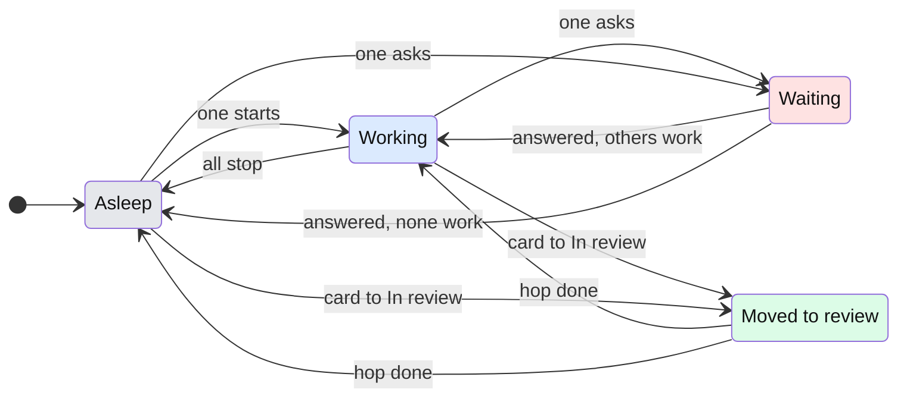

# The gecko: states and behaviour

## Why

Today the person has to read the board's cards to learn whether anything needs them. With several conversations running and attention elsewhere in the window, a waiting question sits unseen. The gecko answers one question without reading: does anything need me right now.

## What is added

| Surface | What appears on it |
|---|---|
| Board top bar (`TopBar` in `client/src/renderer/src/chat/Board.tsx`), in the empty stretch before Ask | The C glass tile, 28 px of tile, the gecko inside it in one of four poses; a count on the tile's corner when more than one conversation waits |
| Tray / menu bar (`client/src/main/tray.ts`) | The gecko's simplified silhouette in three states (asleep, working, waiting), on macOS; Windows and Linux keep the colour app icon |
| Settings, General | One switch, "Show the gecko", on by default |

## States

| State | When | What the person sees | What they do |
|---|---|---|---|
| asleep | nothing working, nothing waiting | gecko curled up, eyes shut, the tile dimmed and without its inner glow | nothing; it is safe to look away |
| working | at least one working, none waiting | the gecko walks inside the tile: two mirrored strides, 280 ms each | nothing; Claude is busy |
| waiting | at least one asking, finished and unread, or a command after ! waiting to be typed into | gecko stopped, head turned toward the board, eyes on it; count when 2 or more | press the gecko to open the conversation that has waited longest |
| review | a card has just moved to In review | the whole tile hops once, about 1 s, the gecko inside with its tail curled | look at In review when convenient; the gecko returns to the state below on its own |

Waiting wins over working; review is a one-off on top of whichever of the other three holds.

## Transitions

| From | Event | To | What the person sees |
|---|---|---|---|
| asleep | a conversation starts working (by itself, no action) | working | the gecko wakes and walks |
| working | the last working conversation stops with nothing waiting (by itself) | asleep | the gecko curls up |
| working or asleep | a conversation asks a question, a permission or a reply (by itself) | waiting | the gecko stops and looks at the board; count when 2 or more |
| waiting | the person answers the last waiting conversation, others still work | working | the gecko walks again |
| waiting | the person answers the last waiting conversation, nothing works | asleep | the gecko curls up |
| waiting | the person presses the gecko | waiting (or the state below once answered) | the longest-waiting conversation opens; pressing again opens the next |
| working or asleep | a card moves to In review | review | one hop of the tile |
| review | the hop finishes (by itself) | the state that holds now | the pose of that state |
| any | the person presses the gecko with nothing waiting | same | the board opens: the List view switches to Board, an open conversation is put away; nothing else happens |

A card moving to In review while something waits does not interrupt waiting: the hop is dropped, since the person has a more urgent thing to see.

## What stays silent

- How many conversations work: the gecko walks the same for one or five. The board shows the number; the gecko only says "busy".
- Which project waits: the conversation opens on press; the gecko itself names nothing (no text from the gecko, spec "Out of scope").
- Hidden conversations and other profiles' projects: not counted, as on the board.
- Background tasks inside a conversation: the conversation's own state counts, not its tasks.
- Errors, "Out of the plan for now" and cards marked Blocked: not a gecko state; the card shows them.
- Which folders the board is narrowed to: the gecko counts every folder of the profile in use, as the Dock badge does, so a question in a folder not shown still wakes it.

## Thresholds and time

- Pose follows within one second of the change (spec US1): the board's own session updates already arrive faster than that, so no extra polling.
- Review hop plays once, one second, then returns: long enough to be noticed in the corner of the eye, short enough not to compete with waiting. A hop that would come while the window is not seen is dropped, not saved.
- Count shown from 2: one waiting conversation needs no number, the pose says it.

## Wording

- Accessible name, asleep: "Nothing running"
- Working: "Claude is working"
- Waiting, one: "1 conversation waiting for you"
- Waiting, more: "2 conversations waiting for you" (the number changes)
- Review is not announced on its own: the name stays that of the state below.
- Tray tooltip keeps today's "GeckIt" text.

## Edge cases

- Everything at once (waiting, working, review): waiting.
- A waiting conversation is hidden: it stops counting; the gecko leaves waiting if it was the only one.
- Two cards reach In review together: one hop.
- The window is hidden or minimised: the pose is still right when it comes back; nothing animates meanwhile (step 5).
- Reduced motion: the still pose of each state, no hop, no walking cycle.
- The gecko switched off: no gecko in the bar; the tray shows today's icon.

## Not included on purpose

- Speech bubbles, text or a "z" for sleeping: the spec keeps the gecko wordless; the shut eyes carry sleep.
- A separate pose for errors: errors belong to the card that has them.
- Sound.

## Decisions

| Question | Verdict | Why |
|---|---|---|
| Which visual direction (A glass gecko, B gecko on the edge, C glass tile) | C, the glass tile (Alex, 2026-10-28) | strongest link to the app icon; its weakness, poses that are hard to tell apart at 30 px, is answered by letting the tile carry the state too (next row) |
| How C stays readable at 30 px | the tile carries the state as well as the gecko: asleep dims the tile and stops the inner glow; working walks the gecko inside; waiting adds the amber badge on the tile's corner; review lifts the whole tile in one small hop | the gecko inside is about 20 px long, too small to carry four poses alone; tile brightness, badge and hop read from the corner of the eye |
| Where in the top bar | the empty stretch before Ask, right-aligned | the only place in the bar with no control; it never covers one |
| Count form | HTML disc on the tile's top right corner, 15 px, 10 px bold numeral, `--warning-text` with a `--bg` numeral and ring | amber is the board's own "asking you" colour; in light it reads darker, ochre, because the token is the text colour the board uses for "Asking you" |
| Review hop when the person moves the card | it hops too | the list carries no record of who moved a card, so a card the person drags to In review hops the same as one a goal or the manager moved; the hop then confirms the move. Alex to confirm |
| Which conversations count | every folder of the profile in use (`chat.everyone`), not only the folders the board is narrowed to | the gecko answers "does anything need me", as the Dock badge; hidden conversations and other profiles' folders are still left out |
| Tray on Windows and Linux | unchanged, the colour app icon | a black template is lost on a dark taskbar, and only macOS colours template images itself |

## Coverage

FR-001 is `geckoState` in `client/src/shared/gecko.ts` with `client/test/gecko.test.ts`; FR-002, FR-003, FR-005 and FR-007 are `client/src/renderer/src/chat/Gecko.tsx`, the Settings switch and the preview; FR-004 is `client/src/main/tray.ts`; FR-006 holds, no new dependency. The phone (US5) is not built.
