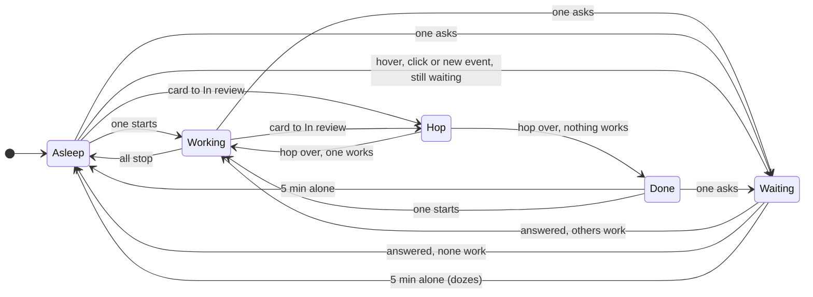

# The gecko: states and behaviour

## Why

Today the person has to read the board's cards to learn whether anything needs them. With several conversations running and attention in another app, a waiting question sits unseen. The gecko answers one question without reading: does anything need me right now. Pressed, it is also the quickest way into GeckIt from any app: a screenshot, a new task, a spoken task, the waiting conversation.

## What is added

| Surface | What appears on it |
|---|---|
| A floating window of its own (`client/src/main/gecko.ts`, the windows in `client/src/main/windows.ts`, the page `client/src/renderer/gecko.html`) | The gecko drawn from the finished demo's frames (`client/src/renderer/src/gecko/frames/`), standing in a transparent square window, always on top and on every desktop, 120 px by default and resizable from 72 to 320 px; the orange waiting count on its top right corner from one waiting conversation. No tile behind it: the demo's gecko stands on the desktop with its own soft shadow. Not in the board |
| Its menu (`client/src/renderer/src/gecko/Ring.tsx`) | A transparent window of its own round the gecko, opened by a press: glass discs with a label each, laid out round the gecko and kept on the gecko's screen |
| Its bubble (`client/src/renderer/src/gecko/Bubble.tsx`) | Beside the gecko: what to do with dropped files, and the notes of the voice task |
| Tray / menu bar (`client/src/main/tray.ts`) | The gecko's simplified silhouette in three states (asleep, working, waiting), on macOS; Windows and Linux keep the colour app icon. Its menu has "Show the Gecko" or "Hide the Gecko" |
| Settings, General | One switch, "Show the gecko", on by default: it shows or hides the floating gecko and the tray's gecko together |

## States

The pose follows the conversations, and what the person is doing with the gecko comes first. In order: files dragged over it (catch), files just dropped (got), the screenshot (camera), the voice task (listen), the menu open (look), then waiting, working, the happy look after a hop (done), asleep. Dozing puts waiting and done to sleep; working keeps working.

| Pose | When | What the person sees | Frames |
|---|---|---|---|
| asleep | nothing working, nothing waiting; or waiting or done left alone 5 minutes | sitting with its eyes shut, breathing slowly eight times (about 29 s), then still; the waiting count stays on its corner | `aA` with the head `aAh` |
| working | at least one working, none waiting | typing on a little laptop: a few keys, a pause, again, nodding a little | one head `wHead` over the hands frames `wA` and `wB` in turn |
| waiting | at least one asking, finished and unread, or a command after ! waiting to be typed into | sitting up with an "o" mouth, looking at the cursor, a small bounce every 3.2 s, now and then three impatient foot taps; blinks; the orange count | one head `tHead` over the foot frames `tB` and `tA`, the pupils drawn over it |
| review (hop) | a card has just moved to In review, nothing waiting | a 1.1 s happy hop with its arms up, the shadow shrinking under it | `hA` alone |
| done | after a hop, until it dozes or another state takes over | a happy look, swaying a little, blinking, eyes on the cursor | `bA` with the head `bAh`, the pupils over it |
| look | its menu is open | the same happy look, still, its eyes on the item in focus | `bA`, `bAh`, pupils |
| catch | files are dragged over it | both hands up, its eyes on the file | `cUp`, pupils |
| got | files were dropped on it | holding the file, a squash, for 1.1 s; then the bubble asks | `cGot` |
| camera | Screenshot was chosen | the Mac's crosshair comes at once; meanwhile it raises a camera to one eye for 1 s, the lens flashes and a white glow flashes round it | `cam`, the other eye's pupil, the lens flash |
| listen | Voice task was chosen, while its capsule is open | headphones on, writing a few strokes, a pause, again | `lA` and `lB` in turn |

In waiting, done and look the pupils follow the cursor anywhere on screen, moving up to 16 units of the 1024 view towards it, less when it is near. Every 2.2 to 5.2 s it blinks: the sitting head is swapped for the drawn closed eyes (`tAc` or `bAc`) for 130 ms. Only the hands, the foot or the pen change between frames; the head stays one image, so nothing flickers.

### What the person does to it

| Action | What happens |
|---|---|
| Moves the cursor anywhere | the pupils follow it (waiting, done, look) |
| Hovers it | a pet: over 1.3 s the head bends on its eight pre-drawn frames and back (sitting poses use the pet head, working and asleep bend their own); cancelled by any change of pose, and not while the menu is open, files are dragged, the camera is up or it listens. A hover also wakes it from dozing |
| Presses it | a small squash, and its menu opens round it; pressed again on the gecko, or anywhere else, the menu closes |
| Chooses in the menu | the menu goes and: Screenshot brings the crosshair at once while the gecko raises its camera; New task opens GeckIt on the New task form; Voice task opens the dictation capsule; Waiting opens the conversation that has waited longest (the next one each time); Open GeckIt brings GeckIt forward |
| Uses the keyboard in the menu | the first item is in focus when it opens; the arrows go round, Enter or Space chooses, Esc closes; pointing at an item puts it in focus too. The gecko looks at the item in focus |
| Speaks after Voice task | the capsule records while the gecko writes; the capsule's Stop (or Enter) ends it, the words are heard on this computer by the app's own whisper.cpp, and GeckIt opens on New task with them in the words, after anything already written there |
| Cancels the capsule | it stops listening and nothing is kept |
| Drags files over it | it raises its hands and looks at the file |
| Drops files on it | it catches them, then its bubble asks what to do with them: a new task with them, sending them to the waiting conversation (only while one waits), or Cancel |
| Drags it | it moves with the pointer; let go, all of it is moved onto the display it is mostly on, and the place is remembered |
| Drags the grip on its bottom right corner (shown while it is pointed at) | it grows or shrinks square from its top left corner, from 72 to 320 px, kept on its display, and the size is remembered |
| Right-clicks it | a menu with "Hide the gecko" |
| Chooses "Show the Gecko" or "Hide the Gecko" in the menu bar's menu | the Settings switch turns on or off |

## Transitions

| From | Event | To | What the person sees |
|---|---|---|---|
| asleep | a conversation starts working | working | the eyes open, it types |
| working | the last working conversation stops, nothing waiting | asleep (or done after a hop) | it shuts its eyes |
| any | a conversation asks | waiting | it sits up and looks at the person; the count pops in |
| waiting | 5 minutes with no hover, click or new event | asleep, the count still on | it falls asleep |
| dozing | a hover, a click, files dragged over it, or any change in the conversations | the state that holds | it wakes |
| working or asleep | a card moves to In review, nothing waiting | hop, then working or done | one happy hop |
| done | 5 minutes alone | asleep | it falls asleep, and a later hover wakes it to the state that holds, not to done |
| any | a press | look, with the menu | the items fly out from it |
| look | a choice, Esc, a click elsewhere | the pose of the choice, or the state | the menu goes |
| any | Screenshot | camera, then the state | crosshair at once, camera and flash beside it |
| any | Voice task | listen while the capsule is open | the capsule hears; GeckIt opens on New task |

## What stays silent

- How many conversations work: the gecko is busy the same for one or five.
- Which project waits: the conversation opens from the menu; the gecko does not name it.
- Hidden conversations and other profiles' projects: not counted, as on the board.
- Background tasks inside a conversation: the conversation's own state counts.
- Errors, "Out of the plan for now" and cards marked Blocked: not a gecko state.
- In review as a count: the demo's green review count is not built; the app keeps no count of cards that reached review unseen.

## Thresholds and time

- Pose follows within one second of the change: main works the state out from the session updates the board gets.
- Doze: 5 minutes (`DOZE` in `client/src/shared/gecko.ts`; the demo used 15 s). Only waiting and done doze; a single timer, armed only while one of them shows and the window is seen.
- Hop 1.1 s; catch 1.1 s; camera 1 s raised, then a 0.5 s flash; pet 1.3 s; blink 130 ms every 2.2 to 5.2 s; menu items fly out over 450 ms, 35 ms apart.
- Typing: 5 to 12 keys of 130 to 220 ms, then 0.5 to 1.4 s of rest. Foot taps: three taps of 370 ms, then 1.6 to 2.8 s still. Writing: 3 to 6 strokes of 170 to 290 ms, then 0.5 to 1.4 s.
- The cursor is read by main ten times a second while it moves, once a second after it has rested two seconds, never without the window.
- What runs without end: working's nod and typing, waiting's bounce and taps, done's sway; waiting and done end at the doze. Asleep breathes eight times and is still. Measured in Electron: renderer 0.00% asleep, 0.67% working, 0.45% waiting, 0.33% done.

## Wording

- Accessible name and tooltip, asleep: "Nothing running"; working: "Claude is working"; waiting: "1 conversation waiting for you", "2 conversations waiting for you". Review is not announced on its own. Dozing keeps the name of the state it holds.
- Menu, named "Gecko", clockwise from the top: "Screenshot" (macOS only), "New task", "Voice task", "Waiting" (only while one waits, with the count on its disc), "Open GeckIt".
- Right-click menu: "Hide the gecko".
- Tray menu: "Hide the Gecko" or "Show the Gecko", in the title case of the rest of that menu.
- Bubble after a drop: "What should I do with this file?" or "What should I do with these 3 files?"; choices "New task with this file" or "New task with these files", "Send to the waiting conversation" (only while one waits), "Cancel".
- Voice task notes are the capsule's own: it says what was not heard or could not be recorded, and how far the speech model has downloaded.
- Settings note under the switch: "A small gecko floats on the desktop and sits in the menu bar, showing whether Claude is working or a conversation is waiting for you. Press it for its menu, drop files on it, drag it anywhere, and resize it from its corner. Off, the menu bar has its plain icon; the menu bar's own menu shows it again."
- Tray tooltip keeps "GeckIt".

## Edge cases

- Everything at once (waiting, working, review): waiting; the hop is dropped.
- A waiting conversation is hidden: it stops counting.
- The screen is locked, or the gecko switched off: its window, menu and bubble are closed; nothing of it runs.
- The window was left on a display no longer connected: it comes back at the top right of the main display.
- Dragged partly off a display: on release all of it is moved onto the display it is mostly on. Resized near an edge: kept on that display.
- The menu near an edge or in a corner: the items spread over the part of the circle that is on the gecko's screen, the first at the end nearer the top, and the circle grows until they are a disc and a half apart. The items always clear the gecko's corners, where its count is.
- The speech model is not downloaded: the first voice task downloads it, the bubble shows the progress without taking the keyboard, and the New task form opens once the words are written down.
- Reduced motion: no breathing, bounce, sway, nod, hop (the happy look after it still shows), blinks, pet, squash, catch or camera; the first frame of each pose holds; Screenshot goes straight to the crosshair; the menu's items appear in place. The eyes still follow the cursor.
- Not seen (the window hidden or covered): no frame loops, no blinks, no doze timer, no CSS animation.
- Windows and Linux: no Screenshot item; the gecko and the menu otherwise the same.

## Not included on purpose

- Text on the gecko itself, or a "z" for sleeping.
- Keyboard access to the floating gecko itself: it never takes the focus; its menu and bubble do while open, and the tray and the board are the keyboard way to the same places.
- A darkening scrim behind the menu: the demo darkens its stage, but on the desktop that would cover the person's other apps.
- The demo's In review item and green count, and the headphones-only frame (`hp.png`): not shown by any state the app has.
- Sound.

## Decisions

| Question | Verdict | Why |
|---|---|---|
| How it is drawn (2026-10-28, later) | the finished HTML demo's frames, ported as they are: one body frame and one head layered, the drawn closed eyes for a blink, pupils masked into the eyes, the pre-drawn bent heads for a pet; no tile behind it. The Mochi-style SVG drawing (the rows below about drawing, style, tile and breathing) is replaced and kept here as the record | Alex's demo is the source of truth for the look and the behaviour; frames are converted to WebP (heads downscaled to 0.6) only for size, 7.7 MB to 0.9 MB |
| What a press does | opens the demo's radial menu in its own transparent window round the gecko, replacing the bubble's question; the bubble stays for dropped files and the voice task's notes | the gecko window is small and never takes the keyboard; a panel window round it takes the keyboard without bringing GeckIt forward, as the bubble did |
| Idle sleep | waiting and done fall asleep after 5 minutes without a hover, a click or a new event; the count stays; working keeps working | a waiting gecko bouncing all day costs CPU and attention; the count still says something waits |
| Count | the demo's orange disc `#f08c1e` with a white ring, from one waiting conversation, sized with the gecko; it replaces the count from 2 | asleep from the doze, the pose no longer says waiting, so the count has to |
| Voice task | the dictation capsule, with the gecko in its listen pose while it is open (Alex, 2026-10-28) | the capsule shows that it records and has Stop and Cancel; the gecko listening alone gave no sign of either |
| Screenshot | the crosshair at once, the camera beside it (Alex, 2026-10-28) | waiting 1.5 s for the camera before the crosshair felt slow |
| Hide | only in the right-click menu (Alex, 2026-10-28) | it was one press from the menu, which made it easy to hide the gecko by mistake |
| Where the gecko lives | a separate small floating glass panel, not in the board (Alex, 2026-10-28) | like Mochi in Coucou, the gecko is seen while the person works in other apps, which is when a waiting question goes unseen; in the board it was only seen by someone already looking at the board. The tile in the top bar (commits a177dcb to de64496) is removed |
| How it is drawn and moves | front-facing, sitting in the panel looking out, drawn in parts with smooth eased motion, and its eyes follow the cursor (Alex, 2026-10-28) | the top-down C gecko read as the icon, not as a creature; facing the person with big slit-pupil eyes it can look at them, which is what makes a mascot. The icon's green, glossy body, toe pads and curling tail keep it the GeckIt gecko; the eyes sit on the sides of the head so it does not read as a frog |
| How cute | cute, not babyish (Alex, 2026-10-28): a small gecko sitting up on its front legs, three-quarter toward the person, head about a third of its height and wedge-shaped with a pointed snout, eyes on the sides of the head about a quarter of its width with slit pupils, slim body, long legs with splayed toe pads, long tapering curled tail, no cheeks | the first front-facing drawing, a big round head with large eyes on top and pink cheeks, read as a baby or a frog; a charming small lizard reads as a gecko. Before and after: `docs/design/gecko/panel-redraw-compare.jpg` |
| Style | in the style of Mochi from Coucou: flat, soft, rounded, no outlines, white with a mint tint, small dot eyes, pink oval blush, tiny mouth, round toe pads, spiral tail (Alex, 2026-10-28); drawn after the reference in `docs/design/gecko/ref/`, made with Gemini through Echopub and approved by Alex | the two drawings before it (front-facing glossy, then a three-quarter lizard) were rejected; the reference is what Alex wants the gecko to be. The rows above about how it is drawn are kept as the record of what was tried |
| Tile or glass | the app icon's green tile, the same on every system and in light and dark; no macOS vibrancy | a white gecko on light glass nearly disappears in light mode; on the green tile it reads in both, and it is the reference's own look |
| Breathing and bouncing that stop | asleep breathes eight times and waiting bounces three times, then they hold still | the panel is always on screen, and a state that lasts hours must not keep the computer awake. Alex to confirm, or say if breathing should never stop |
| Speech bubbles | allowed (Alex, 2026-10-28), for what a press or a drop asks: a bubble beside the gecko with choices, in a window of its own that takes the keyboard. Before, the spec had speech bubbles out of scope and a press went straight to the waiting conversation | a press that can only open GeckIt wastes the one thing the gecko is always close to; a short question with four choices, and files dropped straight on it, make it the quickest way into a new task from any app |
| Default | on | the panel is the feature; it is one right-click to hide |
| Which visual direction (A glass gecko, B gecko on the edge, C glass tile) | C, the glass tile (Alex, 2026-10-28), later redrawn front-facing (rows above) | strongest link to the app icon; at panel size its weakness, poses that were hard to tell apart at 30 px, is gone |
| Count form | HTML disc on the panel's top right corner, 20 px, 12 px bold white numeral on orange `#ec9a2c`, popping in | as in the reference; the board's own amber token read ochre on the green tile |
| Review hop when the person moves the card | it hops too | the list carries no record of who moved a card, so a card the person drags to In review hops the same as one a goal or the manager moved; the hop then confirms the move. Alex to confirm |
| Which conversations count | every folder of the profile in use (`chat.everyone`), not only the folders the board is narrowed to | the gecko answers "does anything need me", as the Dock badge; hidden conversations and other profiles' folders are still left out |
| Tray on Windows and Linux | unchanged, the colour app icon | a black template is lost on a dark taskbar, and only macOS colours template images itself |

## Coverage

FR-001 and the pose rules are `geckoState`, `geckoShown`, `canDoze` and `DOZE` in `client/src/shared/gecko.ts` with `client/test/gecko.test.ts`; the menu's items and layout are `geckoItems` and `geckoRing`, the size and place `geckoSide` and `keptIn`, tested there too. The window, menu, bubble, camera, voice task, resize and move are `client/src/main/gecko.ts` and `client/src/main/windows.ts`; the pages are `client/src/renderer/src/gecko/Art.tsx` (the frames and their layers), `Gecko.tsx`, `Ring.tsx` and `Bubble.tsx`, tested in `client/test/gecko-panel.test.ts`; New task with the spoken words is `Chat.tsx` and `Board.tsx`; the tray item is `client/src/main/tray.ts`; the preview is `client/src/renderer/src/gecko-preview.tsx`. The phone (US5) is not built.
