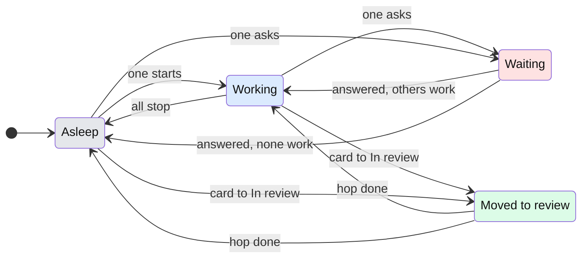

# The gecko: states and behaviour

## Why

Today the person has to read the board's cards to learn whether anything needs them. With several conversations running and attention in another app, a waiting question sits unseen. The gecko answers one question without reading: does anything need me right now.

## What is added

| Surface | What appears on it |
|---|---|
| A floating panel of its own (`client/src/main/gecko.ts`, the window in `client/src/main/windows.ts`, the page `client/src/renderer/gecko.html`) | A small panel, the app icon's green tile about 100 px square, always on top and on every desktop, with the gecko sitting on it facing the person, in one of four states; a count on the panel's corner when more than one conversation waits. Not in the board: the board's top bar is as it was before spec 016 |
| Tray / menu bar (`client/src/main/tray.ts`) | The gecko's simplified silhouette in three states (asleep, working, waiting), on macOS; Windows and Linux keep the colour app icon |
| Settings, General | One switch, "Show the gecko", on by default: it shows or hides the panel and the tray's gecko together |

## States

| State | When | What the person sees | What they do |
|---|---|---|---|
| asleep | nothing working, nothing waiting | lying on its belly, chin on its front paws, eyes shut arcs; the back rises and falls a few times and the tail tip twitches, then it lies still | nothing; it is safe to look away |
| working | at least one working, none waiting | sitting at a tiny laptop in front of it, paws tapping the keys in turn, the head nodding, now and then glancing down at the screen, the tail swaying behind | nothing; Claude is busy |
| waiting | at least one asking, finished and unread, or a command after ! waiting to be typed into | it sits up and looks straight at the person with an \"o\" mouth; now and then a slow blink and a burst of impatient foot taps with a small sway; the orange count pops in from 2 | press the gecko to open the conversation that has waited longest |
| review | a card has just moved to In review | a happy hop of about 0.9 s with paws up and happy arc eyes, squashed on landing, the tail flicking; then the state below returns | look at In review when convenient |

Waiting wins over working; review is a one-off on top of whichever of the other three holds.

In every awake state the dot eyes, and a little the head, follow the mouse cursor anywhere on screen; it blinks every few seconds and now and then tilts its head.

### What the person does to it

| Action | What happens |
|---|---|
| Moves the cursor anywhere | the dot eyes follow it, the head turns a little after them (not asleep: the eyes are shut) |
| Hovers it, awake | it looks straight at them with a small happy wiggle |
| Hovers it, asleep | it opens one eye sleepily and shuts it again; it stays asleep |
| Presses it | a small squash, then GeckIt comes to the front on the longest-waiting conversation, the next on each press; with nothing waiting, GeckIt just comes to the front |
| Drags it | it moves with the pointer anywhere on the screen and is there again on the next launch |
| Right-clicks it | a menu with one item, "Hide the gecko", which turns the Settings switch off |

## Transitions

| From | Event | To | What the person sees |
|---|---|---|---|
| asleep | a conversation starts working (by itself, no action) | working | the eyes open, the head lifts, it gets busy |
| working | the last working conversation stops with nothing waiting (by itself) | asleep | the eyes shut, the head goes down onto its feet, the tail wraps round |
| working or asleep | a conversation asks a question, a permission or a reply (by itself) | waiting | it perks up and looks at the person; count when 2 or more |
| waiting | the person answers the last waiting conversation, others still work | working | it gets busy again |
| waiting | the person answers the last waiting conversation, nothing works | asleep | it goes to sleep |
| waiting | the person presses the gecko | waiting (or the state below once answered) | GeckIt comes to the front on the longest-waiting conversation; pressing again opens the next |
| working or asleep | a card moves to In review | review | one happy hop |
| review | the hop finishes (by itself) | the state that holds now | the pose of that state |
| any | the person presses the gecko with nothing waiting | same | GeckIt comes to the front as it was; nothing else happens |

Between states the head, the pupils and the tail move to their new places with a springy ease rather than jumping.

A card moving to In review while something waits does not interrupt waiting: the hop is dropped, since the person has a more urgent thing to see.

## What stays silent

- How many conversations work: the gecko is busy the same for one or five. The board shows the number; the gecko only says "busy".
- Which project waits: the conversation opens on press; the gecko itself names nothing (no text from the gecko, spec "Out of scope").
- Hidden conversations and other profiles' projects: not counted, as on the board.
- Background tasks inside a conversation: the conversation's own state counts, not its tasks.
- Errors, "Out of the plan for now" and cards marked Blocked: not a gecko state; the card shows them.
- Which folders the board is narrowed to: the gecko counts every folder of the profile in use, as the Dock badge does, so a question in a folder not shown still wakes it.

## Thresholds and time

- Pose follows within one second of the change (spec US1): main works the state out from the same session updates the board gets, so no extra polling.
- Review hop plays once, 0.9 s, then returns. A hop that would come while the panel is not seen is dropped, not saved.
- Count shown from 2: one waiting conversation needs no number, the pose says it.
- Blinks every 2.5 to 6.5 s, a third of them with a head tilt of 0.9 s.
- The cursor is read by main ten times a second while it moves, once a second after it has rested two seconds, and never without a panel; the panel is told only when it moved.
- What runs without end: only the working state's typing, nod, glance and tail. Asleep breathes eight times (about 34 s) and waiting moves only in short bursts at the blink timer's moments (a slow blink, sometimes a second of foot taps), then holds still, so a panel left sleeping or waiting all day costs nothing (measured below).

## Wording

- Accessible name and tooltip of the panel, asleep: "Nothing running"
- Working: "Claude is working"
- Waiting, one: "1 conversation waiting for you"
- Waiting, more: "2 conversations waiting for you" (the number changes)
- Review is not announced on its own: the name stays that of the state below.
- Right-click menu: "Hide the gecko".
- Settings note under the switch: "A small gecko floats on the desktop and sits in the menu bar, showing whether Claude is working or a conversation is waiting for you. Press it to open the one that waits, drag it anywhere. Off, the menu bar has its plain icon."
- Tray tooltip keeps today's "GeckIt" text.

## Edge cases

- Everything at once (waiting, working, review): waiting.
- A waiting conversation is hidden: it stops counting; the gecko leaves waiting if it was the only one.
- Two cards reach In review together: one hop.
- The screen is locked: the panel's window is closed and made again on unlock, so nothing runs meanwhile.
- The panel was left on a display that is no longer connected: it comes back at the top right of the main display.
- Reduced motion: the still pose of each state, no hop, no breathing, no bounce, no blinks, no wiggle or squash; the eyes still follow the cursor.
- The gecko switched off: no panel and no window for it at all; the tray shows today's icon.
- The panel never takes the keyboard: typing elsewhere is never interrupted, and a press brings GeckIt forward itself.

## Not included on purpose

- Speech bubbles, text or a "z" for sleeping: the spec keeps the gecko wordless; the shut eyes carry sleep.
- Keyboard access to the panel itself: it never takes the focus, by design; the board and the tray are the keyboard way to the same conversations.
- A separate pose for errors: errors belong to the card that has them.
- Sound.

## Decisions

| Question | Verdict | Why |
|---|---|---|
| Where the gecko lives | a separate small floating glass panel, not in the board (Alex, 2026-10-28) | like Mochi in Coucou, the gecko is seen while the person works in other apps, which is when a waiting question goes unseen; in the board it was only seen by someone already looking at the board. The tile in the top bar (commits a177dcb to de64496) is removed |
| How it is drawn and moves | front-facing, sitting in the panel looking out, drawn in parts with smooth eased motion, and its eyes follow the cursor (Alex, 2026-10-28) | the top-down C gecko read as the icon, not as a creature; facing the person with big slit-pupil eyes it can look at them, which is what makes a mascot. The icon's green, glossy body, toe pads and curling tail keep it the GeckIt gecko; the eyes sit on the sides of the head so it does not read as a frog |
| How cute | cute, not babyish (Alex, 2026-10-28): a small gecko sitting up on its front legs, three-quarter toward the person, head about a third of its height and wedge-shaped with a pointed snout, eyes on the sides of the head about a quarter of its width with slit pupils, slim body, long legs with splayed toe pads, long tapering curled tail, no cheeks | the first front-facing drawing, a big round head with large eyes on top and pink cheeks, read as a baby or a frog; a charming small lizard reads as a gecko. Before and after: `docs/design/gecko/panel-redraw-compare.jpg` |
| Style | in the style of Mochi from Coucou: flat, soft, rounded, no outlines, white with a mint tint, small dot eyes, pink oval blush, tiny mouth, round toe pads, spiral tail (Alex, 2026-10-28); drawn after the reference in `docs/design/gecko/ref/`, made with Gemini through Echopub and approved by Alex | the two drawings before it (front-facing glossy, then a three-quarter lizard) were rejected; the reference is what Alex wants the gecko to be. The rows above about how it is drawn are kept as the record of what was tried |
| Tile or glass | the app icon's green tile, the same on every system and in light and dark; no macOS vibrancy | a white gecko on light glass nearly disappears in light mode; on the green tile it reads in both, and it is the reference's own look |
| Breathing and bouncing that stop | asleep breathes eight times and waiting bounces three times, then they hold still | the panel is always on screen, and a state that lasts hours must not keep the computer awake. Alex to confirm, or say if breathing should never stop |
| Default | on | the panel is the feature; it is one right-click to hide |
| Which visual direction (A glass gecko, B gecko on the edge, C glass tile) | C, the glass tile (Alex, 2026-10-28), later redrawn front-facing (rows above) | strongest link to the app icon; at panel size its weakness, poses that were hard to tell apart at 30 px, is gone |
| Count form | HTML disc on the panel's top right corner, 20 px, 12 px bold white numeral on orange `#ec9a2c`, popping in | as in the reference; the board's own amber token read ochre on the green tile |
| Review hop when the person moves the card | it hops too | the list carries no record of who moved a card, so a card the person drags to In review hops the same as one a goal or the manager moved; the hop then confirms the move. Alex to confirm |
| Which conversations count | every folder of the profile in use (`chat.everyone`), not only the folders the board is narrowed to | the gecko answers "does anything need me", as the Dock badge; hidden conversations and other profiles' folders are still left out |
| Tray on Windows and Linux | unchanged, the colour app icon | a black template is lost on a dark taskbar, and only macOS colours template images itself |

## Coverage

FR-001 is `geckoState` in `client/src/shared/gecko.ts` with `client/test/gecko.test.ts`, worked out in main (`client/src/main/index.ts`) from the list the window gets; FR-002, FR-003 and FR-005 are `client/src/main/gecko.ts`, the window in `client/src/main/windows.ts`, the page `client/src/renderer/src/gecko/Gecko.tsx` (tests in `client/test/gecko-panel.test.ts`) and the Settings switch; FR-004 is `client/src/main/tray.ts`; FR-006 holds, no new dependency; FR-007 is `client/src/renderer/src/gecko-preview.tsx`. The phone (US5) is not built.
